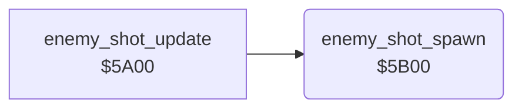

<!-- Generated by c64-docs from knowledge revision 20261024T103119.179-vx1fei and .c64-re-tools/local/generated/src/source-map.json. Do not edit: change the knowledge, generate the source again, then run docs.ts generate. -->
# enemy/enemy_shot_spawn.asm: Enemy shot spawn

Range `$5B00-$5B7F`. Source: [enemy/enemy_shot_spawn.asm](../../../../src/enemy/enemy_shot_spawn.asm). Index: [the reference](../../index.md).

## Call graph

A solid arrow is a call, a thick arrow a table entry, a dotted arrow a jump. Rounded nodes are in this file.

## Names

### [`enemy_shot_spawn`](../../../../src/enemy/enemy_shot_spawn.asm#L6) `$5B00`

*routine*

Every 8th tick, gives one enemy a shot one row below it. The enemy must be on the screen, in the right half for $60 positive, in the left half for $60 negative. The row must be below 10 and not the row of another shot. Sets $61 bit 2. Enemies: X = 4-1, state $57+x, row $47+x, map column $4b+x.

- **Called from:** [`enemy_shot_update`](enemy_shots_5a00.md#enemy_shot_update) [`$5A00`](../../../../src/enemy/enemy_shots_5a00.asm#L7)
- **Reads:** [`wave_flags`](../../memory-map.md#wave_flags), [`SPENA`](../../memory-map.md#SPENA), [`tick`](../../memory-map.md#tick), [`enemy_state`](../../memory-map.md#enemy_state), [`enemy_col`](../../memory-map.md#enemy_col), [`map_column`](../../memory-map.md#map_column), [`wave_dir`](../../memory-map.md#wave_dir), [`calc_x`](../../memory-map.md#calc_x), [`enemy_row`](../../memory-map.md#enemy_row), [`calc_y`](../../memory-map.md#calc_y), [`enemy_shot_row`](../../memory-map.md#enemy_shot_row), [`enemy_shot_row+1`](../../memory-map.md#enemy_shot_row), [`enemy_shot_row+2`](../../memory-map.md#enemy_shot_row), [`enemy_shot_row+3`](../../memory-map.md#enemy_shot_row)
- **Writes:** [`calc_x`](../../memory-map.md#calc_x), [`calc_y`](../../memory-map.md#calc_y), [`enemy_shot_row+3`](../../memory-map.md#enemy_shot_row), `$003B`, [`wave_flags`](../../memory-map.md#wave_flags)

### [`enemy_shot_spawn_loop`](../../../../src/enemy/enemy_shot_spawn.asm#L17) `$5B15`

*label*

- **Jumped to from:** [`enemy_shot_spawn`](enemy_shot_spawn.md#enemy_shot_spawn) [`$5B7C`](../../../../src/enemy/enemy_shot_spawn.asm#L82)

### [`enemy_shot_spawn_left_half`](../../../../src/enemy/enemy_shot_spawn.asm#L34) `$5B34`

*label*

- **Jumped to from:** [`enemy_shot_spawn`](enemy_shot_spawn.md#enemy_shot_spawn) [`$5B2A`](../../../../src/enemy/enemy_shot_spawn.asm#L29)

### [`enemy_shot_spawn_row`](../../../../src/enemy/enemy_shot_spawn.asm#L43) `$5B3F`

*label*

NOP fill.

- **Jumped to from:** [`enemy_shot_spawn`](enemy_shot_spawn.md#enemy_shot_spawn) [`$5B32`](../../../../src/enemy/enemy_shot_spawn.asm#L33)

### [`enemy_shot_spawn_find_slot`](../../../../src/enemy/enemy_shot_spawn.asm#L64) `$5B62`

*label*

- **Jumped to from:** [`enemy_shot_spawn`](enemy_shot_spawn.md#enemy_shot_spawn) [`$5B77`](../../../../src/enemy/enemy_shot_spawn.asm#L77)

### [`enemy_shot_spawn_next_slot`](../../../../src/enemy/enemy_shot_spawn.asm#L75) `$5B76`

*label*

- **Jumped to from:** [`enemy_shot_spawn`](enemy_shot_spawn.md#enemy_shot_spawn) [`$5B64`](../../../../src/enemy/enemy_shot_spawn.asm#L66)

### [`enemy_shot_spawn_next`](../../../../src/enemy/enemy_shot_spawn.asm#L80) `$5B7B`

*label*

- **Jumped to from:** [`enemy_shot_spawn`](enemy_shot_spawn.md#enemy_shot_spawn) [`$5B17`](../../../../src/enemy/enemy_shot_spawn.asm#L19), [`enemy_shot_spawn`](enemy_shot_spawn.md#enemy_shot_spawn) [`$5B1B`](../../../../src/enemy/enemy_shot_spawn.asm#L21), [`enemy_shot_spawn`](enemy_shot_spawn.md#enemy_shot_spawn) [`$5B26`](../../../../src/enemy/enemy_shot_spawn.asm#L27), [`enemy_shot_spawn`](enemy_shot_spawn.md#enemy_shot_spawn) [`$5B30`](../../../../src/enemy/enemy_shot_spawn.asm#L32), [`enemy_shot_spawn`](enemy_shot_spawn.md#enemy_shot_spawn) [`$5B38`](../../../../src/enemy/enemy_shot_spawn.asm#L37), [`enemy_shot_spawn`](enemy_shot_spawn.md#enemy_shot_spawn) [`$5B4E`](../../../../src/enemy/enemy_shot_spawn.asm#L54), [`enemy_shot_spawn`](enemy_shot_spawn.md#enemy_shot_spawn) [`$5B52`](../../../../src/enemy/enemy_shot_spawn.asm#L56), [`enemy_shot_spawn`](enemy_shot_spawn.md#enemy_shot_spawn) [`$5B56`](../../../../src/enemy/enemy_shot_spawn.asm#L58), [`enemy_shot_spawn`](enemy_shot_spawn.md#enemy_shot_spawn) [`$5B5A`](../../../../src/enemy/enemy_shot_spawn.asm#L60), [`enemy_shot_spawn`](enemy_shot_spawn.md#enemy_shot_spawn) [`$5B5E`](../../../../src/enemy/enemy_shot_spawn.asm#L62)

### [`enemy_shot_spawn_done`](../../../../src/enemy/enemy_shot_spawn.asm#L84) `$5B7F`

*label*

- **Jumped to from:** [`enemy_shot_spawn`](enemy_shot_spawn.md#enemy_shot_spawn) [`$5B04`](../../../../src/enemy/enemy_shot_spawn.asm#L9), [`enemy_shot_spawn`](enemy_shot_spawn.md#enemy_shot_spawn) [`$5B0B`](../../../../src/enemy/enemy_shot_spawn.asm#L12), [`enemy_shot_spawn`](enemy_shot_spawn.md#enemy_shot_spawn) [`$5B11`](../../../../src/enemy/enemy_shot_spawn.asm#L15), [`enemy_shot_spawn`](enemy_shot_spawn.md#enemy_shot_spawn) [`$5B74`](../../../../src/enemy/enemy_shot_spawn.asm#L74), [`enemy_shot_spawn`](enemy_shot_spawn.md#enemy_shot_spawn) [`$5B79`](../../../../src/enemy/enemy_shot_spawn.asm#L79)
