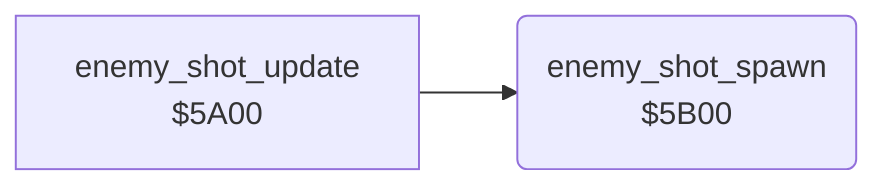

<!-- Generated by c64-docs from knowledge revision 20261025T214607.441-00m56k and .c64-re-tools/local/generated/src/source-map.json. Do not edit: change the knowledge, generate the source again, then run docs.ts generate. -->
# enemy/enemy_shot_spawn.asm: Enemy shot spawn

Range `$5B00-$5B7F`. Source: [enemy/enemy_shot_spawn.asm](../../../../src/enemy/enemy_shot_spawn.asm). Index: [the reference](../../index.md).

## Routines

| Routine | Address | Reached from | Summary |
|---|---|---|---|
| [`enemy_shot_spawn`](enemy_shot_spawn.md#enemy_shot_spawn) | `$5B00` | [`enemy_shot_update`](enemy_shots_5a00.md#enemy_shot_update) | Every 8th tick, gives one enemy a shot one row below it. |

## Call graph

A solid arrow is a call, a thick arrow a table entry. Rounded nodes are in this file.

## Details

### [`enemy_shot_spawn`](../../../../src/enemy/enemy_shot_spawn.asm#L6) `$5B00`

*routine*

Every 8th tick, gives one enemy a shot one row below it. The enemy must be on the screen, in the right half for $60 positive, in the left half for $60 negative. The row must be below 10 and not the row of another shot. Sets $61 bit 2. Enemies: X = 4-1, state $57+x, row $47+x, map column $4b+x.

- **Called from:** [`enemy_shot_update`](enemy_shots_5a00.md#enemy_shot_update)
- **Reads:** [`wave_flags`](../../memory-map.md#wave_flags), [`SPENA`](../../memory-map.md#SPENA), [`tick`](../../memory-map.md#tick), [`enemy_state`](../../memory-map.md#enemy_state), [`enemy_col`](../../memory-map.md#enemy_col), [`map_column`](../../memory-map.md#map_column), [`wave_dir`](../../memory-map.md#wave_dir), [`calc_x`](../../memory-map.md#calc_x), [`enemy_row`](../../memory-map.md#enemy_row), [`calc_y`](../../memory-map.md#calc_y), [`enemy_shot_row`](../../memory-map.md#enemy_shot_row)
- **Writes:** [`calc_x`](../../memory-map.md#calc_x), [`calc_y`](../../memory-map.md#calc_y), [`enemy_shot_row`](../../memory-map.md#enemy_shot_row), `$003B`, [`wave_flags`](../../memory-map.md#wave_flags)

| Label | Address | Comment |
|---|---|---|
| [`enemy_shot_spawn_loop`](../../../../src/enemy/enemy_shot_spawn.asm#L17) | `$5B15` |  |
| [`enemy_shot_spawn_left_half`](../../../../src/enemy/enemy_shot_spawn.asm#L34) | `$5B34` |  |
| [`enemy_shot_spawn_row`](../../../../src/enemy/enemy_shot_spawn.asm#L43) | `$5B3F` | NOP fill. |
| [`enemy_shot_spawn_find_slot`](../../../../src/enemy/enemy_shot_spawn.asm#L64) | `$5B62` |  |
| [`enemy_shot_spawn_next_slot`](../../../../src/enemy/enemy_shot_spawn.asm#L75) | `$5B76` |  |
| [`enemy_shot_spawn_next`](../../../../src/enemy/enemy_shot_spawn.asm#L80) | `$5B7B` |  |
| [`enemy_shot_spawn_done`](../../../../src/enemy/enemy_shot_spawn.asm#L84) | `$5B7F` |  |
