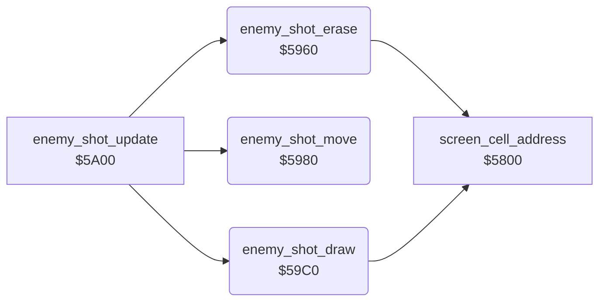

<!-- Generated by c64-docs from knowledge revision 20261024T103119.179-vx1fei and .c64-re-tools/local/generated/src/source-map.json. Do not edit: change the knowledge, generate the source again, then run docs.ts generate. -->
# enemy/enemy_shots.asm: Enemy shots: erase, move and draw

Range `$5960-$59EF`. Source: [enemy/enemy_shots.asm](../../../../src/enemy/enemy_shots.asm). Index: [the reference](../../index.md).

## Call graph

A solid arrow is a call, a thick arrow a table entry, a dotted arrow a jump. Rounded nodes are in this file.

## Names

### [`enemy_shot_erase`](../../../../src/enemy/enemy_shots.asm#L6) `$5960`

*routine*

Writes a space at the cell of each active enemy shot. Slots X = 4-1: row $3b+x, column $3f+x ($ff = free).

- **Called from:** [`enemy_shot_update`](enemy_shots_5a00.md#enemy_shot_update) [`$5A03`](../../../../src/enemy/enemy_shots_5a00.asm#L8)
- **Calls:** [`screen_cell_address`](../game/screen_cell_address.md#screen_cell_address)
- **Reads:** `$003B`, [`enemy_shot_row+3`](../../memory-map.md#enemy_shot_row), [`screen_ptr`](../../memory-map.md#screen_ptr), [`temp`](../../memory-map.md#temp)
- **Writes:** [`temp`](../../memory-map.md#temp)

### [`enemy_shot_erase_loop`](../../../../src/enemy/enemy_shots.asm#L8) `$5962`

*label*

- **Jumped to from:** [`enemy_shot_erase`](enemy_shots.md#enemy_shot_erase) [`$597A`](../../../../src/enemy/enemy_shots.asm#L24)

### [`enemy_shot_erase_next`](../../../../src/enemy/enemy_shots.asm#L22) `$5979`

*label*

- **Jumped to from:** [`enemy_shot_erase`](enemy_shots.md#enemy_shot_erase) [`$5964`](../../../../src/enemy/enemy_shots.asm#L10)

### [`enemy_shot_move`](../../../../src/enemy/enemy_shots.asm#L30) `$5980`

*routine*

Moves each enemy shot one column in the direction of $60: +1 moves left, $ff moves right. Frees a shot outside columns 0-39. Clears $61 bit 2 when no shot is active.

- **Called from:** [`enemy_shot_update`](enemy_shots_5a00.md#enemy_shot_update) [`$5A06`](../../../../src/enemy/enemy_shots_5a00.asm#L9)
- **Reads:** [`tick`](../../memory-map.md#tick), [`enemy_shot_row+3`](../../memory-map.md#enemy_shot_row), [`wave_dir`](../../memory-map.md#wave_dir), [`wave_flags`](../../memory-map.md#wave_flags)
- **Writes:** [`enemy_shot_row+3`](../../memory-map.md#enemy_shot_row), `$003B`, [`wave_flags`](../../memory-map.md#wave_flags)

### [`enemy_shot_move_loop`](../../../../src/enemy/enemy_shots.asm#L35) `$5988`

*label*

- **Jumped to from:** [`enemy_shot_move`](enemy_shots.md#enemy_shot_move) [`$59A7`](../../../../src/enemy/enemy_shots.asm#L56)

### [`enemy_shot_move_left`](../../../../src/enemy/enemy_shots.asm#L43) `$5996`

*label*

- **Jumped to from:** [`enemy_shot_move`](enemy_shots.md#enemy_shot_move) [`$598E`](../../../../src/enemy/enemy_shots.asm#L39)

### [`enemy_shot_move_check_edge`](../../../../src/enemy/enemy_shots.asm#L45) `$5998`

*label*

- **Jumped to from:** [`enemy_shot_move`](enemy_shots.md#enemy_shot_move) [`$5992`](../../../../src/enemy/enemy_shots.asm#L41), [`enemy_shot_move`](enemy_shots.md#enemy_shot_move) [`$5994`](../../../../src/enemy/enemy_shots.asm#L42)

### [`enemy_shot_move_free`](../../../../src/enemy/enemy_shots.asm#L50) `$59A0`

*label*

- **Jumped to from:** [`enemy_shot_move`](enemy_shots.md#enemy_shot_move) [`$599A`](../../../../src/enemy/enemy_shots.asm#L47)

### [`enemy_shot_move_next`](../../../../src/enemy/enemy_shots.asm#L54) `$59A6`

*label*

- **Jumped to from:** [`enemy_shot_move`](enemy_shots.md#enemy_shot_move) [`$598A`](../../../../src/enemy/enemy_shots.asm#L37), [`enemy_shot_move`](enemy_shots.md#enemy_shot_move) [`$599E`](../../../../src/enemy/enemy_shots.asm#L49)

### [`enemy_shot_any_loop`](../../../../src/enemy/enemy_shots.asm#L61) `$59B1`

*label*

A shot with a positive column is still active.

- **Jumped to from:** [`enemy_shot_move`](enemy_shots.md#enemy_shot_move) [`$59B6`](../../../../src/enemy/enemy_shots.asm#L65)

### [`enemy_shot_move_done`](../../../../src/enemy/enemy_shots.asm#L70) `$59BF`

*label*

- **Jumped to from:** [`enemy_shot_move`](enemy_shots.md#enemy_shot_move) [`$5984`](../../../../src/enemy/enemy_shots.asm#L33), [`enemy_shot_move`](enemy_shots.md#enemy_shot_move) [`$59AD`](../../../../src/enemy/enemy_shots.asm#L59), [`enemy_shot_move`](enemy_shots.md#enemy_shot_move) [`$59B3`](../../../../src/enemy/enemy_shots.asm#L63)

### [`enemy_shot_draw`](../../../../src/enemy/enemy_shots.asm#L73) `$59C0`

*routine*

Writes each active enemy shot on the screen: character $26 when $60 is positive, $25 when it is negative. The colour comes from the table at $4000.

- **Called from:** [`enemy_shot_update`](enemy_shots_5a00.md#enemy_shot_update) [`$5A09`](../../../../src/enemy/enemy_shots_5a00.asm#L10)
- **Calls:** [`screen_cell_address`](../game/screen_cell_address.md#screen_cell_address)
- **Reads:** `$003B`, [`enemy_shot_row+3`](../../memory-map.md#enemy_shot_row), [`wave_dir`](../../memory-map.md#wave_dir), [`screen_ptr`](../../memory-map.md#screen_ptr), [`char_colours`](../data/char_colours.md#char_colours), [`colour_ptr`](../../memory-map.md#colour_ptr), [`temp`](../../memory-map.md#temp)
- **Writes:** [`temp`](../../memory-map.md#temp)

### [`enemy_shot_draw_loop`](../../../../src/enemy/enemy_shots.asm#L75) `$59C2`

*label*

- **Jumped to from:** [`enemy_shot_draw`](enemy_shots.md#enemy_shot_draw) [`$59E8`](../../../../src/enemy/enemy_shots.asm#L100)

### [`enemy_shot_draw_char_right`](../../../../src/enemy/enemy_shots.asm#L88) `$59D8`

*label*

- **Jumped to from:** [`enemy_shot_draw`](enemy_shots.md#enemy_shot_draw) [`$59D2`](../../../../src/enemy/enemy_shots.asm#L85)

### [`enemy_shot_draw_put`](../../../../src/enemy/enemy_shots.asm#L90) `$59DA`

*label*

- **Jumped to from:** [`enemy_shot_draw`](enemy_shots.md#enemy_shot_draw) [`$59D6`](../../../../src/enemy/enemy_shots.asm#L87)

### [`enemy_shot_draw_next`](../../../../src/enemy/enemy_shots.asm#L98) `$59E7`

*label*

- **Jumped to from:** [`enemy_shot_draw`](enemy_shots.md#enemy_shot_draw) [`$59C4`](../../../../src/enemy/enemy_shots.asm#L77)
