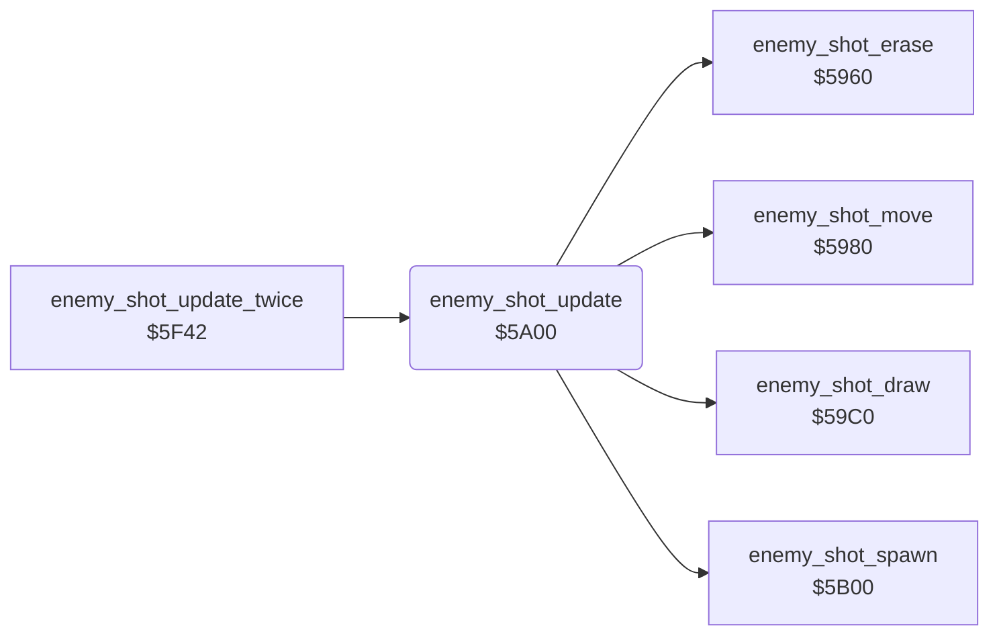

<!-- Generated by c64-docs from knowledge revision 20261024T103119.179-vx1fei and .c64-re-tools/local/generated/src/source-map.json. Do not edit: change the knowledge, generate the source again, then run docs.ts generate. -->
# enemy/enemy_shots_5a00.asm

Range `$5A00-$5A0C`. Source: [enemy/enemy_shots_5a00.asm](../../../../src/enemy/enemy_shots_5a00.asm). Index: [the reference](../../index.md).

## Call graph

A solid arrow is a call, a thick arrow a table entry, a dotted arrow a jump. Rounded nodes are in this file.

## Names

### [`enemy_shot_update`](../../../../src/enemy/enemy_shots_5a00.asm#L6) `$5A00`

*routine*

Updates the enemy shots: spawn ($5b00), erase ($5960), move ($5980) and draw ($59c0).

- **Called from:** [`$41B4`](../../../../src/game/main_loop.asm#L72), [`enemy_shot_update_twice`](../landscape/scroll_by_speed.md#enemy_shot_update_twice) [`$5F42`](../../../../src/landscape/scroll_by_speed.asm#L45), [`enemy_shot_update_twice`](../landscape/scroll_by_speed.md#enemy_shot_update_twice) [`$5F45`](../../../../src/landscape/scroll_by_speed.asm#L46)
- **Calls:** [`enemy_shot_spawn`](enemy_shot_spawn.md#enemy_shot_spawn), [`enemy_shot_erase`](enemy_shots.md#enemy_shot_erase), [`enemy_shot_move`](enemy_shots.md#enemy_shot_move), [`enemy_shot_draw`](enemy_shots.md#enemy_shot_draw)
