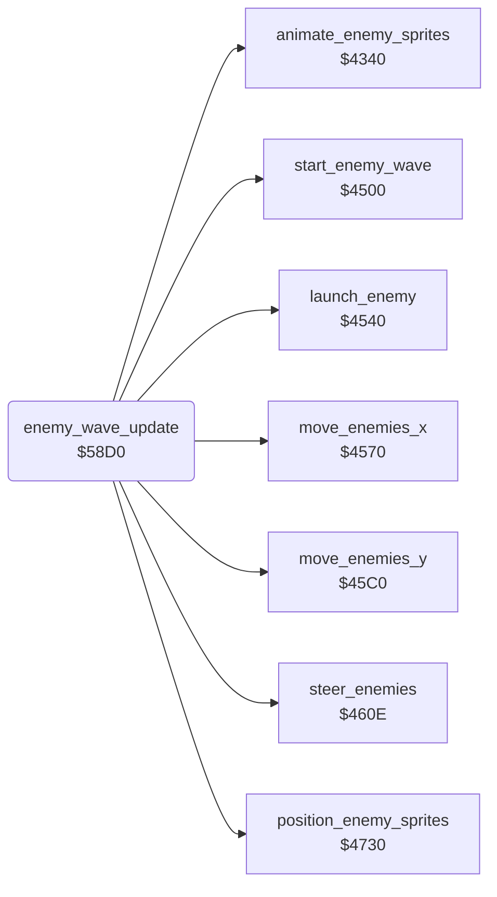

<!-- Generated by c64-docs from knowledge revision 20261025T214607.441-00m56k and .c64-re-tools/local/generated/src/source-map.json. Do not edit: change the knowledge, generate the source again, then run docs.ts generate. -->
# enemy/enemy_wave_update.asm: Enemy wave update

Range `$58D0-$58F1`. Source: [enemy/enemy_wave_update.asm](../../../../src/enemy/enemy_wave_update.asm). Index: [the reference](../../index.md).

## Routines

| Routine | Address | Reached from | Summary |
|---|---|---|---|
| [`enemy_wave_update`](enemy_wave_update.md#enemy_wave_update) | `$58D0` | [`$41B1`](../../../../src/game/main_loop.asm#L71) | Calls the wave start $4500. |

## Call graph

A solid arrow is a call, a thick arrow a table entry. Rounded nodes are in this file.

## Details

### [`enemy_wave_update`](../../../../src/enemy/enemy_wave_update.asm#L6) `$58D0`

*routine*

Calls the wave start $4500. While $61 bit 0 (wave active) is set, it calls the enemy routines $4540, $4570, $460e, $45c0 (two times), $4730 and $4340.

- **Called from:** [`$41B1`](../../../../src/game/main_loop.asm#L71)
- **Calls:** [`start_enemy_wave`](enemy_waves.md#start_enemy_wave), [`launch_enemy`](enemy_waves.md#launch_enemy), [`move_enemies_x`](enemy_waves.md#move_enemies_x), [`steer_enemies`](enemy_waves.md#steer_enemies), [`move_enemies_y`](enemy_waves.md#move_enemies_y), [`position_enemy_sprites`](enemy_positions.md#position_enemy_sprites), [`animate_enemy_sprites`](enemy_frames.md#animate_enemy_sprites)
- **Reads:** [`wave_flags`](../../memory-map.md#wave_flags)

| Label | Address | Comment |
|---|---|---|
| [`enemy_wave_update_done`](../../../../src/enemy/enemy_wave_update.asm#L18) | `$58EE` | NOP fill. |
