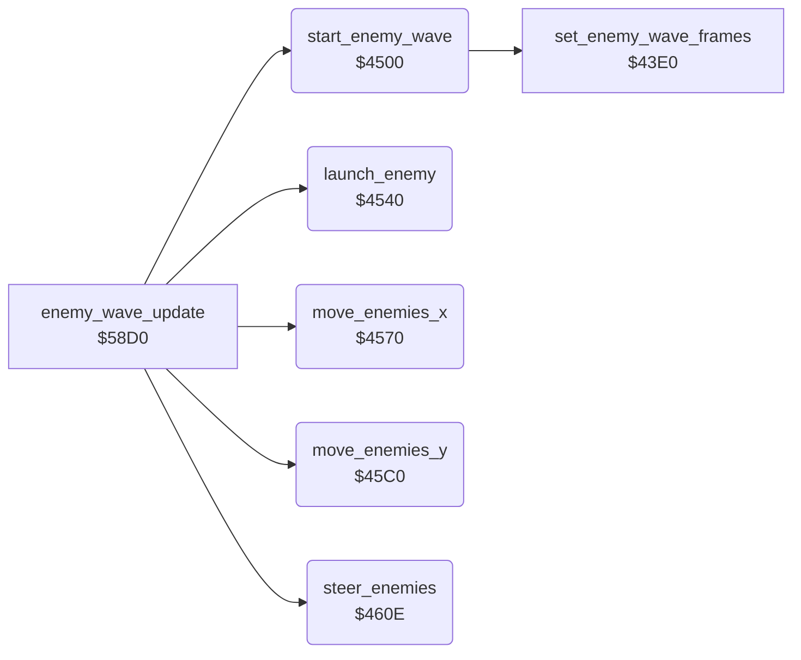

<!-- Generated by c64-docs from knowledge revision 20261024T103119.179-vx1fei and .c64-re-tools/local/generated/src/source-map.json. Do not edit: change the knowledge, generate the source again, then run docs.ts generate. -->
# enemy/enemy_waves.asm: Enemy waves and movement

Range `$4500-$4689`. Source: [enemy/enemy_waves.asm](../../../../src/enemy/enemy_waves.asm). Index: [the reference](../../index.md).

## Call graph

A solid arrow is a call, a thick arrow a table entry, a dotted arrow a jump. Rounded nodes are in this file.

## Data

| Range | Type | Name | Read by | Written by |
|---|---|---|---|---|
| [`$460B`](../../../../src/enemy/enemy_waves.asm#L174)-`$460D` | unused |  |  |  |

## Names

### [`start_enemy_wave`](../../../../src/enemy/enemy_waves.asm#L6) `$4500`

*routine*

Starts a wave when $61 bits 0-2 are clear and tick AND $3f = 0. It sets a random start column and direction, and the points of the first kill.

- **Called from:** [`enemy_wave_update`](enemy_wave_update.md#enemy_wave_update) [`$58D0`](../../../../src/enemy/enemy_wave_update.asm#L7)
- **Calls:** [`set_enemy_wave_frames`](enemy_frames_43e0.md#set_enemy_wave_frames)
- **Reads:** [`wave_flags`](../../memory-map.md#wave_flags), [`tick`](../../memory-map.md#tick), [`map_column`](../../memory-map.md#map_column), [`RANDOM`](../../memory-map.md#RANDOM), [`temp`](../../memory-map.md#temp)
- **Writes:** [`temp`](../../memory-map.md#temp), [`wave_start_col`](../../memory-map.md#wave_start_col), [`wave_dir`](../../memory-map.md#wave_dir), [`wave_flags`](../../memory-map.md#wave_flags), [`launch_timer`](../../memory-map.md#launch_timer), [`wave_launched`](../../memory-map.md#wave_launched), [`kill_points`](../../memory-map.md#kill_points)

### [`start_wave_dir_left`](../../../../src/enemy/enemy_waves.asm#L26) `$4526`

*label*

- **Jumped to from:** [`start_enemy_wave`](enemy_waves.md#start_enemy_wave) [`$4520`](../../../../src/enemy/enemy_waves.asm#L23)

### [`start_wave_set_dir`](../../../../src/enemy/enemy_waves.asm#L28) `$4528`

*label*

- **Jumped to from:** [`start_enemy_wave`](enemy_waves.md#start_enemy_wave) [`$4524`](../../../../src/enemy/enemy_waves.asm#L25)

### [`start_wave_done`](../../../../src/enemy/enemy_waves.asm#L41) `$453F`

*label*

- **Jumped to from:** [`start_enemy_wave`](enemy_waves.md#start_enemy_wave) [`$4504`](../../../../src/enemy/enemy_waves.asm#L9), [`start_enemy_wave`](enemy_waves.md#start_enemy_wave) [`$450A`](../../../../src/enemy/enemy_waves.asm#L12)

### [`launch_enemy`](../../../../src/enemy/enemy_waves.asm#L44) `$4540`

*routine*

When the wave is active and $65 < $66, it counts $63 up to $62. Then it starts the next enemy: state 1, column $64, row 0, flying down.

- **Called from:** [`enemy_wave_update`](enemy_wave_update.md#enemy_wave_update) [`$58D9`](../../../../src/enemy/enemy_wave_update.asm#L11)
- **Reads:** [`wave_flags`](../../memory-map.md#wave_flags), [`wave_launched`](../../memory-map.md#wave_launched), [`wave_size`](../../memory-map.md#wave_size), [`launch_timer`](../../memory-map.md#launch_timer), [`launch_delay`](../../memory-map.md#launch_delay), [`enemy_state`](../../memory-map.md#enemy_state), [`wave_start_col`](../../memory-map.md#wave_start_col)
- **Writes:** [`launch_timer`](../../memory-map.md#launch_timer), [`wave_launched`](../../memory-map.md#wave_launched), [`enemy_state`](../../memory-map.md#enemy_state), [`enemy_col`](../../memory-map.md#enemy_col), [`enemy_row`](../../memory-map.md#enemy_row), [`enemy_y_fine`](../../memory-map.md#enemy_y_fine), [`enemy_x_fine`](../../memory-map.md#enemy_x_fine), [`enemy_climb`](../../memory-map.md#enemy_climb)

### [`launch_enemy_done`](../../../../src/enemy/enemy_waves.asm#L69) `$456F`

*label*

- **Jumped to from:** [`launch_enemy`](enemy_waves.md#launch_enemy) [`$4544`](../../../../src/enemy/enemy_waves.asm#L47), [`launch_enemy`](enemy_waves.md#launch_enemy) [`$454A`](../../../../src/enemy/enemy_waves.asm#L50), [`launch_enemy`](enemy_waves.md#launch_enemy) [`$4552`](../../../../src/enemy/enemy_waves.asm#L54)

### [`move_enemies_x`](../../../../src/enemy/enemy_waves.asm#L72) `$4570`

*routine*

Moves each enemy 7 pixels in the direction $60, one pixel in each of 7 steps. When tick AND $1f is 0, each step adds 1 to enemy_state, so the state goes up by 7. Exploding enemies (state >= $e0) do not move.

- **Called from:** [`enemy_wave_update`](enemy_wave_update.md#enemy_wave_update) [`$58DC`](../../../../src/enemy/enemy_wave_update.asm#L12)
- **Reads:** [`wave_flags`](../../memory-map.md#wave_flags), [`enemy_state`](../../memory-map.md#enemy_state), [`tick`](../../memory-map.md#tick), [`wave_dir`](../../memory-map.md#wave_dir), [`enemy_x_fine`](../../memory-map.md#enemy_x_fine), [`enemy_col`](../../memory-map.md#enemy_col)
- **Writes:** [`enemy_state`](../../memory-map.md#enemy_state), [`enemy_x_fine`](../../memory-map.md#enemy_x_fine), [`enemy_col`](../../memory-map.md#enemy_col)

### [`move_enemies_x_step`](../../../../src/enemy/enemy_waves.asm#L77) `$4578`

*label*

- **Jumped to from:** [`move_enemies_x`](enemy_waves.md#move_enemies_x) [`$45B3`](../../../../src/enemy/enemy_waves.asm#L114)

### [`move_enemies_x_loop`](../../../../src/enemy/enemy_waves.asm#L79) `$457A`

*label*

- **Jumped to from:** [`move_enemies_x`](enemy_waves.md#move_enemies_x) [`$45B0`](../../../../src/enemy/enemy_waves.asm#L112)

### [`move_enemies_x_check`](../../../../src/enemy/enemy_waves.asm#L86) `$4586`

*label*

- **Jumped to from:** [`move_enemies_x`](enemy_waves.md#move_enemies_x) [`$4582`](../../../../src/enemy/enemy_waves.asm#L84)

### [`move_enemies_x_right`](../../../../src/enemy/enemy_waves.asm#L100) `$459F`

*label*

Fine X $53+x + 1. At 8: 0, and column $4b+x + 1.

- **Jumped to from:** [`move_enemies_x`](enemy_waves.md#move_enemies_x) [`$458E`](../../../../src/enemy/enemy_waves.asm#L91)

### [`move_enemies_x_next`](../../../../src/enemy/enemy_waves.asm#L110) `$45AF`

*label*

- **Jumped to from:** [`move_enemies_x`](enemy_waves.md#move_enemies_x) [`$457C`](../../../../src/enemy/enemy_waves.asm#L81), [`move_enemies_x`](enemy_waves.md#move_enemies_x) [`$458A`](../../../../src/enemy/enemy_waves.asm#L89), [`move_enemies_x`](enemy_waves.md#move_enemies_x) [`$4594`](../../../../src/enemy/enemy_waves.asm#L95), [`move_enemies_x`](enemy_waves.md#move_enemies_x) [`$459C`](../../../../src/enemy/enemy_waves.asm#L99), [`move_enemies_x`](enemy_waves.md#move_enemies_x) [`$45A7`](../../../../src/enemy/enemy_waves.asm#L106)

### [`move_enemies_x_done`](../../../../src/enemy/enemy_waves.asm#L125) `$45BF`

*label*

- **Jumped to from:** [`move_enemies_x`](enemy_waves.md#move_enemies_x) [`$4574`](../../../../src/enemy/enemy_waves.asm#L75)

### [`move_enemies_y`](../../../../src/enemy/enemy_waves.asm#L128) `$45C0`

*routine*

Moves each enemy 1 pixel by its direction $5b+x (1 up, $ff down). An enemy above row 0 ends. Then it ends the wave when all enemies are gone. $58d0 calls it two times in each pass.

- **Called from:** [`enemy_wave_update`](enemy_wave_update.md#enemy_wave_update) [`$58E2`](../../../../src/enemy/enemy_wave_update.asm#L14), [`enemy_wave_update`](enemy_wave_update.md#enemy_wave_update) [`$58E5`](../../../../src/enemy/enemy_wave_update.asm#L15)
- **Reads:** [`wave_flags`](../../memory-map.md#wave_flags), [`enemy_state`](../../memory-map.md#enemy_state), [`enemy_climb`](../../memory-map.md#enemy_climb), [`enemy_y_fine`](../../memory-map.md#enemy_y_fine), [`enemy_row`](../../memory-map.md#enemy_row), [`wave_launched`](../../memory-map.md#wave_launched), [`wave_size`](../../memory-map.md#wave_size)
- **Writes:** [`enemy_y_fine`](../../memory-map.md#enemy_y_fine), [`enemy_row`](../../memory-map.md#enemy_row), [`enemy_state`](../../memory-map.md#enemy_state), [`wave_flags`](../../memory-map.md#wave_flags)

### [`move_enemies_y_loop`](../../../../src/enemy/enemy_waves.asm#L135) `$45CC`

*label*

- **Jumped to from:** [`move_enemies_y`](enemy_waves.md#move_enemies_y) [`$45F3`](../../../../src/enemy/enemy_waves.asm#L158)

### [`move_enemies_y_down`](../../../../src/enemy/enemy_waves.asm#L148) `$45E4`

*label*

Down: fine Y $4f+x + 1. At 8: 0, and row $47+x + 1.

- **Jumped to from:** [`move_enemies_y`](enemy_waves.md#move_enemies_y) [`$45D0`](../../../../src/enemy/enemy_waves.asm#L138)

### [`move_enemies_y_next`](../../../../src/enemy/enemy_waves.asm#L156) `$45F2`

*label*

- **Jumped to from:** [`move_enemies_y`](enemy_waves.md#move_enemies_y) [`$45CA`](../../../../src/enemy/enemy_waves.asm#L134), [`move_enemies_y`](enemy_waves.md#move_enemies_y) [`$45CE`](../../../../src/enemy/enemy_waves.asm#L137), [`move_enemies_y`](enemy_waves.md#move_enemies_y) [`$45D4`](../../../../src/enemy/enemy_waves.asm#L140), [`move_enemies_y`](enemy_waves.md#move_enemies_y) [`$45DC`](../../../../src/enemy/enemy_waves.asm#L144), [`move_enemies_y`](enemy_waves.md#move_enemies_y) [`$45E2`](../../../../src/enemy/enemy_waves.asm#L147), [`move_enemies_y`](enemy_waves.md#move_enemies_y) [`$45EA`](../../../../src/enemy/enemy_waves.asm#L152)

### [`move_enemies_y_end_loop`](../../../../src/enemy/enemy_waves.asm#L160) `$45F7`

*label*

- **Jumped to from:** [`move_enemies_y`](enemy_waves.md#move_enemies_y) [`$45FC`](../../../../src/enemy/enemy_waves.asm#L164)

### [`move_enemies_y_done`](../../../../src/enemy/enemy_waves.asm#L171) `$460A`

*label*

- **Jumped to from:** [`move_enemies_y`](enemy_waves.md#move_enemies_y) [`$45C4`](../../../../src/enemy/enemy_waves.asm#L131), [`move_enemies_y`](enemy_waves.md#move_enemies_y) [`$45F9`](../../../../src/enemy/enemy_waves.asm#L162), [`move_enemies_y`](enemy_waves.md#move_enemies_y) [`$4602`](../../../../src/enemy/enemy_waves.asm#L167)

### [`steer_enemies`](../../../../src/enemy/enemy_waves.asm#L176) `$460E`

*routine*

Sets the vertical direction $5b+x of each enemy from its state and row. Flying enemies change direction at random between the rows 0 and $0d. Row >= $0e: the enemy explodes. Falling: down. State >= $80: up.

- **Called from:** [`enemy_wave_update`](enemy_wave_update.md#enemy_wave_update) [`$58DF`](../../../../src/enemy/enemy_wave_update.asm#L13)
- **Reads:** [`wave_flags`](../../memory-map.md#wave_flags), [`enemy_state`](../../memory-map.md#enemy_state), [`enemy_row`](../../memory-map.md#enemy_row), [`RANDOM`](../../memory-map.md#RANDOM), [`enemy_climb`](../../memory-map.md#enemy_climb), [`CI2TBLO`](../../memory-map.md#CI2TBLO), [`temp`](../../memory-map.md#temp)
- **Writes:** [`enemy_state`](../../memory-map.md#enemy_state), [`enemy_climb`](../../memory-map.md#enemy_climb), [`temp`](../../memory-map.md#temp)

### [`steer_enemies_loop`](../../../../src/enemy/enemy_waves.asm#L181) `$4616`

*label*

- **Jumped to from:** [`steer_enemies`](enemy_waves.md#steer_enemies) [`$4687`](../../../../src/enemy/enemy_waves.asm#L248)

### [`steer_enemies_level`](../../../../src/enemy/enemy_waves.asm#L192) `$462A`

*label*

- **Jumped to from:** [`steer_enemies`](enemy_waves.md#steer_enemies) [`$4624`](../../../../src/enemy/enemy_waves.asm#L189), [`steer_enemies`](enemy_waves.md#steer_enemies) [`$4634`](../../../../src/enemy/enemy_waves.asm#L199)

### [`steer_enemies_state`](../../../../src/enemy/enemy_waves.asm#L196) `$4630`

*label*

- **Jumped to from:** [`steer_enemies`](enemy_waves.md#steer_enemies) [`$461E`](../../../../src/enemy/enemy_waves.asm#L186)

### [`steer_enemies_set_dir`](../../../../src/enemy/enemy_waves.asm#L203) `$463C`

*label*

- **Jumped to from:** [`steer_enemies`](enemy_waves.md#steer_enemies) [`$4646`](../../../../src/enemy/enemy_waves.asm#L210)

### [`steer_enemies_flying`](../../../../src/enemy/enemy_waves.asm#L206) `$4640`

*label*

State $80-$cf: up.

- **Jumped to from:** [`steer_enemies`](enemy_waves.md#steer_enemies) [`$4638`](../../../../src/enemy/enemy_waves.asm#L201)

### [`steer_enemies_row`](../../../../src/enemy/enemy_waves.asm#L211) `$4648`

*label*

Row 0: level or down, at random.

- **Jumped to from:** [`steer_enemies`](enemy_waves.md#steer_enemies) [`$4642`](../../../../src/enemy/enemy_waves.asm#L208)

### [`steer_enemies_not_top`](../../../../src/enemy/enemy_waves.asm#L220) `$4659`

*label*

Row >= $0a: level or up, at random.

- **Jumped to from:** [`steer_enemies`](enemy_waves.md#steer_enemies) [`$464A`](../../../../src/enemy/enemy_waves.asm#L213)

### [`steer_enemies_random`](../../../../src/enemy/enemy_waves.asm#L229) `$466A`

*label*

CIA 2 timer B low byte as a random value. A change only when its bits 0-4 are 0.

- **Jumped to from:** [`steer_enemies`](enemy_waves.md#steer_enemies) [`$465B`](../../../../src/enemy/enemy_waves.asm#L222)

### [`steer_enemies_up_down`](../../../../src/enemy/enemy_waves.asm#L239) `$467D`

*label*

- **Jumped to from:** [`steer_enemies`](enemy_waves.md#steer_enemies) [`$4675`](../../../../src/enemy/enemy_waves.asm#L235)

### [`steer_enemies_store_dir`](../../../../src/enemy/enemy_waves.asm#L243) `$4683`

*label*

- **Jumped to from:** [`steer_enemies`](enemy_waves.md#steer_enemies) [`$467F`](../../../../src/enemy/enemy_waves.asm#L241)

### [`steer_enemies_next`](../../../../src/enemy/enemy_waves.asm#L246) `$4686`

*label*

- **Jumped to from:** [`steer_enemies`](enemy_waves.md#steer_enemies) [`$4618`](../../../../src/enemy/enemy_waves.asm#L183), [`steer_enemies`](enemy_waves.md#steer_enemies) [`$462E`](../../../../src/enemy/enemy_waves.asm#L195), [`steer_enemies`](enemy_waves.md#steer_enemies) [`$463E`](../../../../src/enemy/enemy_waves.asm#L205), [`steer_enemies`](enemy_waves.md#steer_enemies) [`$4653`](../../../../src/enemy/enemy_waves.asm#L217), [`steer_enemies`](enemy_waves.md#steer_enemies) [`$4657`](../../../../src/enemy/enemy_waves.asm#L219), [`steer_enemies`](enemy_waves.md#steer_enemies) [`$4664`](../../../../src/enemy/enemy_waves.asm#L226), [`steer_enemies`](enemy_waves.md#steer_enemies) [`$4668`](../../../../src/enemy/enemy_waves.asm#L228), [`steer_enemies`](enemy_waves.md#steer_enemies) [`$4671`](../../../../src/enemy/enemy_waves.asm#L233), [`steer_enemies`](enemy_waves.md#steer_enemies) [`$467B`](../../../../src/enemy/enemy_waves.asm#L238)

### [`steer_enemies_done`](../../../../src/enemy/enemy_waves.asm#L249) `$4689`

*label*

- **Jumped to from:** [`steer_enemies`](enemy_waves.md#steer_enemies) [`$4612`](../../../../src/enemy/enemy_waves.asm#L179)
