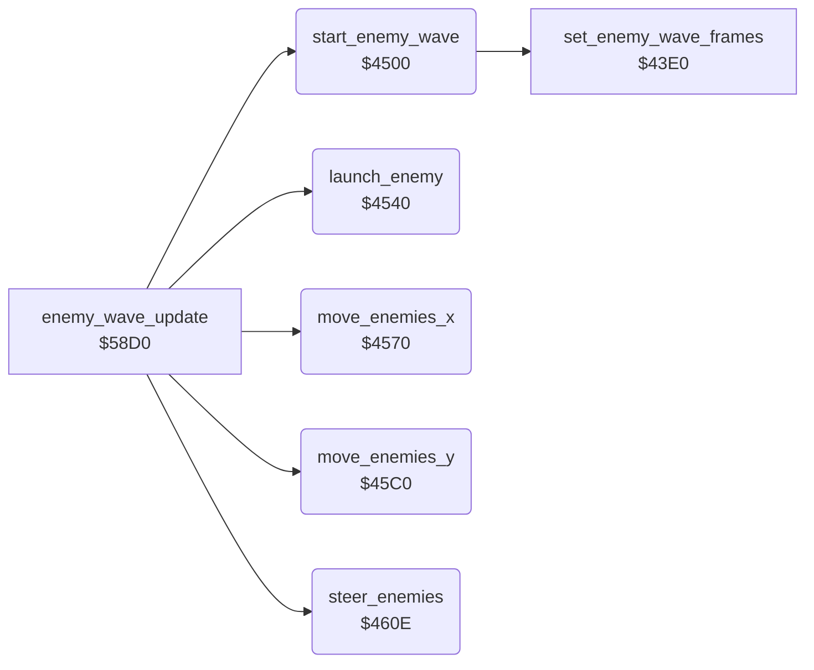

<!-- Generated by c64-docs from knowledge revision 20261025T214607.441-00m56k and .c64-re-tools/local/generated/src/source-map.json. Do not edit: change the knowledge, generate the source again, then run docs.ts generate. -->
# enemy/enemy_waves.asm: Enemy waves and movement

Range `$4500-$4689`. Source: [enemy/enemy_waves.asm](../../../../src/enemy/enemy_waves.asm). Index: [the reference](../../index.md).

## Routines

| Routine | Address | Reached from | Summary |
|---|---|---|---|
| [`start_enemy_wave`](enemy_waves.md#start_enemy_wave) | `$4500` | [`enemy_wave_update`](enemy_wave_update.md#enemy_wave_update) | Starts a wave when $61 bits 0-2 are clear and tick AND $3f = 0. |
| [`launch_enemy`](enemy_waves.md#launch_enemy) | `$4540` | [`enemy_wave_update`](enemy_wave_update.md#enemy_wave_update) | When the wave is active and $65 < $66, it counts $63 up to $62. |
| [`move_enemies_x`](enemy_waves.md#move_enemies_x) | `$4570` | [`enemy_wave_update`](enemy_wave_update.md#enemy_wave_update) | Moves each enemy 7 pixels in the direction $60, one pixel in each of 7 steps. |
| [`move_enemies_y`](enemy_waves.md#move_enemies_y) | `$45C0` | [`enemy_wave_update`](enemy_wave_update.md#enemy_wave_update) | Moves each enemy 1 pixel by its direction $5b+x (1 up, $ff down). |
| [`steer_enemies`](enemy_waves.md#steer_enemies) | `$460E` | [`enemy_wave_update`](enemy_wave_update.md#enemy_wave_update) | Sets the vertical direction $5b+x of each enemy from its state and row. |

## Data

| Range | Type | Name | Read by | Written by |
|---|---|---|---|---|
| [`$460B`](../../../../src/enemy/enemy_waves.asm#L174)-`$460D` | unused |  |  |  |

## Call graph

A solid arrow is a call, a thick arrow a table entry. Rounded nodes are in this file.

## Details

### [`start_enemy_wave`](../../../../src/enemy/enemy_waves.asm#L6) `$4500`

*routine*

Starts a wave when $61 bits 0-2 are clear and tick AND $3f = 0. It sets a random start column and direction, and the points of the first kill.

- **Called from:** [`enemy_wave_update`](enemy_wave_update.md#enemy_wave_update)
- **Calls:** [`set_enemy_wave_frames`](enemy_frames_43e0.md#set_enemy_wave_frames)
- **Reads:** [`wave_flags`](../../memory-map.md#wave_flags), [`tick`](../../memory-map.md#tick), [`map_column`](../../memory-map.md#map_column), [`RANDOM`](../../memory-map.md#RANDOM), [`temp`](../../memory-map.md#temp)
- **Writes:** [`temp`](../../memory-map.md#temp), [`wave_start_col`](../../memory-map.md#wave_start_col), [`wave_dir`](../../memory-map.md#wave_dir), [`wave_flags`](../../memory-map.md#wave_flags), [`launch_timer`](../../memory-map.md#launch_timer), [`wave_launched`](../../memory-map.md#wave_launched), [`kill_points`](../../memory-map.md#kill_points)

| Label | Address | Comment |
|---|---|---|
| [`start_wave_dir_left`](../../../../src/enemy/enemy_waves.asm#L26) | `$4526` |  |
| [`start_wave_set_dir`](../../../../src/enemy/enemy_waves.asm#L28) | `$4528` |  |
| [`start_wave_done`](../../../../src/enemy/enemy_waves.asm#L41) | `$453F` |  |

### [`launch_enemy`](../../../../src/enemy/enemy_waves.asm#L44) `$4540`

*routine*

When the wave is active and $65 < $66, it counts $63 up to $62. Then it starts the next enemy: state 1, column $64, row 0, flying down.

- **Called from:** [`enemy_wave_update`](enemy_wave_update.md#enemy_wave_update)
- **Reads:** [`wave_flags`](../../memory-map.md#wave_flags), [`wave_launched`](../../memory-map.md#wave_launched), [`wave_size`](../../memory-map.md#wave_size), [`launch_timer`](../../memory-map.md#launch_timer), [`launch_delay`](../../memory-map.md#launch_delay), [`enemy_state`](../../memory-map.md#enemy_state), [`wave_start_col`](../../memory-map.md#wave_start_col)
- **Writes:** [`launch_timer`](../../memory-map.md#launch_timer), [`wave_launched`](../../memory-map.md#wave_launched), [`enemy_state`](../../memory-map.md#enemy_state), [`enemy_col`](../../memory-map.md#enemy_col), [`enemy_row`](../../memory-map.md#enemy_row), [`enemy_y_fine`](../../memory-map.md#enemy_y_fine), [`enemy_x_fine`](../../memory-map.md#enemy_x_fine), [`enemy_climb`](../../memory-map.md#enemy_climb)

| Label | Address | Comment |
|---|---|---|
| [`launch_enemy_done`](../../../../src/enemy/enemy_waves.asm#L69) | `$456F` |  |

### [`move_enemies_x`](../../../../src/enemy/enemy_waves.asm#L72) `$4570`

*routine*

Moves each enemy 7 pixels in the direction $60, one pixel in each of 7 steps. When tick AND $1f is 0, each step adds 1 to enemy_state, so the state goes up by 7. Exploding enemies (state >= $e0) do not move.

- **Called from:** [`enemy_wave_update`](enemy_wave_update.md#enemy_wave_update)
- **Reads:** [`wave_flags`](../../memory-map.md#wave_flags), [`enemy_state`](../../memory-map.md#enemy_state), [`tick`](../../memory-map.md#tick), [`wave_dir`](../../memory-map.md#wave_dir), [`enemy_x_fine`](../../memory-map.md#enemy_x_fine), [`enemy_col`](../../memory-map.md#enemy_col)
- **Writes:** [`enemy_state`](../../memory-map.md#enemy_state), [`enemy_x_fine`](../../memory-map.md#enemy_x_fine), [`enemy_col`](../../memory-map.md#enemy_col)

| Label | Address | Comment |
|---|---|---|
| [`move_enemies_x_step`](../../../../src/enemy/enemy_waves.asm#L77) | `$4578` |  |
| [`move_enemies_x_loop`](../../../../src/enemy/enemy_waves.asm#L79) | `$457A` |  |
| [`move_enemies_x_check`](../../../../src/enemy/enemy_waves.asm#L86) | `$4586` |  |
| [`move_enemies_x_right`](../../../../src/enemy/enemy_waves.asm#L100) | `$459F` | Fine X $53+x + 1. At 8: 0, and column $4b+x + 1. |
| [`move_enemies_x_next`](../../../../src/enemy/enemy_waves.asm#L110) | `$45AF` |  |
| [`move_enemies_x_done`](../../../../src/enemy/enemy_waves.asm#L125) | `$45BF` |  |

### [`move_enemies_y`](../../../../src/enemy/enemy_waves.asm#L128) `$45C0`

*routine*

Moves each enemy 1 pixel by its direction $5b+x (1 up, $ff down). An enemy above row 0 ends. Then it ends the wave when all enemies are gone. $58d0 calls it two times in each pass.

- **Called from:** [`enemy_wave_update`](enemy_wave_update.md#enemy_wave_update)
- **Reads:** [`wave_flags`](../../memory-map.md#wave_flags), [`enemy_state`](../../memory-map.md#enemy_state), [`enemy_climb`](../../memory-map.md#enemy_climb), [`enemy_y_fine`](../../memory-map.md#enemy_y_fine), [`enemy_row`](../../memory-map.md#enemy_row), [`wave_launched`](../../memory-map.md#wave_launched), [`wave_size`](../../memory-map.md#wave_size)
- **Writes:** [`enemy_y_fine`](../../memory-map.md#enemy_y_fine), [`enemy_row`](../../memory-map.md#enemy_row), [`enemy_state`](../../memory-map.md#enemy_state), [`wave_flags`](../../memory-map.md#wave_flags)

| Label | Address | Comment |
|---|---|---|
| [`move_enemies_y_loop`](../../../../src/enemy/enemy_waves.asm#L135) | `$45CC` |  |
| [`move_enemies_y_down`](../../../../src/enemy/enemy_waves.asm#L148) | `$45E4` | Down: fine Y $4f+x + 1. At 8: 0, and row $47+x + 1. |
| [`move_enemies_y_next`](../../../../src/enemy/enemy_waves.asm#L156) | `$45F2` |  |
| [`move_enemies_y_end_loop`](../../../../src/enemy/enemy_waves.asm#L160) | `$45F7` |  |
| [`move_enemies_y_done`](../../../../src/enemy/enemy_waves.asm#L171) | `$460A` |  |

### [`steer_enemies`](../../../../src/enemy/enemy_waves.asm#L176) `$460E`

*routine*

Sets the vertical direction $5b+x of each enemy from its state and row. Flying enemies change direction at random between the rows 0 and $0d. Row >= $0e: the enemy explodes. Falling: down. State >= $80: up.

- **Called from:** [`enemy_wave_update`](enemy_wave_update.md#enemy_wave_update)
- **Reads:** [`wave_flags`](../../memory-map.md#wave_flags), [`enemy_state`](../../memory-map.md#enemy_state), [`enemy_row`](../../memory-map.md#enemy_row), [`RANDOM`](../../memory-map.md#RANDOM), [`enemy_climb`](../../memory-map.md#enemy_climb), [`CI2TBLO`](../../memory-map.md#CI2TBLO), [`temp`](../../memory-map.md#temp)
- **Writes:** [`enemy_state`](../../memory-map.md#enemy_state), [`enemy_climb`](../../memory-map.md#enemy_climb), [`temp`](../../memory-map.md#temp)

| Label | Address | Comment |
|---|---|---|
| [`steer_enemies_loop`](../../../../src/enemy/enemy_waves.asm#L181) | `$4616` |  |
| [`steer_enemies_level`](../../../../src/enemy/enemy_waves.asm#L192) | `$462A` |  |
| [`steer_enemies_state`](../../../../src/enemy/enemy_waves.asm#L196) | `$4630` |  |
| [`steer_enemies_set_dir`](../../../../src/enemy/enemy_waves.asm#L203) | `$463C` |  |
| [`steer_enemies_flying`](../../../../src/enemy/enemy_waves.asm#L206) | `$4640` | State $80-$cf: up. |
| [`steer_enemies_row`](../../../../src/enemy/enemy_waves.asm#L211) | `$4648` | Row 0: level or down, at random. |
| [`steer_enemies_not_top`](../../../../src/enemy/enemy_waves.asm#L220) | `$4659` | Row >= $0a: level or up, at random. |
| [`steer_enemies_random`](../../../../src/enemy/enemy_waves.asm#L229) | `$466A` | CIA 2 timer B low byte as a random value. A change only when its bits 0-4 are 0. |
| [`steer_enemies_up_down`](../../../../src/enemy/enemy_waves.asm#L239) | `$467D` |  |
| [`steer_enemies_store_dir`](../../../../src/enemy/enemy_waves.asm#L243) | `$4683` |  |
| [`steer_enemies_next`](../../../../src/enemy/enemy_waves.asm#L246) | `$4686` |  |
| [`steer_enemies_done`](../../../../src/enemy/enemy_waves.asm#L249) | `$4689` |  |
