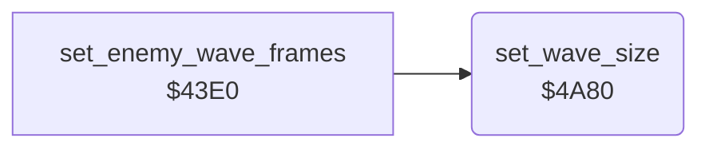

<!-- Generated by c64-docs from knowledge revision 20261025T214607.441-00m56k and .c64-re-tools/local/generated/src/source-map.json. Do not edit: change the knowledge, generate the source again, then run docs.ts generate. -->
# enemy/wave_size.asm: Size of the next enemy wave

Range `$4A80-$4ABA`. Source: [enemy/wave_size.asm](../../../../src/enemy/wave_size.asm). Index: [the reference](../../index.md).

## Routines

| Routine | Address | Reached from | Summary |
|---|---|---|---|
| [`set_wave_size`](wave_size.md#set_wave_size) | `$4A80` | [`set_enemy_wave_frames`](enemy_frames_43e0.md#set_enemy_wave_frames) | Sets the enemy count of a wave $66 from the score digits $13 and $14: 2 below 400, 3 from 400, 4 from 1500. |

## Call graph

A solid arrow is a call, a thick arrow a table entry. Rounded nodes are in this file.

## Details

### [`set_wave_size`](../../../../src/enemy/wave_size.asm#L6) `$4A80`

*routine*

Sets the enemy count of a wave $66 from the score digits $13 and $14: 2 below 400, 3 from 400, 4 from 1500. Then sets $62 = 2 * $66 + 2 plus $66 - 1 random values 0-3.

- **Called from:** [`set_enemy_wave_frames`](enemy_frames_43e0.md#set_enemy_wave_frames)
- **Reads:** [`score`](../../memory-map.md#score), [`wave_size`](../../memory-map.md#wave_size), [`RANDOM`](../../memory-map.md#RANDOM), [`launch_delay`](../../memory-map.md#launch_delay)
- **Writes:** [`wave_size`](../../memory-map.md#wave_size), [`launch_delay`](../../memory-map.md#launch_delay)
- **Refers to:** [`score`](../../memory-map.md#score)

| Label | Address | Comment |
|---|---|---|
| [`wave_size_check_1000s`](../../../../src/enemy/wave_size.asm#L14) | `$4A8E` | Score 1000-1499: 3, from 1500: 4. |
| [`wave_size_four`](../../../../src/enemy/wave_size.asm#L18) | `$4A94` |  |
| [`wave_size_check_below_1000`](../../../../src/enemy/wave_size.asm#L21) | `$4A98` | Score below 1000: 2 below 400, else 3. |
| [`wave_size_three`](../../../../src/enemy/wave_size.asm#L25) | `$4A9E` |  |
| [`wave_size_store`](../../../../src/enemy/wave_size.asm#L28) | `$4AA0` |  |
| [`wave_size_set_interval`](../../../../src/enemy/wave_size.asm#L30) | `$4AA2` |  |
| [`wave_size_add_random`](../../../../src/enemy/wave_size.asm#L38) | `$4AAD` | SID voice 3 oscillator output as a random value. |
