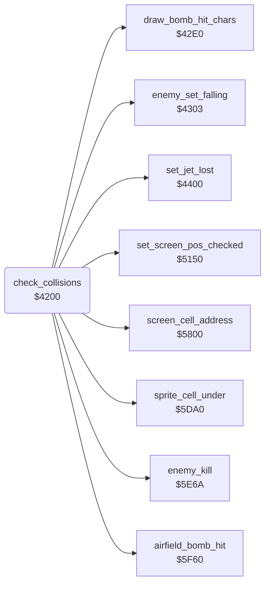

<!-- Generated by c64-docs from knowledge revision 20261024T103119.179-vx1fei and .c64-re-tools/local/generated/src/source-map.json. Do not edit: change the knowledge, generate the source again, then run docs.ts generate. -->
# game/collisions.asm: Sprite collisions

Range `$4200-$42DB`. Source: [game/collisions.asm](../../../../src/game/collisions.asm). Index: [the reference](../../index.md).

## Call graph

A solid arrow is a call, a thick arrow a table entry, a dotted arrow a jump. Rounded nodes are in this file.

## Names

### [`check_collisions`](../../../../src/game/collisions.asm#L6) `$4200`

*routine*

Reads the sprite-sprite and the sprite-background collisions. It handles the lost jet, the collisions and missile hits of the enemies, and the bombs. Then it counts down $af.
NOP fill.

- **Called from:** [`$41BA`](../../../../src/game/main_loop.asm#L74)
- **Calls:** [`set_jet_lost`](../player/jet_lost.md#set_jet_lost), [`enemy_set_falling`](collisions_4303.md#enemy_set_falling), [`sprite_cell_under`](sprite_cell.md#sprite_cell_under), [`screen_cell_address`](screen_cell_address.md#screen_cell_address), [`enemy_kill`](../enemy/enemy_kill.md#enemy_kill), [`set_screen_pos_checked`](screen_pos.md#set_screen_pos_checked), [`airfield_bomb_hit`](../landscape/airfield_bombing.md#airfield_bomb_hit), [`draw_bomb_hit_chars`](collisions_42e0.md#draw_bomb_hit_chars)
- **Reads:** [`SPSPCL`](../../memory-map.md#SPSPCL), [`sprite_hits`](../../memory-map.md#sprite_hits), [`SPBGCL`](../../memory-map.md#SPBGCL), [`background_hits`](../../memory-map.md#background_hits), [`char_col`](../../memory-map.md#char_col), [`enemy_row`](../../memory-map.md#enemy_row), [`screen_ptr`](../../memory-map.md#screen_ptr), [`kill_sound_timer`](../../memory-map.md#kill_sound_timer)
- **Writes:** [`sprite_hits`](../../memory-map.md#sprite_hits), [`bomb_y_fine`](../../memory-map.md#bomb_y_fine), [`background_hits`](../../memory-map.md#background_hits), [`temp2`](../../memory-map.md#temp2), [`kill_sound_timer`](../../memory-map.md#kill_sound_timer)

### [`collisions_bomb_hit_loop`](../../../../src/game/collisions.asm#L22) `$421B`

*label*

- **Jumped to from:** [`check_collisions`](collisions.md#check_collisions) [`$4227`](../../../../src/game/collisions.asm#L32)

### [`collisions_bomb_hit_next`](../../../../src/game/collisions.asm#L29) `$4224`

*label*

- **Jumped to from:** [`check_collisions`](collisions.md#check_collisions) [`$421C`](../../../../src/game/collisions.asm#L24)

### [`collisions_enemy_hit`](../../../../src/game/collisions.asm#L35) `$422B`

*label*

Enemy sprites 1-4 in the collision.

- **Jumped to from:** [`check_collisions`](collisions.md#check_collisions) [`$4216`](../../../../src/game/collisions.asm#L19)

### [`collisions_enemy_hit_loop`](../../../../src/game/collisions.asm#L41) `$4234`

*label*

- **Jumped to from:** [`check_collisions`](collisions.md#check_collisions) [`$423F`](../../../../src/game/collisions.asm#L50)

### [`collisions_enemy_hit_next`](../../../../src/game/collisions.asm#L47) `$423C`

*label*

- **Jumped to from:** [`check_collisions`](collisions.md#check_collisions) [`$4235`](../../../../src/game/collisions.asm#L43)

### [`collisions_background`](../../../../src/game/collisions.asm#L51) `$4241`

*label*

- **Jumped to from:** [`check_collisions`](collisions.md#check_collisions) [`$4209`](../../../../src/game/collisions.asm#L13), [`check_collisions`](collisions.md#check_collisions) [`$420D`](../../../../src/game/collisions.asm#L15), [`check_collisions`](collisions.md#check_collisions) [`$422F`](../../../../src/game/collisions.asm#L38)

### [`collisions_bg_enemies`](../../../../src/game/collisions.asm#L58) `$424F`

*label*

Enemy sprites 1-4 on a character.

- **Jumped to from:** [`check_collisions`](collisions.md#check_collisions) [`$424A`](../../../../src/game/collisions.asm#L56)

### [`collisions_bg_enemy_loop`](../../../../src/game/collisions.asm#L64) `$4258`

*label*

- **Jumped to from:** [`check_collisions`](collisions.md#check_collisions) [`$4287`](../../../../src/game/collisions.asm#L99)

### [`collisions_missile_test_loop`](../../../../src/game/collisions.asm#L76) `$426C`

*label*

Tests three characters for a missile character $0c-$13.

- **Jumped to from:** [`check_collisions`](collisions.md#check_collisions) [`$4273`](../../../../src/game/collisions.asm#L82)

### [`collisions_missile_test_next`](../../../../src/game/collisions.asm#L80) `$4272`

*label*

- **Jumped to from:** [`check_collisions`](collisions.md#check_collisions) [`$4279`](../../../../src/game/collisions.asm#L86)

### [`collisions_missile_test_low`](../../../../src/game/collisions.asm#L84) `$4277`

*label*

- **Jumped to from:** [`check_collisions`](collisions.md#check_collisions) [`$4270`](../../../../src/game/collisions.asm#L79)

### [`collisions_bg_enemy_restore`](../../../../src/game/collisions.asm#L92) `$4281`

*label*

- **Jumped to from:** [`check_collisions`](collisions.md#check_collisions) [`$4275`](../../../../src/game/collisions.asm#L83)

### [`collisions_bg_enemy_next`](../../../../src/game/collisions.asm#L96) `$4284`

*label*

- **Jumped to from:** [`check_collisions`](collisions.md#check_collisions) [`$4259`](../../../../src/game/collisions.asm#L66)

### [`collisions_bg_bombs`](../../../../src/game/collisions.asm#L100) `$4289`

*label*

Bomb sprites 5-6 on a character.

- **Jumped to from:** [`check_collisions`](collisions.md#check_collisions) [`$4253`](../../../../src/game/collisions.asm#L61)

### [`collisions_bg_bombs_check`](../../../../src/game/collisions.asm#L103) `$428D`

*label*

- **Jumped to from:** [`check_collisions`](collisions.md#check_collisions) [`$4246`](../../../../src/game/collisions.asm#L54)

### [`collisions_bg_bomb_loop`](../../../../src/game/collisions.asm#L107) `$4292`

*label*

- **Jumped to from:** [`check_collisions`](collisions.md#check_collisions) [`$42CF`](../../../../src/game/collisions.asm#L152)

### [`collisions_bomb_crater`](../../../../src/game/collisions.asm#L127) `$42B5`

*label*

Row > $0b: two characters one row below the bomb.

- **Jumped to from:** [`check_collisions`](collisions.md#check_collisions) [`$42AD`](../../../../src/game/collisions.asm#L123)

### [`collisions_bomb_end`](../../../../src/game/collisions.asm#L139) `$42C2`

*label*

- **Jumped to from:** [`check_collisions`](collisions.md#check_collisions) [`$42B3`](../../../../src/game/collisions.asm#L126)

### [`collisions_bomb_restore`](../../../../src/game/collisions.asm#L145) `$42C9`

*label*

- **Jumped to from:** [`check_collisions`](collisions.md#check_collisions) [`$42A5`](../../../../src/game/collisions.asm#L119), [`check_collisions`](collisions.md#check_collisions) [`$42AB`](../../../../src/game/collisions.asm#L122)

### [`collisions_bg_bomb_next`](../../../../src/game/collisions.asm#L149) `$42CC`

*label*

- **Jumped to from:** [`check_collisions`](collisions.md#check_collisions) [`$4293`](../../../../src/game/collisions.asm#L109)

### [`collisions_sound_timer`](../../../../src/game/collisions.asm#L153) `$42D1`

*label*

$af counts down to 0. $5e8f sets it to 6 for a kill.

- **Jumped to from:** [`check_collisions`](collisions.md#check_collisions) [`$428D`](../../../../src/game/collisions.asm#L104)

### [`collisions_done`](../../../../src/game/collisions.asm#L159) `$42DB`

*label*

- **Jumped to from:** [`check_collisions`](collisions.md#check_collisions) [`$42D5`](../../../../src/game/collisions.asm#L156)
