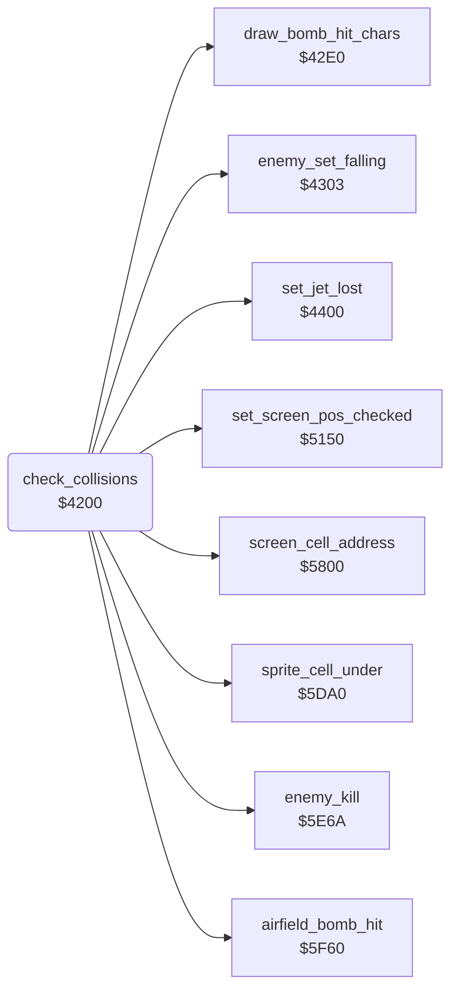

<!-- Generated by c64-docs from knowledge revision 20261025T214607.441-00m56k and .c64-re-tools/local/generated/src/source-map.json. Do not edit: change the knowledge, generate the source again, then run docs.ts generate. -->
# game/collisions.asm: Sprite collisions

Range `$4200-$42DB`. Source: [game/collisions.asm](../../../../src/game/collisions.asm). Index: [the reference](../../index.md).

## Routines

| Routine | Address | Reached from | Summary |
|---|---|---|---|
| [`check_collisions`](collisions.md#check_collisions) | `$4200` | [`$41BA`](../../../../src/game/main_loop.asm#L74) | Reads the sprite-sprite and the sprite-background collisions. |

## Call graph

A solid arrow is a call, a thick arrow a table entry. Rounded nodes are in this file.

## Details

### [`check_collisions`](../../../../src/game/collisions.asm#L6) `$4200`

*routine*

Reads the sprite-sprite and the sprite-background collisions. It handles the lost jet, the collisions and missile hits of the enemies, and the bombs. Then it counts down $af.
NOP fill.

- **Called from:** [`$41BA`](../../../../src/game/main_loop.asm#L74)
- **Calls:** [`set_jet_lost`](../player/jet_lost.md#set_jet_lost), [`enemy_set_falling`](collisions_4303.md#enemy_set_falling), [`sprite_cell_under`](sprite_cell.md#sprite_cell_under), [`screen_cell_address`](screen_cell_address.md#screen_cell_address), [`enemy_kill`](../enemy/enemy_kill.md#enemy_kill), [`set_screen_pos_checked`](screen_pos.md#set_screen_pos_checked), [`airfield_bomb_hit`](../landscape/airfield_bombing.md#airfield_bomb_hit), [`draw_bomb_hit_chars`](collisions_42e0.md#draw_bomb_hit_chars)
- **Reads:** [`SPSPCL`](../../memory-map.md#SPSPCL), [`sprite_hits`](../../memory-map.md#sprite_hits), [`SPBGCL`](../../memory-map.md#SPBGCL), [`background_hits`](../../memory-map.md#background_hits), [`char_col`](../../memory-map.md#char_col), [`enemy_row`](../../memory-map.md#enemy_row), [`screen_ptr`](../../memory-map.md#screen_ptr), [`kill_sound_timer`](../../memory-map.md#kill_sound_timer)
- **Writes:** [`sprite_hits`](../../memory-map.md#sprite_hits), [`bomb_y_fine`](../../memory-map.md#bomb_y_fine), [`background_hits`](../../memory-map.md#background_hits), [`temp2`](../../memory-map.md#temp2), [`kill_sound_timer`](../../memory-map.md#kill_sound_timer)

| Label | Address | Comment |
|---|---|---|
| [`collisions_bomb_hit_loop`](../../../../src/game/collisions.asm#L22) | `$421B` |  |
| [`collisions_bomb_hit_next`](../../../../src/game/collisions.asm#L29) | `$4224` |  |
| [`collisions_enemy_hit`](../../../../src/game/collisions.asm#L35) | `$422B` | Enemy sprites 1-4 in the collision. |
| [`collisions_enemy_hit_loop`](../../../../src/game/collisions.asm#L41) | `$4234` |  |
| [`collisions_enemy_hit_next`](../../../../src/game/collisions.asm#L47) | `$423C` |  |
| [`collisions_background`](../../../../src/game/collisions.asm#L51) | `$4241` |  |
| [`collisions_bg_enemies`](../../../../src/game/collisions.asm#L58) | `$424F` | Enemy sprites 1-4 on a character. |
| [`collisions_bg_enemy_loop`](../../../../src/game/collisions.asm#L64) | `$4258` |  |
| [`collisions_missile_test_loop`](../../../../src/game/collisions.asm#L76) | `$426C` | Tests three characters for a missile character $0c-$13. |
| [`collisions_missile_test_next`](../../../../src/game/collisions.asm#L80) | `$4272` |  |
| [`collisions_missile_test_low`](../../../../src/game/collisions.asm#L84) | `$4277` |  |
| [`collisions_bg_enemy_restore`](../../../../src/game/collisions.asm#L92) | `$4281` |  |
| [`collisions_bg_enemy_next`](../../../../src/game/collisions.asm#L96) | `$4284` |  |
| [`collisions_bg_bombs`](../../../../src/game/collisions.asm#L100) | `$4289` | Bomb sprites 5-6 on a character. |
| [`collisions_bg_bombs_check`](../../../../src/game/collisions.asm#L103) | `$428D` |  |
| [`collisions_bg_bomb_loop`](../../../../src/game/collisions.asm#L107) | `$4292` |  |
| [`collisions_bomb_crater`](../../../../src/game/collisions.asm#L127) | `$42B5` | Row > $0b: two characters one row below the bomb. |
| [`collisions_bomb_end`](../../../../src/game/collisions.asm#L139) | `$42C2` |  |
| [`collisions_bomb_restore`](../../../../src/game/collisions.asm#L145) | `$42C9` |  |
| [`collisions_bg_bomb_next`](../../../../src/game/collisions.asm#L149) | `$42CC` |  |
| [`collisions_sound_timer`](../../../../src/game/collisions.asm#L153) | `$42D1` | $af counts down to 0. $5e8f sets it to 6 for a kill. |
| [`collisions_done`](../../../../src/game/collisions.asm#L159) | `$42DB` |  |
