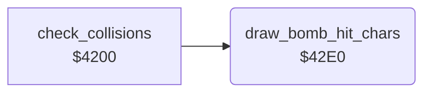

<!-- Generated by c64-docs from knowledge revision 20261024T103119.179-vx1fei and .c64-re-tools/local/generated/src/source-map.json. Do not edit: change the knowledge, generate the source again, then run docs.ts generate. -->
# game/collisions_42e0.asm

Range `$42E0-$42F3`. Source: [game/collisions_42e0.asm](../../../../src/game/collisions_42e0.asm). Index: [the reference](../../index.md).

## Call graph

A solid arrow is a call, a thick arrow a table entry, a dotted arrow a jump. Rounded nodes are in this file.

## Names

### [`draw_bomb_hit_chars`](../../../../src/game/collisions_42e0.asm#L6) `$42E0`

*routine*

Writes the characters $2a and $2b with colour $0c at ($05) and ($07), offsets 0 and 1. Input: the pointers of $5150.

- **Called from:** [`check_collisions`](collisions.md#check_collisions) [`$42B5`](../../../../src/game/collisions.asm#L128)
- **Reads:** [`screen_ptr`](../../memory-map.md#screen_ptr), [`colour_ptr`](../../memory-map.md#colour_ptr)
