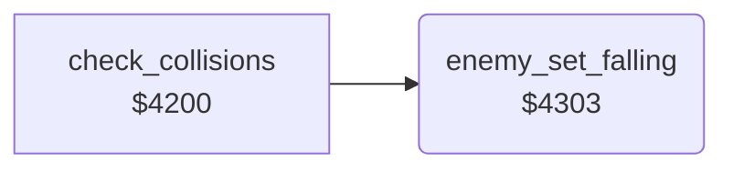

<!-- Generated by c64-docs from knowledge revision 20261024T103119.179-vx1fei and .c64-re-tools/local/generated/src/source-map.json. Do not edit: change the knowledge, generate the source again, then run docs.ts generate. -->
# game/collisions_4303.asm

Range `$4303-$430F`. Source: [game/collisions_4303.asm](../../../../src/game/collisions_4303.asm). Index: [the reference](../../index.md).

## Call graph

A solid arrow is a call, a thick arrow a table entry, a dotted arrow a jump. Rounded nodes are in this file.

## Names

### [`enemy_set_falling`](../../../../src/game/collisions_4303.asm#L6) `$4303`

*routine*

Input: X = enemy 1-4. When enemy_state is 1-$cf (flying), it becomes $d0 (falling). Else no change.

- **Called from:** [`check_collisions`](collisions.md#check_collisions) [`$4238`](../../../../src/game/collisions.asm#L45)
- **Reads:** [`enemy_state`](../../memory-map.md#enemy_state)
- **Writes:** [`enemy_state`](../../memory-map.md#enemy_state)

### [`enemy_set_falling_done`](../../../../src/game/collisions_4303.asm#L13) `$430F`

*label*

- **Jumped to from:** [`enemy_set_falling`](collisions_4303.md#enemy_set_falling) [`$4305`](../../../../src/game/collisions_4303.asm#L8), [`enemy_set_falling`](collisions_4303.md#enemy_set_falling) [`$4309`](../../../../src/game/collisions_4303.asm#L10)
