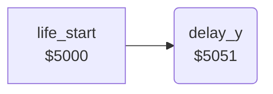

<!-- Generated by c64-docs from knowledge revision 20261025T214607.441-00m56k and .c64-re-tools/local/generated/src/source-map.json. Do not edit: change the knowledge, generate the source again, then run docs.ts generate. -->
# game/delay_5051.asm

Range `$5051-$5059`. Source: [game/delay_5051.asm](../../../../src/game/delay_5051.asm). Index: [the reference](../../index.md).

## Routines

| Routine | Address | Reached from | Summary |
|---|---|---|---|
| [`delay_y`](delay_5051.md#delay_y) | `$5051` | [`life_start`](../player/life_start.md#life_start) | Waits Y times 255 loop steps. |

## Call graph

A solid arrow is a call, a thick arrow a table entry. Rounded nodes are in this file.

## Details

### [`delay_y`](../../../../src/game/delay_5051.asm#L6) `$5051`

*routine*

Waits Y times 255 loop steps. Input: Y. Output: X and Y are 0.

- **Called from:** [`life_start`](../player/life_start.md#life_start)

| Label | Address | Comment |
|---|---|---|
| [`delay_y_inner`](../../../../src/game/delay_5051.asm#L8) | `$5053` |  |
