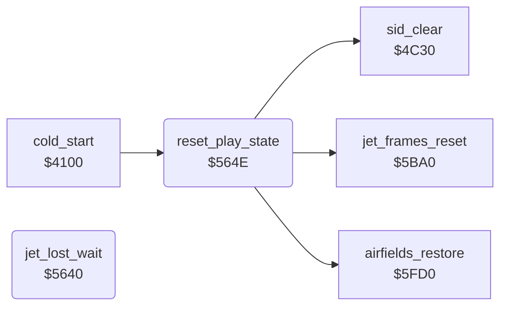

<!-- Generated by c64-docs from knowledge revision 20261025T214607.441-00m56k and .c64-re-tools/local/generated/src/source-map.json. Do not edit: change the knowledge, generate the source again, then run docs.ts generate. -->
# game/jet_lost.asm: Lost jet wait and reset of the play state

Range `$5640-$5682`. Source: [game/jet_lost.asm](../../../../src/game/jet_lost.asm). Index: [the reference](../../index.md).

## Routines

| Routine | Address | Reached from | Summary |
|---|---|---|---|
| [`jet_lost_wait`](jet_lost.md#jet_lost_wait) | `$5640` | [`$41CD`](../../../../src/game/main_loop.asm#L83) | Main loop part for a lost jet. |
| [`reset_play_state`](jet_lost.md#reset_play_state) | `$564E` | [`cold_start`](../init/cold_start.md#cold_start) | Clears the play state $17-$64 but keeps lives, sets $3c-$43 to $ff, clears $98-$b0, silences the SID. |

## Call graph

A solid arrow is a call, a thick arrow a table entry. Rounded nodes are in this file.

## Details

### [`jet_lost_wait`](../../../../src/game/jet_lost.asm#L6) `$5640`

*routine*

Main loop part for a lost jet. When the jet frame is $90 or more and tick = $4f, it runs on into reset_play_state.

- **Called from:** [`$41CD`](../../../../src/game/main_loop.asm#L83)
- **Jumps to:** [`jet_lost_wait_done`](jet_lost.md#jet_lost_wait_done)
- **Reads:** [`SPRPTR`](../../memory-map.md#SPRPTR), [`tick`](../../memory-map.md#tick)

### [`reset_play_state`](../../../../src/game/jet_lost.asm#L15) `$564E`

*routine*

Clears the play state $17-$64 but keeps lives, sets $3c-$43 to $ff, clears $98-$b0, silences the SID. The cold start also calls it.

- **Called from:** [`cold_start`](../init/cold_start.md#cold_start)
- **Calls:** [`airfields_restore`](../landscape/airfield_bombing_5fd0.md#airfields_restore), [`sid_clear`](../title/title_tune_4c30.md#sid_clear), [`jet_frames_reset`](../player/jet_frames_reset.md#jet_frames_reset)
- **Reads:** [`lives`](../../memory-map.md#lives)
- **Writes:** [`score`](../../memory-map.md#score), [`lives`](../../memory-map.md#lives), [`enemy_shot_row`](../../memory-map.md#enemy_shot_row), [`pitch_active`](../../memory-map.md#pitch_active), [`launch_delay`](../../memory-map.md#launch_delay), [`gauge_colour`](../../memory-map.md#gauge_colour), [`crash_stage`](../../memory-map.md#crash_stage)

| Label | Address | Comment |
|---|---|---|
| [`reset_play_clear_zp`](../../../../src/game/jet_lost.asm#L20) | `$5657` |  |
| [`reset_play_fill_ff`](../../../../src/game/jet_lost.asm#L27) | `$5662` |  |
| [`reset_play_clear_98`](../../../../src/game/jet_lost.asm#L33) | `$566B` |  |
| [`jet_lost_wait_done`](../../../../src/game/jet_lost.asm#L45) | `$5682` |  |
