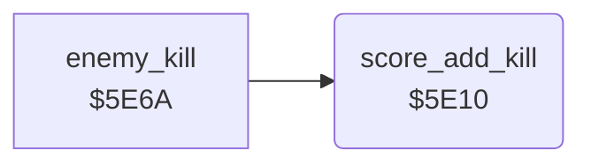

<!-- Generated by c64-docs from knowledge revision 20261024T103119.179-vx1fei and .c64-re-tools/local/generated/src/source-map.json. Do not edit: change the knowledge, generate the source again, then run docs.ts generate. -->
# game/score_add.asm: Score of a kill

Range `$5E10-$5E2E`. Source: [game/score_add.asm](../../../../src/game/score_add.asm). Index: [the reference](../../index.md).

## Call graph

A solid arrow is a call, a thick arrow a table entry, a dotted arrow a jump. Rounded nodes are in this file.

## Names

### [`score_add_kill`](../../../../src/game/score_add.asm#L6) `$5E10`

*routine*

Adds the kill points $aa to the last score digit $16 and carries the digits $16-$13 into the next digit. Then it doubles $aa. The wave start sets $aa to 25, so the kills give 25, 50, 100 and 200. The digit $12 has no carry test.

- **Called from:** [`enemy_kill`](../enemy/enemy_kill.md#enemy_kill) [`$5E76`](../../../../src/enemy/enemy_kill.asm#L14)
- **Reads:** [`kill_points`](../../memory-map.md#kill_points), [`score+4`](../../memory-map.md#score), [`score`](../../memory-map.md#score), [`radar_offset`](../../memory-map.md#radar_offset)
- **Writes:** [`score+4`](../../memory-map.md#score), [`radar_offset`](../../memory-map.md#radar_offset), [`score`](../../memory-map.md#score), [`kill_points`](../../memory-map.md#kill_points)

### [`score_add_digit_loop`](../../../../src/game/score_add.asm#L13) `$5E19`

*label*

- **Jumped to from:** [`score_add_kill`](score_add.md#score_add_kill) [`$5E2A`](../../../../src/game/score_add.asm#L26)

### [`score_add_carry_loop`](../../../../src/game/score_add.asm#L15) `$5E1B`

*label*

- **Jumped to from:** [`score_add_kill`](score_add.md#score_add_kill) [`$5E27`](../../../../src/game/score_add.asm#L23)

### [`score_add_next_digit`](../../../../src/game/score_add.asm#L24) `$5E29`

*label*

- **Jumped to from:** [`score_add_kill`](score_add.md#score_add_kill) [`$5E1D`](../../../../src/game/score_add.asm#L17)
