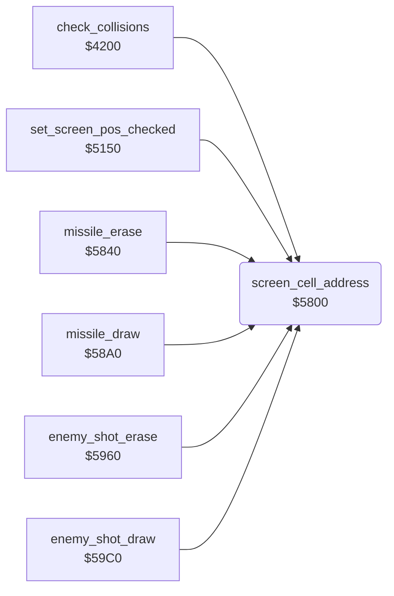

<!-- Generated by c64-docs from knowledge revision 20261024T103119.179-vx1fei and .c64-re-tools/local/generated/src/source-map.json. Do not edit: change the knowledge, generate the source again, then run docs.ts generate. -->
# game/screen_cell_address.asm: Screen and colour RAM address of a character cell

Range `$5800-$5830`. Source: [game/screen_cell_address.asm](../../../../src/game/screen_cell_address.asm). Index: [the reference](../../index.md).

## Call graph

A solid arrow is a call, a thick arrow a table entry, a dotted arrow a jump. Rounded nodes are in this file.

## Names

### [`screen_cell_address`](../../../../src/game/screen_cell_address.asm#L6) `$5800`

*routine*

Sets $05/$06 to $0400 + Y*40 + X and $07/$08 to $d800 + Y*40 + X. Input: X column, Y row. Output: Y is $ff.

- **Called from:** [`check_collisions`](collisions.md#check_collisions) [`$4267`](../../../../src/game/collisions.asm#L74), [`set_screen_pos_checked`](screen_pos.md#set_screen_pos_checked) [`$5158`](../../../../src/game/screen_pos.asm#L11), [`missile_erase`](../missile/missile_update.md#missile_erase) [`$584F`](../../../../src/missile/missile_update.asm#L17), [`missile_draw`](../missile/missile_update_58a0.md#missile_draw) [`$58B0`](../../../../src/missile/missile_update_58a0.asm#L18), [`enemy_shot_erase`](../enemy/enemy_shots.md#enemy_shot_erase) [`$596D`](../../../../src/enemy/enemy_shots.asm#L16), [`enemy_shot_draw`](../enemy/enemy_shots.md#enemy_shot_draw) [`$59CD`](../../../../src/enemy/enemy_shots.asm#L83)
- **Reads:** [`screen_ptr`](../../memory-map.md#screen_ptr), [`screen_ptr_hi`](../../memory-map.md#screen_ptr_hi), [`colour_ptr_hi`](../../memory-map.md#colour_ptr_hi)
- **Writes:** [`screen_ptr`](../../memory-map.md#screen_ptr), [`colour_ptr`](../../memory-map.md#colour_ptr), [`screen_ptr_hi`](../../memory-map.md#screen_ptr_hi), [`colour_ptr_hi`](../../memory-map.md#colour_ptr_hi)

### [`screen_cell_row_loop`](../../../../src/game/screen_cell_address.asm#L14) `$580E`

*label*

- **Jumped to from:** [`screen_cell_address`](screen_cell_address.md#screen_cell_address) [`$581A`](../../../../src/game/screen_cell_address.asm#L22), [`screen_cell_address`](screen_cell_address.md#screen_cell_address) [`$5820`](../../../../src/game/screen_cell_address.asm#L25)

### [`screen_cell_add_column`](../../../../src/game/screen_cell_address.asm#L26) `$5822`

*label*

- **Jumped to from:** [`screen_cell_address`](screen_cell_address.md#screen_cell_address) [`$580F`](../../../../src/game/screen_cell_address.asm#L16)

### [`screen_cell_done`](../../../../src/game/screen_cell_address.asm#L35) `$5830`

*label*

- **Jumped to from:** [`screen_cell_address`](screen_cell_address.md#screen_cell_address) [`$582A`](../../../../src/game/screen_cell_address.asm#L32)
