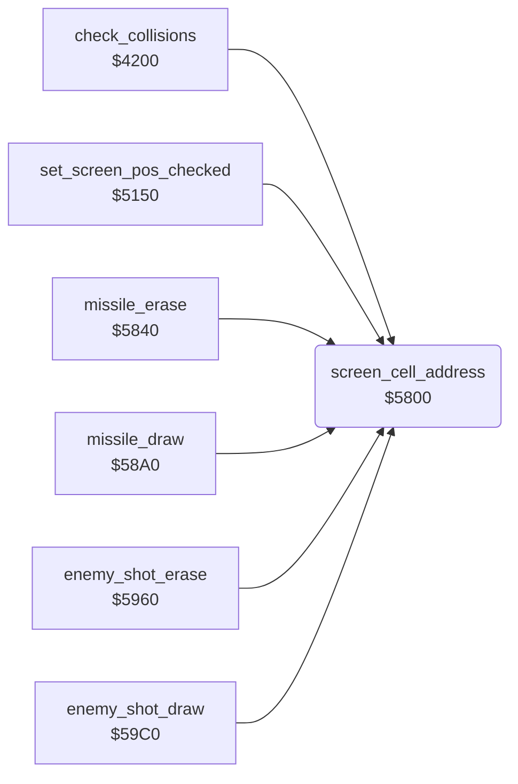

<!-- Generated by c64-docs from knowledge revision 20261025T214607.441-00m56k and .c64-re-tools/local/generated/src/source-map.json. Do not edit: change the knowledge, generate the source again, then run docs.ts generate. -->
# game/screen_cell_address.asm: Screen and colour RAM address of a character cell

Range `$5800-$5830`. Source: [game/screen_cell_address.asm](../../../../src/game/screen_cell_address.asm). Index: [the reference](../../index.md).

## Routines

| Routine | Address | Reached from | Summary |
|---|---|---|---|
| [`screen_cell_address`](screen_cell_address.md#screen_cell_address) | `$5800` | [`check_collisions`](collisions.md#check_collisions), [`set_screen_pos_checked`](screen_pos.md#set_screen_pos_checked), [`missile_erase`](../missile/missile_update.md#missile_erase), [`missile_draw`](../missile/missile_update_58a0.md#missile_draw), [`enemy_shot_erase`](../enemy/enemy_shots.md#enemy_shot_erase), [`enemy_shot_draw`](../enemy/enemy_shots.md#enemy_shot_draw) | Sets $05/$06 to $0400 + Y*40 + X and $07/$08 to $d800 + Y*40 + X. |

## Call graph

A solid arrow is a call, a thick arrow a table entry. Rounded nodes are in this file.

## Details

### [`screen_cell_address`](../../../../src/game/screen_cell_address.asm#L6) `$5800`

*routine*

Sets $05/$06 to $0400 + Y*40 + X and $07/$08 to $d800 + Y*40 + X. Input: X column, Y row. Output: Y is $ff.

- **Called from:** [`check_collisions`](collisions.md#check_collisions), [`set_screen_pos_checked`](screen_pos.md#set_screen_pos_checked), [`missile_erase`](../missile/missile_update.md#missile_erase), [`missile_draw`](../missile/missile_update_58a0.md#missile_draw), [`enemy_shot_erase`](../enemy/enemy_shots.md#enemy_shot_erase), [`enemy_shot_draw`](../enemy/enemy_shots.md#enemy_shot_draw)
- **Reads:** [`screen_ptr`](../../memory-map.md#screen_ptr), [`screen_ptr_hi`](../../memory-map.md#screen_ptr_hi), [`colour_ptr_hi`](../../memory-map.md#colour_ptr_hi)
- **Writes:** [`screen_ptr`](../../memory-map.md#screen_ptr), [`colour_ptr`](../../memory-map.md#colour_ptr), [`screen_ptr_hi`](../../memory-map.md#screen_ptr_hi), [`colour_ptr_hi`](../../memory-map.md#colour_ptr_hi)

| Label | Address | Comment |
|---|---|---|
| [`screen_cell_row_loop`](../../../../src/game/screen_cell_address.asm#L14) | `$580E` |  |
| [`screen_cell_add_column`](../../../../src/game/screen_cell_address.asm#L26) | `$5822` |  |
| [`screen_cell_done`](../../../../src/game/screen_cell_address.asm#L35) | `$5830` |  |
