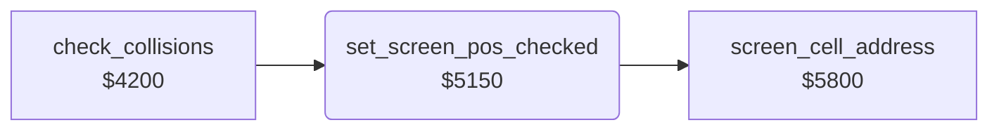

<!-- Generated by c64-docs from knowledge revision 20261025T214607.441-00m56k and .c64-re-tools/local/generated/src/source-map.json. Do not edit: change the knowledge, generate the source again, then run docs.ts generate. -->
# game/screen_pos.asm: Checked screen position and two unused screen fills

Range `$5150-$515C`. Source: [game/screen_pos.asm](../../../../src/game/screen_pos.asm). Index: [the reference](../../index.md).

## Routines

| Routine | Address | Reached from | Summary |
|---|---|---|---|
| [`set_screen_pos_checked`](screen_pos.md#set_screen_pos_checked) | `$5150` | [`check_collisions`](collisions.md#check_collisions) | Input: X column, Y row. |

## Call graph

A solid arrow is a call, a thick arrow a table entry. Rounded nodes are in this file.

## Details

### [`set_screen_pos_checked`](../../../../src/game/screen_pos.asm#L6) `$5150`

*routine*

Input: X column, Y row. When X < 39 and Y < 18, sets the screen pointer $05/$06 and colour pointer $07/$08 ($5800) and clears carry.

- **Called from:** [`check_collisions`](collisions.md#check_collisions)
- **Calls:** [`screen_cell_address`](screen_cell_address.md#screen_cell_address)

| Label | Address | Comment |
|---|---|---|
| [`set_screen_pos_done`](../../../../src/game/screen_pos.asm#L13) | `$515C` | Carry set: the position is outside the area. |
