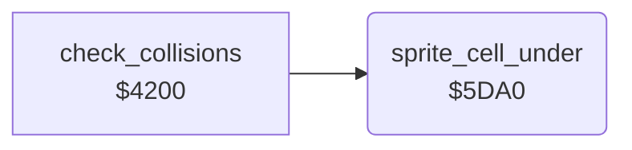

<!-- Generated by c64-docs from knowledge revision 20261024T103119.179-vx1fei and .c64-re-tools/local/generated/src/source-map.json. Do not edit: change the knowledge, generate the source again, then run docs.ts generate. -->
# game/sprite_cell.asm: Character cell under a sprite

Range `$5DA0-$5DD9`. Source: [game/sprite_cell.asm](../../../../src/game/sprite_cell.asm). Index: [the reference](../../index.md).

## Call graph

A solid arrow is a call, a thick arrow a table entry, a dotted arrow a jump. Rounded nodes are in this file.

## Data

| Range | Type | Name | Read by | Written by |
|---|---|---|---|---|
| [`$5DAA`](../../../../src/game/sprite_cell.asm#L13)-`$5DAB` | dual-use |  |  |  |

## Names

### [`sprite_cell_under`](../../../../src/game/sprite_cell.asm#L6) `$5DA0`

*routine*

Finds the cell under pixel 6,6 of sprite $2f. Output: $47 row = (Y - $2c) / 8, $46 column = (X low + 6) / 8 + 32 * MSB - 3. The caller gives $46 and $47 to screen_cell_address. Y below $2c gives row 31, which is outside the screen.

- **Called from:** [`check_collisions`](collisions.md#check_collisions) [`$4260`](../../../../src/game/collisions.asm#L71), [`check_collisions`](collisions.md#check_collisions) [`$429A`](../../../../src/game/collisions.asm#L114)
- **Reads:** [`temp2`](../../memory-map.md#temp2), [`SP0Y`](../../memory-map.md#SP0Y), [`SP0X`](../../memory-map.md#SP0X), [`MSIGX`](../../memory-map.md#MSIGX), [`temp`](../../memory-map.md#temp)
- **Writes:** [`enemy_row`](../../memory-map.md#enemy_row), [`temp`](../../memory-map.md#temp), [`char_col`](../../memory-map.md#char_col)

### [`sprite_cell_bit_loop`](../../../../src/game/sprite_cell.asm#L28) `$5DC0`

*label*

Makes the bit of the sprite for $d010.

- **Jumped to from:** [`sprite_cell_under`](sprite_cell.md#sprite_cell_under) [`$5DC4`](../../../../src/game/sprite_cell.asm#L32)

### [`sprite_cell_test_msb`](../../../../src/game/sprite_cell.asm#L33) `$5DC6`

*label*

- **Jumped to from:** [`sprite_cell_under`](sprite_cell.md#sprite_cell_under) [`$5DC1`](../../../../src/game/sprite_cell.asm#L30)

### [`sprite_cell_store_column`](../../../../src/game/sprite_cell.asm#L40) `$5DD2`

*label*

- **Jumped to from:** [`sprite_cell_under`](sprite_cell.md#sprite_cell_under) [`$5DC9`](../../../../src/game/sprite_cell.asm#L35)
