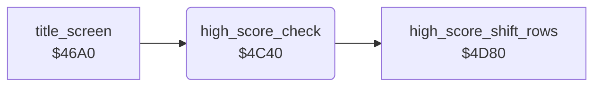

<!-- Generated by c64-docs from knowledge revision 20261024T103119.179-vx1fei and .c64-re-tools/local/generated/src/source-map.json. Do not edit: change the knowledge, generate the source again, then run docs.ts generate. -->
# highscore/high_score_check.asm: High-score check

Range `$4C40-$4C8F`. Source: [highscore/high_score_check.asm](../../../../src/highscore/high_score_check.asm). Index: [the reference](../../index.md).

## Call graph

A solid arrow is a call, a thick arrow a table entry, a dotted arrow a jump. Rounded nodes are in this file.

## Names

### [`high_score_check`](../../../../src/highscore/high_score_check.asm#L6) `$4C40`

*routine*

Compares the score with the 5 rows of the high-score table at $08d2 (one row each $50 bytes). Output: Y = 5 for row 0 down to 1 for row 4, 0 for no entry. It moves the lower rows down ($4d80).

- **Called from:** [`title_screen`](../title/title_screen.md#title_screen) [`$46A0`](../../../../src/title/title_screen.asm#L7)
- **Calls:** [`high_score_shift_rows`](high_score_shift.md#high_score_shift_rows)
- **Reads:** [`score`](../../memory-map.md#score), [`screen_ptr`](../../memory-map.md#screen_ptr), [`screen_ptr_hi`](../../memory-map.md#screen_ptr_hi)
- **Writes:** [`screen_ptr`](../../memory-map.md#screen_ptr), [`screen_ptr_hi`](../../memory-map.md#screen_ptr_hi)

### [`high_score_check_zero_loop`](../../../../src/highscore/high_score_check.asm#L9) `$4C44`

*label*

- **Jumped to from:** [`high_score_check`](high_score_check.md#high_score_check) [`$4C49`](../../../../src/highscore/high_score_check.asm#L13)

### [`high_score_check_rows`](../../../../src/highscore/high_score_check.asm#L15) `$4C4D`

*label*

- **Jumped to from:** [`high_score_check`](high_score_check.md#high_score_check) [`$4C46`](../../../../src/highscore/high_score_check.asm#L11)

### [`high_score_check_row`](../../../../src/highscore/high_score_check.asm#L18) `$4C57`

*label*

- **Jumped to from:** [`high_score_check`](high_score_check.md#high_score_check) [`$4C7F`](../../../../src/highscore/high_score_check.asm#L48), [`high_score_check`](high_score_check.md#high_score_check) [`$4C83`](../../../../src/highscore/high_score_check.asm#L50)

### [`high_score_check_digit`](../../../../src/highscore/high_score_check.asm#L20) `$4C59`

*label*

- **Jumped to from:** [`high_score_check`](high_score_check.md#high_score_check) [`$4C67`](../../../../src/highscore/high_score_check.asm#L30)

### [`high_score_check_next_digit`](../../../../src/highscore/high_score_check.asm#L27) `$4C64`

*label*

- **Jumped to from:** [`high_score_check`](high_score_check.md#high_score_check) [`$4C5E`](../../../../src/highscore/high_score_check.asm#L23)

### [`high_score_check_insert`](../../../../src/highscore/high_score_check.asm#L31) `$4C69`

*label*

- **Jumped to from:** [`high_score_check`](high_score_check.md#high_score_check) [`$4C60`](../../../../src/highscore/high_score_check.asm#L24)

### [`high_score_check_next_row`](../../../../src/highscore/high_score_check.asm#L37) `$4C71`

*label*

- **Jumped to from:** [`high_score_check`](high_score_check.md#high_score_check) [`$4C62`](../../../../src/highscore/high_score_check.asm#L26)

### [`high_score_check_row_ptr`](../../../../src/highscore/high_score_check.asm#L43) `$4C78`

*label*

- **Jumped to from:** [`high_score_check`](high_score_check.md#high_score_check) [`$4C72`](../../../../src/highscore/high_score_check.asm#L40)

### [`high_score_check_done`](../../../../src/highscore/high_score_check.asm#L62) `$4C8F`

*label*

- **Jumped to from:** [`high_score_check`](high_score_check.md#high_score_check) [`$4C4B`](../../../../src/highscore/high_score_check.asm#L14), [`high_score_check`](high_score_check.md#high_score_check) [`$4C6F`](../../../../src/highscore/high_score_check.asm#L36), [`high_score_check`](high_score_check.md#high_score_check) [`$4C76`](../../../../src/highscore/high_score_check.asm#L42)
