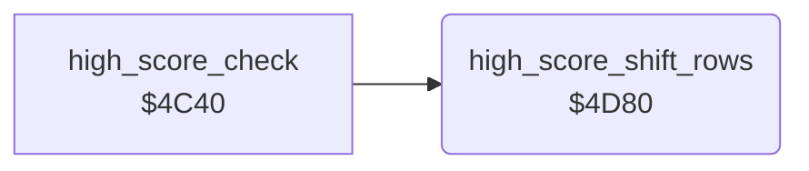

<!-- Generated by c64-docs from knowledge revision 20261024T103119.179-vx1fei and .c64-re-tools/local/generated/src/source-map.json. Do not edit: change the knowledge, generate the source again, then run docs.ts generate. -->
# highscore/high_score_shift.asm: Move the high-score rows down

Range `$4D80-$4DBC`. Source: [highscore/high_score_shift.asm](../../../../src/highscore/high_score_shift.asm). Index: [the reference](../../index.md).

## Call graph

A solid arrow is a call, a thick arrow a table entry, a dotted arrow a jump. Rounded nodes are in this file.

## Names

### [`high_score_shift_rows`](../../../../src/highscore/high_score_shift.asm#L6) `$4D80`

*routine*

Moves the 23-byte table rows below the new entry down by one row. The row 4 entry drops out. Input: Y = 5-1 from $4c40. Y does not change.

- **Called from:** [`high_score_check`](high_score_check.md#high_score_check) [`$4C6B`](../../../../src/highscore/high_score_check.asm#L34)
- **Reads:** [`hiscore_table+240`](../../memory-map.md#hiscore_table), [`hiscore_table+160`](../../memory-map.md#hiscore_table), [`hiscore_table+80`](../../memory-map.md#hiscore_table), [`hiscore_table`](../../memory-map.md#hiscore_table)
- **Writes:** `$0A12`, [`hiscore_table+240`](../../memory-map.md#hiscore_table), [`hiscore_table+160`](../../memory-map.md#hiscore_table), [`hiscore_table+80`](../../memory-map.md#hiscore_table)

### [`high_score_shift_row3`](../../../../src/highscore/high_score_shift.asm#L12) `$4D87`

*label*

- **Jumped to from:** [`high_score_shift_rows`](high_score_shift.md#high_score_shift_rows) [`$4D8E`](../../../../src/highscore/high_score_shift.asm#L16)

### [`high_score_shift_row2`](../../../../src/highscore/high_score_shift.asm#L20) `$4D95`

*label*

- **Jumped to from:** [`high_score_shift_rows`](high_score_shift.md#high_score_shift_rows) [`$4D9C`](../../../../src/highscore/high_score_shift.asm#L24)

### [`high_score_shift_row1`](../../../../src/highscore/high_score_shift.asm#L28) `$4DA3`

*label*

- **Jumped to from:** [`high_score_shift_rows`](high_score_shift.md#high_score_shift_rows) [`$4DAA`](../../../../src/highscore/high_score_shift.asm#L32)

### [`high_score_shift_row0`](../../../../src/highscore/high_score_shift.asm#L36) `$4DB1`

*label*

- **Jumped to from:** [`high_score_shift_rows`](high_score_shift.md#high_score_shift_rows) [`$4DB8`](../../../../src/highscore/high_score_shift.asm#L40)

### [`high_score_shift_done`](../../../../src/highscore/high_score_shift.asm#L41) `$4DBA`

*label*

- **Jumped to from:** [`high_score_shift_rows`](high_score_shift.md#high_score_shift_rows) [`$4D83`](../../../../src/highscore/high_score_shift.asm#L10), [`high_score_shift_rows`](high_score_shift.md#high_score_shift_rows) [`$4D91`](../../../../src/highscore/high_score_shift.asm#L18), [`high_score_shift_rows`](high_score_shift.md#high_score_shift_rows) [`$4D9F`](../../../../src/highscore/high_score_shift.asm#L26), [`high_score_shift_rows`](high_score_shift.md#high_score_shift_rows) [`$4DAD`](../../../../src/highscore/high_score_shift.asm#L34)
