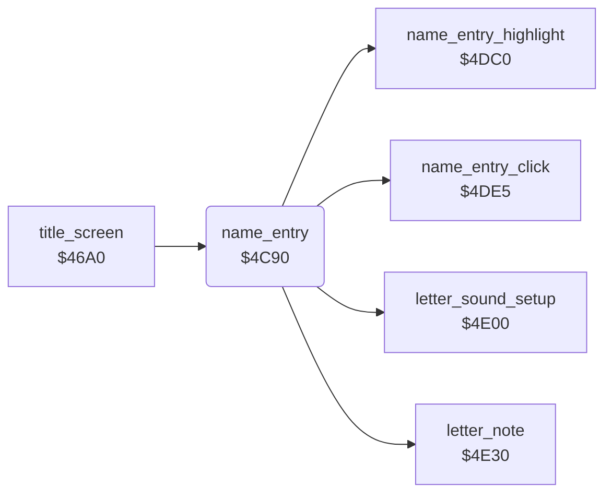

<!-- Generated by c64-docs from knowledge revision 20261024T103119.179-vx1fei and .c64-re-tools/local/generated/src/source-map.json. Do not edit: change the knowledge, generate the source again, then run docs.ts generate. -->
# highscore/name_entry.asm: Name entry for the high-score table

Range `$4C90-$4D76`. Source: [highscore/name_entry.asm](../../../../src/highscore/name_entry.asm). Index: [the reference](../../index.md).

## Call graph

A solid arrow is a call, a thick arrow a table entry, a dotted arrow a jump. Rounded nodes are in this file.

## Names

### [`name_entry`](../../../../src/highscore/name_entry.asm#L6) `$4C90`

*routine*

Name entry. Input: Y = 5-1 from $4c40. Writes the score into the table row and lets the player select letters with left/right and FIRE (at most 12). The name is played as notes and written into the row.

- **Called from:** [`title_screen`](../title/title_screen.md#title_screen) [`$46DF`](../../../../src/title/title_screen.asm#L44)
- **Calls:** [`name_entry_highlight`](name_entry_helpers.md#name_entry_highlight), [`name_entry_click`](name_entry_helpers_4de5.md#name_entry_click), [`letter_sound_setup`](name_entry_helpers_4e00.md#letter_sound_setup), [`letter_note`](name_entry_helpers_4e30.md#letter_note)
- **Reads:** [`screen_ptr`](../../memory-map.md#screen_ptr), [`screen_ptr_hi`](../../memory-map.md#screen_ptr_hi), [`score`](../../memory-map.md#score), [`colour_ptr`](../../memory-map.md#colour_ptr), [`CIAPRB`](../../memory-map.md#CIAPRB), [`joy_bits`](../../memory-map.md#joy_bits), [`temp`](../../memory-map.md#temp), [`name_entry_text`](../../memory-map.md#name_entry_text), [`tick`](../../memory-map.md#tick)
- **Writes:** [`screen_ptr`](../../memory-map.md#screen_ptr), [`screen_ptr_hi`](../../memory-map.md#screen_ptr_hi), [`colour_ptr`](../../memory-map.md#colour_ptr), [`colour_ptr_hi`](../../memory-map.md#colour_ptr_hi), [`temp2`](../../memory-map.md#temp2), [`temp`](../../memory-map.md#temp), [`joy_bits`](../../memory-map.md#joy_bits), [`name_entry_text`](../../memory-map.md#name_entry_text), [`tick`](../../memory-map.md#tick), [`CUTHI`](../../memory-map.md#CUTHI), [`VCREG1`](../../memory-map.md#VCREG1)

### [`name_entry_find_row`](../../../../src/highscore/name_entry.asm#L8) `$4C98`

*label*

$05/$06 = $0a12 (row 4) minus $50 for each step.

- **Jumped to from:** [`name_entry`](name_entry.md#name_entry) [`$4CA2`](../../../../src/highscore/name_entry.asm#L15), [`name_entry`](name_entry.md#name_entry) [`$4CA6`](../../../../src/highscore/name_entry.asm#L17)

### [`name_entry_copy_score`](../../../../src/highscore/name_entry.asm#L18) `$4CA8`

*label*

- **Jumped to from:** [`name_entry`](name_entry.md#name_entry) [`$4C99`](../../../../src/highscore/name_entry.asm#L10)

### [`name_entry_copy_digit`](../../../../src/highscore/name_entry.asm#L20) `$4CAA`

*label*

- **Jumped to from:** [`name_entry`](name_entry.md#name_entry) [`$4CB0`](../../../../src/highscore/name_entry.asm#L24)

### [`name_entry_clear_name`](../../../../src/highscore/name_entry.asm#L27) `$4CB6`

*label*

- **Jumped to from:** [`name_entry`](name_entry.md#name_entry) [`$4CBB`](../../../../src/highscore/name_entry.asm#L31)

### [`name_entry_colour_row`](../../../../src/highscore/name_entry.asm#L43) `$4CCF`

*label*

26 cells in white.

- **Jumped to from:** [`name_entry`](name_entry.md#name_entry) [`$4CD4`](../../../../src/highscore/name_entry.asm#L47)

### [`name_entry_select`](../../../../src/highscore/name_entry.asm#L54) `$4CDF`

*label*

Highlights letter X and waits ($4dc0). Then reads port 1: FIRE takes the letter, left/right move X through 28 letters.

- **Jumped to from:** [`name_entry`](name_entry.md#name_entry) [`$4CF2`](../../../../src/highscore/name_entry.asm#L65), [`name_entry`](name_entry.md#name_entry) [`$4CF6`](../../../../src/highscore/name_entry.asm#L67), [`name_entry`](name_entry.md#name_entry) [`$4CFC`](../../../../src/highscore/name_entry.asm#L71), [`name_entry`](name_entry.md#name_entry) [`$4D01`](../../../../src/highscore/name_entry.asm#L74), [`name_entry`](name_entry.md#name_entry) [`$4D05`](../../../../src/highscore/name_entry.asm#L77), [`name_entry`](name_entry.md#name_entry) [`$4D2B`](../../../../src/highscore/name_entry.asm#L100)

### [`name_entry_check_right`](../../../../src/highscore/name_entry.asm#L68) `$4CF8`

*label*

- **Jumped to from:** [`name_entry`](name_entry.md#name_entry) [`$4CEF`](../../../../src/highscore/name_entry.asm#L62)

### [`name_entry_fire`](../../../../src/highscore/name_entry.asm#L78) `$4D07`

*label*

Letter $1b (the end mark) ends the entry.

- **Jumped to from:** [`name_entry`](name_entry.md#name_entry) [`$4CE9`](../../../../src/highscore/name_entry.asm#L59)

### [`name_entry_wait_release`](../../../../src/highscore/name_entry.asm#L96) `$4D24`

*label*

- **Jumped to from:** [`name_entry`](name_entry.md#name_entry) [`$4D29`](../../../../src/highscore/name_entry.asm#L99)

### [`name_entry_store_name`](../../../../src/highscore/name_entry.asm#L106) `$4D2F`

*label*

Copies the 12 cells of the name buffer to the bytes 11-22 of the row. Plays each letter as a note with a falling filter cutoff.

- **Jumped to from:** [`name_entry`](name_entry.md#name_entry) [`$4D09`](../../../../src/highscore/name_entry.asm#L80), [`name_entry`](name_entry.md#name_entry) [`$4D22`](../../../../src/highscore/name_entry.asm#L95)

### [`name_entry_store_char`](../../../../src/highscore/name_entry.asm#L110) `$4D36`

*label*

- **Jumped to from:** [`name_entry`](name_entry.md#name_entry) [`$4D5B`](../../../../src/highscore/name_entry.asm#L133)

### [`name_entry_note_delay`](../../../../src/highscore/name_entry.asm#L119) `$4D46`

*label*

- **Jumped to from:** [`name_entry`](name_entry.md#name_entry) [`$4D48`](../../../../src/highscore/name_entry.asm#L121), [`name_entry`](name_entry.md#name_entry) [`$4D4E`](../../../../src/highscore/name_entry.asm#L124)

### [`name_entry_next_char`](../../../../src/highscore/name_entry.asm#L129) `$4D57`

*label*

- **Jumped to from:** [`name_entry`](name_entry.md#name_entry) [`$4D3D`](../../../../src/highscore/name_entry.asm#L114)

### [`name_entry_clear_buffer`](../../../../src/highscore/name_entry.asm#L136) `$4D61`

*label*

- **Jumped to from:** [`name_entry`](name_entry.md#name_entry) [`$4D65`](../../../../src/highscore/name_entry.asm#L139)

### [`name_entry_final_release`](../../../../src/highscore/name_entry.asm#L142) `$4D6C`

*label*

- **Jumped to from:** [`name_entry`](name_entry.md#name_entry) [`$4D71`](../../../../src/highscore/name_entry.asm#L145)
