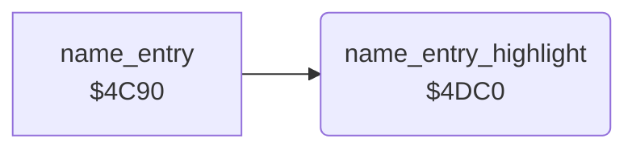

<!-- Generated by c64-docs from knowledge revision 20261025T214607.441-00m56k and .c64-re-tools/local/generated/src/source-map.json. Do not edit: change the knowledge, generate the source again, then run docs.ts generate. -->
# highscore/name_entry_helpers.asm: Letter highlight and the sounds of the name entry

Range `$4DC0-$4DE2`. Source: [highscore/name_entry_helpers.asm](../../../../src/highscore/name_entry_helpers.asm). Index: [the reference](../../index.md).

## Routines

| Routine | Address | Reached from | Summary |
|---|---|---|---|
| [`name_entry_highlight`](name_entry_helpers.md#name_entry_highlight) | `$4DC0` | [`name_entry`](name_entry.md#name_entry) | Highlights letter X of the letter row (colour RAM $db4e): the old letter $2f goes back to colour 4, letter X gets colour 1. |

## Call graph

A solid arrow is a call, a thick arrow a table entry. Rounded nodes are in this file.

## Details

### [`name_entry_highlight`](../../../../src/highscore/name_entry_helpers.asm#L6) `$4DC0`

*routine*

Highlights letter X of the letter row (colour RAM $db4e): the old letter $2f goes back to colour 4, letter X gets colour 1. Then waits. X does not change.

- **Called from:** [`name_entry`](name_entry.md#name_entry)
- **Reads:** [`temp2`](../../memory-map.md#temp2), [`tick`](../../memory-map.md#tick)
- **Writes:** `$DB4E`, [`temp2`](../../memory-map.md#temp2), [`tick`](../../memory-map.md#tick)

| Label | Address | Comment |
|---|---|---|
| [`name_entry_highlight_wait`](../../../../src/highscore/name_entry_helpers.asm#L20) | `$4DD7` |  |
| [`name_entry_highlight_delay`](../../../../src/highscore/name_entry_helpers.asm#L24) | `$4DDB` |  |
