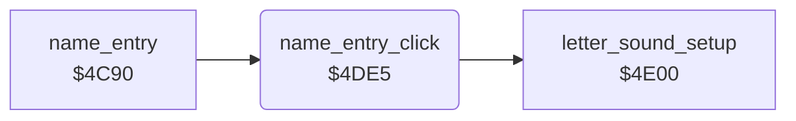

<!-- Generated by c64-docs from knowledge revision 20261025T214607.441-00m56k and .c64-re-tools/local/generated/src/source-map.json. Do not edit: change the knowledge, generate the source again, then run docs.ts generate. -->
# highscore/name_entry_helpers_4de5.asm

Range `$4DE5-$4DFC`. Source: [highscore/name_entry_helpers_4de5.asm](../../../../src/highscore/name_entry_helpers_4de5.asm). Index: [the reference](../../index.md).

## Routines

| Routine | Address | Reached from | Summary |
|---|---|---|---|
| [`name_entry_click`](name_entry_helpers_4de5.md#name_entry_click) | `$4DE5` | [`name_entry`](name_entry.md#name_entry) | Shows the new letter X of the name buffer in white and plays a click on voice 1 (triangle). |

## Call graph

A solid arrow is a call, a thick arrow a table entry. Rounded nodes are in this file.

## Details

### [`name_entry_click`](../../../../src/highscore/name_entry_helpers_4de5.asm#L6) `$4DE5`

*routine*

Shows the new letter X of the name buffer in white and plays a click on voice 1 (triangle).

- **Called from:** [`name_entry`](name_entry.md#name_entry)
- **Calls:** [`letter_sound_setup`](name_entry_helpers_4e00.md#letter_sound_setup)
- **Writes:** `$DAB4`, [`RESON`](../../memory-map.md#RESON), [`ATDCY1`](../../memory-map.md#ATDCY1), [`VCREG1`](../../memory-map.md#VCREG1)
