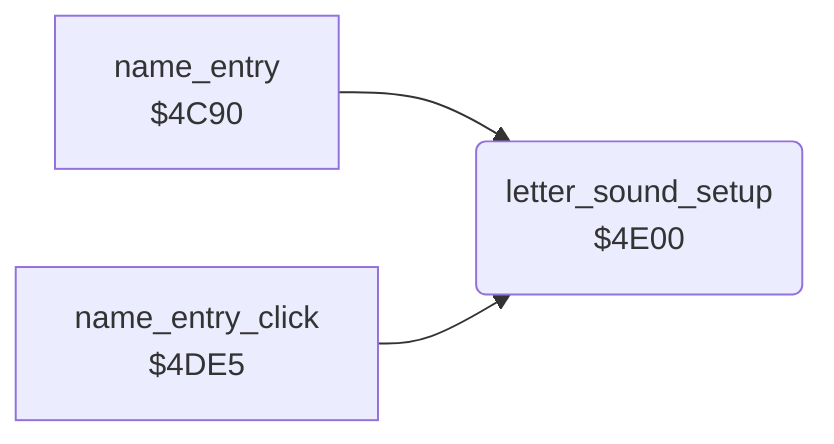

<!-- Generated by c64-docs from knowledge revision 20261025T214607.441-00m56k and .c64-re-tools/local/generated/src/source-map.json. Do not edit: change the knowledge, generate the source again, then run docs.ts generate. -->
# highscore/name_entry_helpers_4e00.asm

Range `$4E00-$4E24`. Source: [highscore/name_entry_helpers_4e00.asm](../../../../src/highscore/name_entry_helpers_4e00.asm). Index: [the reference](../../index.md).

## Routines

| Routine | Address | Reached from | Summary |
|---|---|---|---|
| [`letter_sound_setup`](name_entry_helpers_4e00.md#letter_sound_setup) | `$4E00` | [`name_entry`](name_entry.md#name_entry), [`name_entry_click`](name_entry_helpers_4de5.md#name_entry_click) | Sets the SID for the letter sounds: voice 1 gate off, attack/decay $3a, voice 1 through the filter with resonance 15, cutoff $7f, low-pass and volume 15. |

## Call graph

A solid arrow is a call, a thick arrow a table entry. Rounded nodes are in this file.

## Details

### [`letter_sound_setup`](../../../../src/highscore/name_entry_helpers_4e00.asm#L6) `$4E00`

*routine*

Sets the SID for the letter sounds: voice 1 gate off, attack/decay $3a, voice 1 through the filter with resonance 15, cutoff $7f, low-pass and volume 15.

- **Called from:** [`name_entry`](name_entry.md#name_entry), [`name_entry_click`](name_entry_helpers_4de5.md#name_entry_click)
- **Writes:** [`VCREG1`](../../memory-map.md#VCREG1), [`ATDCY1`](../../memory-map.md#ATDCY1), [`SUREL1`](../../memory-map.md#SUREL1), [`RESON`](../../memory-map.md#RESON), [`CUTHI`](../../memory-map.md#CUTHI), [`SIGVOL`](../../memory-map.md#SIGVOL), [`FREHI1`](../../memory-map.md#FREHI1)
