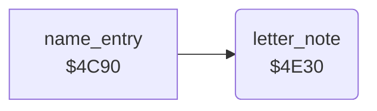

<!-- Generated by c64-docs from knowledge revision 20261025T214607.441-00m56k and .c64-re-tools/local/generated/src/source-map.json. Do not edit: change the knowledge, generate the source again, then run docs.ts generate. -->
# highscore/name_entry_helpers_4e30.asm

Range `$4E30-$4E4C`. Source: [highscore/name_entry_helpers_4e30.asm](../../../../src/highscore/name_entry_helpers_4e30.asm). Index: [the reference](../../index.md).

## Routines

| Routine | Address | Reached from | Summary |
|---|---|---|---|
| [`letter_note`](name_entry_helpers_4e30.md#letter_note) | `$4E30` | [`name_entry`](name_entry.md#name_entry) | Plays the note of a letter on voice 1. |

## Call graph

A solid arrow is a call, a thick arrow a table entry. Rounded nodes are in this file.

## Details

### [`letter_note`](../../../../src/highscore/name_entry_helpers_4e30.asm#L6) `$4E30`

*routine*

Plays the note of a letter on voice 1. Input: A = screen code ($80 + letter index). The frequency comes from the tables $2fe0 (low) and $2fc0 (high). X does not change.

- **Called from:** [`name_entry`](name_entry.md#name_entry)
- **Reads:** [`bomb_row`](../../memory-map.md#bomb_row), [`letter_pitch_lo`](../data/letter_pitches.md#letter_pitch_lo), [`letter_pitch_hi`](../data/letter_pitches.md#letter_pitch_hi)
- **Writes:** [`bomb_row`](../../memory-map.md#bomb_row), [`FRELO1`](../../memory-map.md#FRELO1), [`FREHI1`](../../memory-map.md#FREHI1), [`VCREG1`](../../memory-map.md#VCREG1)
