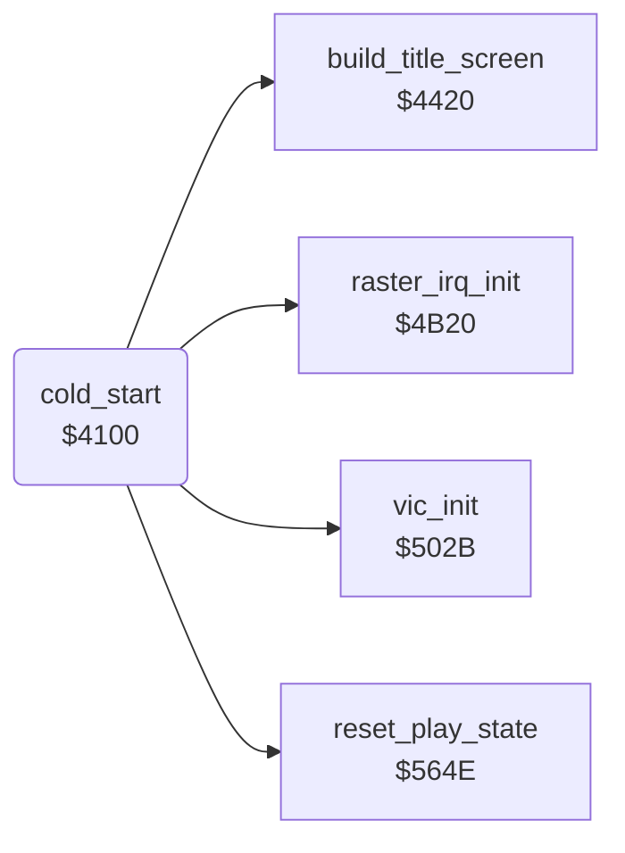

<!-- Generated by c64-docs from knowledge revision 20261024T103119.179-vx1fei and .c64-re-tools/local/generated/src/source-map.json. Do not edit: change the knowledge, generate the source again, then run docs.ts generate. -->
# init/cold_start.asm: Cold start

Range `$4100-$413F`. Source: [init/cold_start.asm](../../../../src/init/cold_start.asm). Index: [the reference](../../index.md).

## Call graph

A solid arrow is a call, a thick arrow a table entry, a dotted arrow a jump. Rounded nodes are in this file.

## Names

### [`cold_start`](../../../../src/init/cold_start.asm#L6) `$4100`

*routine*

Program entry (SYS 16640). Clears the zero page $03-$72, starts the CIA 2 timers, sets the IRQ and builds the title screen. Then it goes to the title.

- **Calls:** [`vic_init`](vic_setup.md#vic_init), [`reset_play_state`](../game/jet_lost.md#reset_play_state), [`raster_irq_init`](../irq/raster_irq_4b20.md#raster_irq_init), [`build_title_screen`](../title/title_layout.md#build_title_screen)
- **Jumps to:** [`show_title`](../game/main_loop.md#show_title)
- **Reads:** `$003B`
- **Writes:** `$0002`, [`bomb_sprite_ptrs`](../../memory-map.md#bomb_sprite_ptrs), [`SPRPTR+6`](../../memory-map.md#SPRPTR), [`CIAICR`](../../memory-map.md#CIAICR), [`CI2CRA`](../../memory-map.md#CI2CRA), [`CI2CRB`](../../memory-map.md#CI2CRB), [`launch_delay`](../../memory-map.md#launch_delay), [`wave_size`](../../memory-map.md#wave_size), `$003B`
- **Refers to:** [`bomb_sprite`](../data/sprites_2200.md#bomb_sprite)

### [`cold_start_clear_zp`](../../../../src/init/cold_start.asm#L10) `$4105`

*label*

- **Jumped to from:** [`cold_start`](cold_start.md#cold_start) [`$4108`](../../../../src/init/cold_start.asm#L13)

### [`cold_start_set_ff`](../../../../src/init/cold_start.asm#L30) `$412D`

*label*

$3c-$43 go from 0 to $ff. $5662 also sets them to $ff.

- **Jumped to from:** [`cold_start`](cold_start.md#cold_start) [`$4130`](../../../../src/init/cold_start.asm#L33)
