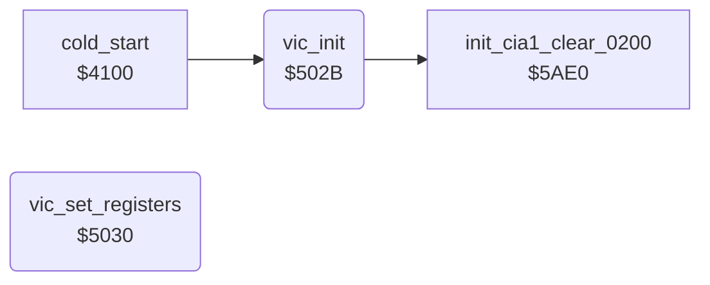

<!-- Generated by c64-docs from knowledge revision 20261024T103119.179-vx1fei and .c64-re-tools/local/generated/src/source-map.json. Do not edit: change the knowledge, generate the source again, then run docs.ts generate. -->
# init/vic_setup.asm: VIC register setup

Range `$502B-$503F`. Source: [init/vic_setup.asm](../../../../src/init/vic_setup.asm). Index: [the reference](../../index.md).

## Call graph

A solid arrow is a call, a thick arrow a table entry, a dotted arrow a jump. Rounded nodes are in this file.

## Names

### [`vic_init`](../../../../src/init/vic_setup.asm#L6) `$502B`

*routine*

Cold start part: calls $5ae0, then sets the VIC registers from the table at $4310.

- **Called from:** [`cold_start`](cold_start.md#cold_start) [`$4113`](../../../../src/init/cold_start.asm#L18)
- **Calls:** [`init_cia1_clear_0200`](cia1_ports_init.md#init_cia1_clear_0200)

### [`vic_set_registers`](../../../../src/init/vic_setup.asm#L11) `$5030`

*routine*

Copies the table $4310-$433e to the VIC registers $d000-$d02e. A table byte $ff keeps the register unchanged. Changes X and A.

- **Called from:** [`$4147`](../../../../src/game/main_loop.asm#L12)
- **Reads:** [`vic_init_table`](../data/vic_init_table.md#vic_init_table)
- **Writes:** [`SP0X`](../../memory-map.md#SP0X)

### [`vic_set_registers_loop`](../../../../src/init/vic_setup.asm#L13) `$5032`

*label*

- **Jumped to from:** [`vic_set_registers`](vic_setup.md#vic_set_registers) [`$503D`](../../../../src/init/vic_setup.asm#L20)

### [`vic_set_registers_next`](../../../../src/init/vic_setup.asm#L18) `$503C`

*label*

- **Jumped to from:** [`vic_set_registers`](vic_setup.md#vic_set_registers) [`$5037`](../../../../src/init/vic_setup.asm#L16)
