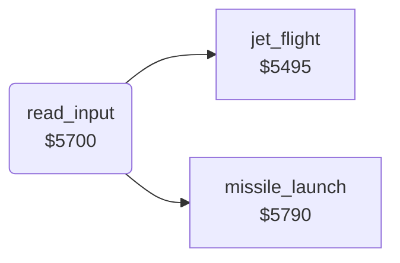

<!-- Generated by c64-docs from knowledge revision 20261024T103119.179-vx1fei and .c64-re-tools/local/generated/src/source-map.json. Do not edit: change the knowledge, generate the source again, then run docs.ts generate. -->
# input/read_input.asm: Joystick input and its masks

Range `$5700-$578F`. Source: [input/read_input.asm](../../../../src/input/read_input.asm). Index: [the reference](../../index.md).

## Call graph

A solid arrow is a call, a thick arrow a table entry, a dotted arrow a jump. Rounded nodes are in this file.

## Names

### [`read_input`](../../../../src/input/read_input.asm#L6) `$5700`

*routine*

Reads port 1 into joy_bits and masks it with the jet height and jet_state. Then runs jet_flight, and missile_launch on FIRE.

- **Called from:** [`$4199`](../../../../src/game/main_loop.asm#L63)
- **Calls:** [`jet_flight`](../player/flight.md#jet_flight), [`missile_launch`](../missile/missile_launch.md#missile_launch)
- **Reads:** [`CIAPRB`](../../memory-map.md#CIAPRB), [`SP0Y`](../../memory-map.md#SP0Y), [`joy_bits`](../../memory-map.md#joy_bits), [`jet_state`](../../memory-map.md#jet_state), [`SPRPTR`](../../memory-map.md#SPRPTR)
- **Writes:** [`joy_bits`](../../memory-map.md#joy_bits), [`jet_climb`](../../memory-map.md#jet_climb), [`jet_speed_x`](../../memory-map.md#jet_speed_x), [`jet_state`](../../memory-map.md#jet_state)

### [`read_input_stop_climb`](../../../../src/input/read_input.asm#L15) `$5712`

*label*

- **Jumped to from:** [`read_input`](read_input.md#read_input) [`$5722`](../../../../src/input/read_input.asm#L26)

### [`read_input_check_low`](../../../../src/input/read_input.asm#L19) `$5718`

*label*

Y >= $bf: masks DOWN and stops the climb. Never executed.

- **Jumped to from:** [`read_input`](read_input.md#read_input) [`$570A`](../../../../src/input/read_input.asm#L11)

### [`read_input_check_fire`](../../../../src/input/read_input.asm#L27) `$5724`

*label*

- **Jumped to from:** [`read_input`](read_input.md#read_input) [`$5716`](../../../../src/input/read_input.asm#L18), [`read_input`](read_input.md#read_input) [`$571A`](../../../../src/input/read_input.asm#L21)

### [`read_input_check_landed`](../../../../src/input/read_input.asm#L34) `$5731`

*label*

Bit 1 (landed): only UP stays.

- **Jumped to from:** [`read_input`](read_input.md#read_input) [`$5729`](../../../../src/input/read_input.asm#L30)

### [`read_input_check_forced`](../../../../src/input/read_input.asm#L41) `$573D`

*label*

- **Jumped to from:** [`read_input`](read_input.md#read_input) [`$5735`](../../../../src/input/read_input.asm#L37)

### [`read_input_check_bottom`](../../../../src/input/read_input.asm#L60) `$5760`

*label*

- **Jumped to from:** [`read_input`](read_input.md#read_input) [`$5741`](../../../../src/input/read_input.asm#L44), [`read_input`](read_input.md#read_input) [`$574B`](../../../../src/input/read_input.asm#L49), [`read_input`](read_input.md#read_input) [`$5752`](../../../../src/input/read_input.asm#L52)

### [`read_input_fly`](../../../../src/input/read_input.asm#L81) `$5780`

*label*

- **Jumped to from:** [`read_input`](read_input.md#read_input) [`$5765`](../../../../src/input/read_input.asm#L63), [`read_input`](read_input.md#read_input) [`$5772`](../../../../src/input/read_input.asm#L72)

### [`read_input_done`](../../../../src/input/read_input.asm#L90) `$578F`

*label*

- **Jumped to from:** [`read_input`](read_input.md#read_input) [`$5787`](../../../../src/input/read_input.asm#L85)
