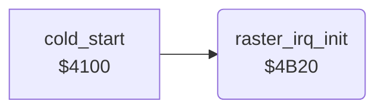

<!-- Generated by c64-docs from knowledge revision 20261024T103119.179-vx1fei and .c64-re-tools/local/generated/src/source-map.json. Do not edit: change the knowledge, generate the source again, then run docs.ts generate. -->
# irq/raster_irq_4b20.asm

Range `$4B20-$4B55`. Source: [irq/raster_irq_4b20.asm](../../../../src/irq/raster_irq_4b20.asm). Index: [the reference](../../index.md).

## Call graph

A solid arrow is a call, a thick arrow a table entry, a dotted arrow a jump. Rounded nodes are in this file.

## Names

### [`raster_irq_init`](../../../../src/irq/raster_irq_4b20.asm#L6) `$4B20`

*routine*

Sets the IRQ vector $0314 to $4ac0, enables only the raster IRQ at line $8a and disables the CIA 1 interrupts. Waits for line $fe, then sets irq_phase to 0.

- **Called from:** [`cold_start`](../init/cold_start.md#cold_start) [`$4135`](../../../../src/init/cold_start.asm#L35)
- **Reads:** [`RASTER`](../../memory-map.md#RASTER)
- **Writes:** [`CINV`](../../memory-map.md#CINV), [`CINV+1`](../../memory-map.md#CINV), [`IRQMSK`](../../memory-map.md#IRQMSK), [`CIAICR`](../../memory-map.md#CIAICR), [`SCROLY`](../../memory-map.md#SCROLY), [`RASTER`](../../memory-map.md#RASTER), [`BGCOL0`](../../memory-map.md#BGCOL0), [`irq_phase`](../../memory-map.md#irq_phase), [`VICIRQ`](../../memory-map.md#VICIRQ)

### [`raster_irq_init_wait`](../../../../src/irq/raster_irq_4b20.asm#L19) `$4B44`

*label*

- **Jumped to from:** [`raster_irq_init`](raster_irq_4b20.md#raster_irq_init) [`$4B49`](../../../../src/irq/raster_irq_4b20.asm#L22)
