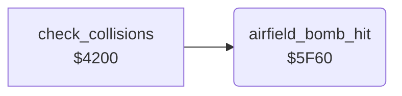

<!-- Generated by c64-docs from knowledge revision 20261024T103119.179-vx1fei and .c64-re-tools/local/generated/src/source-map.json. Do not edit: change the knowledge, generate the source again, then run docs.ts generate. -->
# landscape/airfield_bombing.asm: Airfield destroyed by a bomb, and restore

Range `$5F60-$5FBF`. Source: [landscape/airfield_bombing.asm](../../../../src/landscape/airfield_bombing.asm). Index: [the reference](../../index.md).

## Call graph

A solid arrow is a call, a thick arrow a table entry, a dotted arrow a jump. Rounded nodes are in this file.

## Names

### [`airfield_bomb_hit`](../../../../src/landscape/airfield_bombing.asm#L6) `$5F60`

*routine*

A bomb hit row 12. Starts 11 columns left of the hit in the map row $3800 and finds the next $16 (airfield) or $6f (destroyed). It changes the airfield $16 $17 $16 $17 to $6f $70 $6f $70, also on the screen at $05e0 in black. A jet on the pad ($22 bit 1) is lost.
Y is $ff here: screen_cell_address leaves it. $05 is the low byte of the hit cell.

- **Called from:** [`check_collisions`](../game/collisions.md#check_collisions) [`$42AF`](../../../../src/game/collisions.asm#L124)
- **Reads:** [`screen_ptr`](../../memory-map.md#screen_ptr), [`map_column`](../../memory-map.md#map_column), [`landscape_map`](../data/map.md#landscape_map), [`temp`](../../memory-map.md#temp), [`jet_state`](../../memory-map.md#jet_state)
- **Writes:** [`landscape_map`](../data/map.md#landscape_map), [`temp`](../../memory-map.md#temp), [`landscape_screen`](../../memory-map.md#landscape_screen), `$D9E0`, [`jet_state`](../../memory-map.md#jet_state)

### [`airfield_find_loop`](../../../../src/landscape/airfield_bombing.asm#L15) `$5F6B`

*label*

- **Jumped to from:** [`airfield_bomb_hit`](airfield_bombing.md#airfield_bomb_hit) [`$5F78`](../../../../src/landscape/airfield_bombing.asm#L23)

### [`airfield_destroy`](../../../../src/landscape/airfield_bombing.asm#L26) `$5F7B`

*label*

- **Jumped to from:** [`airfield_bomb_hit`](airfield_bombing.md#airfield_bomb_hit) [`$5F70`](../../../../src/landscape/airfield_bombing.asm#L18)

### [`airfield_destroy_loop`](../../../../src/landscape/airfield_bombing.asm#L28) `$5F7D`

*label*

- **Jumped to from:** [`airfield_bomb_hit`](airfield_bombing.md#airfield_bomb_hit) [`$5FA7`](../../../../src/landscape/airfield_bombing.asm#L55)

### [`airfield_destroy_other`](../../../../src/landscape/airfield_bombing.asm#L34) `$5F88`

*label*

- **Jumped to from:** [`airfield_bomb_hit`](airfield_bombing.md#airfield_bomb_hit) [`$5F82`](../../../../src/landscape/airfield_bombing.asm#L31)

### [`airfield_destroy_store`](../../../../src/landscape/airfield_bombing.asm#L36) `$5F8A`

*label*

- **Jumped to from:** [`airfield_bomb_hit`](airfield_bombing.md#airfield_bomb_hit) [`$5F86`](../../../../src/landscape/airfield_bombing.asm#L33)

### [`airfield_destroy_next`](../../../../src/landscape/airfield_bombing.asm#L50) `$5FA3`

*label*

- **Jumped to from:** [`airfield_bomb_hit`](airfield_bombing.md#airfield_bomb_hit) [`$5F97`](../../../../src/landscape/airfield_bombing.asm#L45)

### [`airfield_bomb_done`](../../../../src/landscape/airfield_bombing.asm#L72) `$5FBF`

*label*

- **Jumped to from:** [`airfield_bomb_hit`](airfield_bombing.md#airfield_bomb_hit) [`$5F74`](../../../../src/landscape/airfield_bombing.asm#L20), [`airfield_bomb_hit`](airfield_bombing.md#airfield_bomb_hit) [`$5FAD`](../../../../src/landscape/airfield_bombing.asm#L58)
