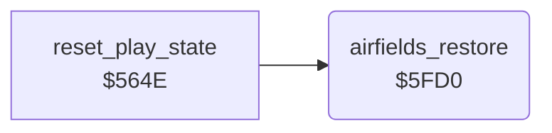

<!-- Generated by c64-docs from knowledge revision 20261024T103119.179-vx1fei and .c64-re-tools/local/generated/src/source-map.json. Do not edit: change the knowledge, generate the source again, then run docs.ts generate. -->
# landscape/airfield_bombing_5fd0.asm

Range `$5FD0-$6000`. Source: [landscape/airfield_bombing_5fd0.asm](../../../../src/landscape/airfield_bombing_5fd0.asm). Index: [the reference](../../index.md).

## Call graph

A solid arrow is a call, a thick arrow a table entry, a dotted arrow a jump. Rounded nodes are in this file.

## Data

| Range | Type | Name | Read by | Written by |
|---|---|---|---|---|
| [`$5FEA`](../../../../src/landscape/airfield_bombing_5fd0.asm#L25)-`$5FFF` | unused |  |  |  |
| [`$6000`](../../../../src/landscape/airfield_bombing_5fd0.asm#L45)-`$FFFF` | bytes | [`panel_bar_buffer`](../../../../src/landscape/airfield_bombing_5fd0.asm#L37) | `$41C0`, [`check_collisions`](../game/collisions.md#check_collisions), [`animate_enemy_sprites`](../enemy/enemy_frames.md#animate_enemy_sprites), [`set_jet_lost`](../player/jet_lost.md#set_jet_lost), [`start_enemy_wave`](../enemy/enemy_waves.md#start_enemy_wave), [`steer_enemies`](../enemy/enemy_waves.md#steer_enemies), [`title_screen`](../title/title_screen.md#title_screen), [`position_enemy_sprites`](../enemy/enemy_positions.md#position_enemy_sprites), [`sound_update`](../sound/sound_update.md#sound_update), [`set_wave_size`](../enemy/wave_size.md#set_wave_size), [`raster_irq_init`](../irq/raster_irq_4b20.md#raster_irq_init), [`title_tune`](../title/title_tune.md#title_tune), [`name_entry`](../highscore/name_entry.md#name_entry), [`draw_gas_gauge`](../panel/panel_draw_4ea0.md#draw_gas_gauge), [`title_wait_fire`](../title/title_wait_fire.md#title_wait_fire), [`sprite7_follow_jet`](../player/sprite7_follow.md#sprite7_follow_jet), [`jet_lower_to_start`](../player/jet_start.md#jet_lower_to_start), [`wait_fire_to_start`](../game/wait_fire.md#wait_fire_to_start), [`unused_input_masks`](../player/flight.md#unused_input_masks), [`jet_flight`](../player/flight.md#jet_flight), [`landing_check`](../player/landing.md#landing_check), [`jet_lost_animate`](../player/jet_lost_animation.md#jet_lost_animate), [`read_input`](../input/read_input.md#read_input), [`missile_launch`](../missile/missile_launch.md#missile_launch), [`enemy_shot_spawn`](../enemy/enemy_shot_spawn.md#enemy_shot_spawn), [`bomb_drop`](../enemy/enemy_bombs_5c00.md#bomb_drop), [`bomb_sprites_place`](../enemy/enemy_bombs_5d00.md#bomb_sprites_place), [`sprite_cell_under`](../game/sprite_cell.md#sprite_cell_under), [`crater_chars_animate`](../graphics/crater_chars_animate.md#crater_chars_animate) | [`cold_start`](../init/cold_start.md#cold_start), `$4187`, `$418C`, `$41E0`, `$41E8`, [`animate_enemy_sprites`](../enemy/enemy_frames.md#animate_enemy_sprites), [`set_title_colours`](../title/title_layout_4480.md#set_title_colours), [`draw_title_texts`](../title/title_layout_44a0.md#draw_title_texts), [`draw_title_heading`](../title/title_layout_44c0.md#draw_title_heading), [`title_screen`](../title/title_screen.md#title_screen), [`position_enemy_sprites`](../enemy/enemy_positions.md#position_enemy_sprites), [`sound_update`](../sound/sound_update.md#sound_update), [`refuel_tone`](../sound/sound_update_4880.md#refuel_tone), [`engine_cutoff_down`](../sound/sound_update_48e0.md#engine_cutoff_down), [`fuel_alarm`](../sound/fuel_alarm.md#fuel_alarm), [`engine_sound_start`](../sound/sound_start.md#engine_sound_start), [`crash_fall_sound_start`](../sound/sound_start_4990.md#crash_fall_sound_start), [`crash_ground_sound_start`](../sound/sound_start_49c0.md#crash_ground_sound_start), [`voice2_reset`](../sound/sound_start_49f0.md#voice2_reset), [`refuel_tone_start`](../sound/sound_start_49f0.md#refuel_tone_start), [`fuel_alarm_sound_start`](../sound/sound_start_4a60.md#fuel_alarm_sound_start), [`raster_irq`](../irq/raster_irq.md#raster_irq), [`raster_irq_init`](../irq/raster_irq_4b20.md#raster_irq_init), [`title_tune`](../title/title_tune.md#title_tune), [`title_tune_stop`](../title/title_tune_4c0e.md#title_tune_stop), [`sid_clear`](../title/title_tune_4c30.md#sid_clear), [`name_entry`](../highscore/name_entry.md#name_entry), [`name_entry_highlight`](../highscore/name_entry_helpers.md#name_entry_highlight), [`name_entry_click`](../highscore/name_entry_helpers_4de5.md#name_entry_click), [`letter_sound_setup`](../highscore/name_entry_helpers_4e00.md#letter_sound_setup), [`letter_note`](../highscore/name_entry_helpers_4e30.md#letter_note), [`fill_row11_char_9e`](row11_fill.md#fill_row11_char_9e), [`draw_panel`](../panel/panel_draw.md#draw_panel), [`draw_gas_gauge`](../panel/panel_draw_4ea0.md#draw_gas_gauge), [`extra_jet_beep`](../sound/extra_jet_beep.md#extra_jet_beep), [`extra_jet_sound_start`](../sound/extra_jet_beep_4fd0.md#extra_jet_sound_start), [`unused_draw_lives`](../leftovers/leftover_5020.md#unused_draw_lives), [`vic_set_registers`](../init/vic_setup.md#vic_set_registers), [`sprite7_follow_jet`](../player/sprite7_follow.md#sprite7_follow_jet), [`unused_fill_panel`](../leftovers/leftover_515d.md#unused_fill_panel) and 12 more |

## Names

### [`airfields_restore`](../../../../src/landscape/airfield_bombing_5fd0.asm#L6) `$5FD0`

*routine*

Restores all airfields of the map row $3800-$38ff: $6f to $16 and $70 to $17. Called from $564e when the jet is lost.

- **Called from:** [`reset_play_state`](../game/jet_lost.md#reset_play_state) [`$564E`](../../../../src/game/jet_lost.asm#L16)
- **Reads:** [`landscape_map`](../data/map.md#landscape_map)
- **Writes:** [`landscape_map`](../data/map.md#landscape_map)

### [`airfields_restore_loop`](../../../../src/landscape/airfield_bombing_5fd0.asm#L8) `$5FD2`

*label*

- **Jumped to from:** [`airfields_restore`](airfield_bombing_5fd0.md#airfields_restore) [`$5FE7`](../../../../src/landscape/airfield_bombing_5fd0.asm#L22)

### [`airfields_restore_check_70`](../../../../src/landscape/airfield_bombing_5fd0.asm#L14) `$5FDD`

*label*

- **Jumped to from:** [`airfields_restore`](airfield_bombing_5fd0.md#airfields_restore) [`$5FD7`](../../../../src/landscape/airfield_bombing_5fd0.asm#L11)

### [`airfields_restore_store`](../../../../src/landscape/airfield_bombing_5fd0.asm#L18) `$5FE3`

*label*

- **Jumped to from:** [`airfields_restore`](airfield_bombing_5fd0.md#airfields_restore) [`$5FDB`](../../../../src/landscape/airfield_bombing_5fd0.asm#L13)

### [`airfields_restore_next`](../../../../src/landscape/airfield_bombing_5fd0.asm#L20) `$5FE6`

*label*

- **Jumped to from:** [`airfields_restore`](airfield_bombing_5fd0.md#airfields_restore) [`$5FDF`](../../../../src/landscape/airfield_bombing_5fd0.asm#L16)

### [`panel_bar_buffer`](../../../../src/landscape/airfield_bombing_5fd0.asm#L37) `$6000-$CFFF`

*variable*

Work buffer of 9 characters at $6000-$6008 outside the game file. $4ea0 fills it with $20, $a0 and $b4 and copies it to the screen at $078f.

- **Read by:** [`draw_gas_gauge`](../panel/panel_draw_4ea0.md#draw_gas_gauge) [`$4ED2`](../../../../src/panel/panel_draw_4ea0.asm#L40)
- **Written by:** [`draw_gas_gauge`](../panel/panel_draw_4ea0.md#draw_gas_gauge) [`$4EA6`](../../../../src/panel/panel_draw_4ea0.asm#L11), [`draw_gas_gauge`](../panel/panel_draw_4ea0.md#draw_gas_gauge) [`$4EB9`](../../../../src/panel/panel_draw_4ea0.asm#L23), [`draw_gas_gauge`](../panel/panel_draw_4ea0.md#draw_gas_gauge) [`$4ECD`](../../../../src/panel/panel_draw_4ea0.asm#L36), [`fill_buffer_6400`](../game/buffer_6400.md#fill_buffer_6400) [`$5224`](../../../../src/game/buffer_6400.asm#L10) (+1024), [`fill_buffer_6400`](../game/buffer_6400.md#fill_buffer_6400) [`$5227`](../../../../src/game/buffer_6400.asm#L11) (+1184), [`fill_buffer_6400`](../game/buffer_6400.md#fill_buffer_6400) [`$5231`](../../../../src/game/buffer_6400.asm#L16) (+1412), [`fill_buffer_6400`](../game/buffer_6400.md#fill_buffer_6400) [`$5235`](../../../../src/game/buffer_6400.asm#L18) (+1492), [`fill_buffer_6400`](../game/buffer_6400.md#fill_buffer_6400) [`$5239`](../../../../src/game/buffer_6400.asm#L20) (+1572), [`fill_buffer_6400`](../game/buffer_6400.md#fill_buffer_6400) [`$523E`](../../../../src/game/buffer_6400.asm#L22) (+1413), [`fill_buffer_6400`](../game/buffer_6400.md#fill_buffer_6400) [`$5241`](../../../../src/game/buffer_6400.asm#L23) (+1493), [`fill_buffer_6400`](../game/buffer_6400.md#fill_buffer_6400) [`$5244`](../../../../src/game/buffer_6400.asm#L24) (+1573), [`fill_buffer_6400`](../game/buffer_6400.md#fill_buffer_6400) [`$524A`](../../../../src/game/buffer_6400.asm#L28) (+1159), [`fill_buffer_6400`](../game/buffer_6400.md#fill_buffer_6400) [`$524D`](../../../../src/game/buffer_6400.asm#L29) (+1239), [`fill_buffer_6400`](../game/buffer_6400.md#fill_buffer_6400) [`$5250`](../../../../src/game/buffer_6400.asm#L30) (+1575)
