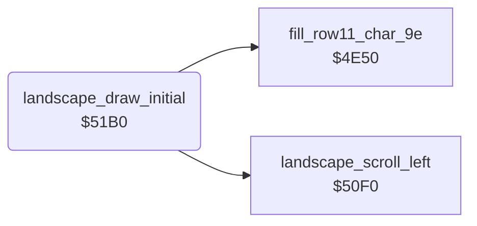

<!-- Generated by c64-docs from knowledge revision 20261024T103119.179-vx1fei and .c64-re-tools/local/generated/src/source-map.json. Do not edit: change the knowledge, generate the source again, then run docs.ts generate. -->
# landscape/draw_initial.asm: Initial landscape

Range `$51B0-$51BF`. Source: [landscape/draw_initial.asm](../../../../src/landscape/draw_initial.asm). Index: [the reference](../../index.md).

## Call graph

A solid arrow is a call, a thick arrow a table entry, a dotted arrow a jump. Rounded nodes are in this file.

## Names

### [`landscape_draw_initial`](../../../../src/landscape/draw_initial.asm#L6) `$51B0`

*routine*

Draws the landscape at the start of a life: 42 left scrolls fill all 40 columns from the map. Then $4e50 draws the row 11.

- **Called from:** [`$4153`](../../../../src/game/main_loop.asm#L16)
- **Calls:** [`landscape_scroll_left`](scroll_50f0.md#landscape_scroll_left), [`fill_row11_char_9e`](row11_fill.md#fill_row11_char_9e)

### [`landscape_draw_initial_loop`](../../../../src/landscape/draw_initial.asm#L8) `$51B2`

*label*

- **Jumped to from:** [`landscape_draw_initial`](draw_initial.md#landscape_draw_initial) [`$51BA`](../../../../src/landscape/draw_initial.asm#L15)
