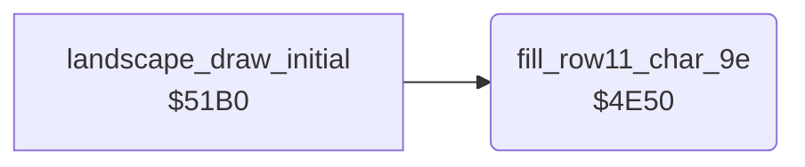

<!-- Generated by c64-docs from knowledge revision 20261025T214607.441-00m56k and .c64-re-tools/local/generated/src/source-map.json. Do not edit: change the knowledge, generate the source again, then run docs.ts generate. -->
# landscape/row11_fill.asm: Fill of the screen row 11

Range `$4E50-$4E60`. Source: [landscape/row11_fill.asm](../../../../src/landscape/row11_fill.asm). Index: [the reference](../../index.md).

## Routines

| Routine | Address | Reached from | Summary |
|---|---|---|---|
| [`fill_row11_char_9e`](row11_fill.md#fill_row11_char_9e) | `$4E50` | [`landscape_draw_initial`](draw_initial.md#landscape_draw_initial) | Fills the screen row 11 ($05b8-$05df) with character $9e in colour $0f. |

## Call graph

A solid arrow is a call, a thick arrow a table entry. Rounded nodes are in this file.

## Details

### [`fill_row11_char_9e`](../../../../src/landscape/row11_fill.asm#L6) `$4E50`

*routine*

Fills the screen row 11 ($05b8-$05df) with character $9e in colour $0f. Row 11 is the first row below the raster split at line $8a.

- **Called from:** [`landscape_draw_initial`](draw_initial.md#landscape_draw_initial)
- **Writes:** [`horizon_row`](../../memory-map.md#horizon_row), `$D9B8`

| Label | Address | Comment |
|---|---|---|
| [`fill_row11_loop`](../../../../src/landscape/row11_fill.asm#L9) | `$4E54` |  |
