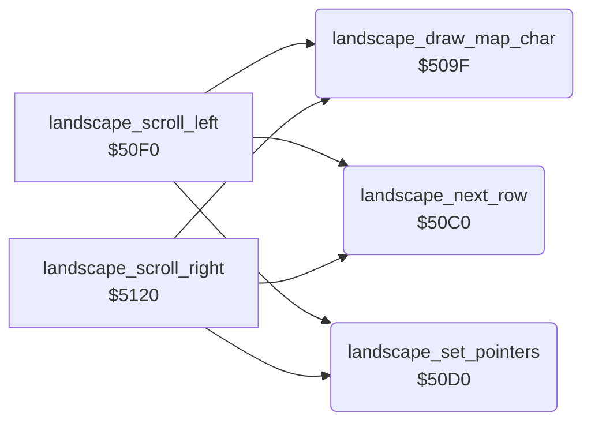

<!-- Generated by c64-docs from knowledge revision 20261025T214607.441-00m56k and .c64-re-tools/local/generated/src/source-map.json. Do not edit: change the knowledge, generate the source again, then run docs.ts generate. -->
# landscape/scroll_509f.asm

Range `$509F-$50EA`. Source: [landscape/scroll_509f.asm](../../../../src/landscape/scroll_509f.asm). Index: [the reference](../../index.md).

## Routines

| Routine | Address | Reached from | Summary |
|---|---|---|---|
| [`landscape_draw_map_char`](scroll_509f.md#landscape_draw_map_char) | `$509F` | [`landscape_scroll_left`](scroll_50f0.md#landscape_scroll_left), [`landscape_scroll_right`](scroll_5120.md#landscape_scroll_right) | Draws one map character of the current row. |
| [`landscape_next_row`](scroll_509f.md#landscape_next_row) | `$50C0` | [`landscape_scroll_left`](scroll_50f0.md#landscape_scroll_left), [`landscape_scroll_right`](scroll_5120.md#landscape_scroll_right) | Moves the screen pointer $07/$08 and the colour pointer $09/$0a one screen row (40 bytes) down. |
| [`landscape_set_pointers`](scroll_509f.md#landscape_set_pointers) | `$50D0` | [`landscape_scroll_left`](scroll_50f0.md#landscape_scroll_left), [`landscape_scroll_right`](scroll_5120.md#landscape_scroll_right) | Sets the pointers for the 8 landscape rows: screen $05e0 (row 12), colour $d9e0, map $3800, row count $0b = 8. |

## Call graph

A solid arrow is a call, a thick arrow a table entry. Rounded nodes are in this file.

## Details

### [`landscape_draw_map_char`](../../../../src/landscape/scroll_509f.asm#L6) `$509F`

*routine*

Draws one map character of the current row. Y = 0 takes map column $0d, other Y takes column $0d + $27. Keeps Y.
Map column of screen column 0.

- **Called from:** [`landscape_scroll_left`](scroll_50f0.md#landscape_scroll_left), [`landscape_scroll_right`](scroll_5120.md#landscape_scroll_right)
- **Reads:** [`map_column`](../../memory-map.md#map_column), [`temp`](../../memory-map.md#temp), [`map_ptr`](../../memory-map.md#map_ptr), [`colour_ptr`](../../memory-map.md#colour_ptr), [`char_colours`](../data/char_colours.md#char_colours), [`scroll_colour_ptr`](../../memory-map.md#scroll_colour_ptr), [`map_ptr_hi`](../../memory-map.md#map_ptr_hi)
- **Writes:** [`temp`](../../memory-map.md#temp), [`map_ptr_hi`](../../memory-map.md#map_ptr_hi)

| Label | Address | Comment |
|---|---|---|
| [`landscape_draw_char_at`](../../../../src/landscape/scroll_509f.asm#L16) | `$50AE` |  |

### [`landscape_next_row`](../../../../src/landscape/scroll_509f.asm#L29) `$50C0`

*routine*

Moves the screen pointer $07/$08 and the colour pointer $09/$0a one screen row (40 bytes) down.

- **Called from:** [`landscape_scroll_left`](scroll_50f0.md#landscape_scroll_left), [`landscape_scroll_right`](scroll_5120.md#landscape_scroll_right)
- **Reads:** [`colour_ptr`](../../memory-map.md#colour_ptr), [`colour_ptr_hi`](../../memory-map.md#colour_ptr_hi), [`scroll_colour_ptr_hi`](../../memory-map.md#scroll_colour_ptr_hi)
- **Writes:** [`colour_ptr`](../../memory-map.md#colour_ptr), [`scroll_colour_ptr`](../../memory-map.md#scroll_colour_ptr), [`colour_ptr_hi`](../../memory-map.md#colour_ptr_hi), [`scroll_colour_ptr_hi`](../../memory-map.md#scroll_colour_ptr_hi)

| Label | Address | Comment |
|---|---|---|
| [`landscape_next_row_done`](../../../../src/landscape/scroll_509f.asm#L38) | `$50CF` |  |

### [`landscape_set_pointers`](../../../../src/landscape/scroll_509f.asm#L41) `$50D0`

*routine*

Sets the pointers for the 8 landscape rows: screen $05e0 (row 12), colour $d9e0, map $3800, row count $0b = 8.

- **Called from:** [`landscape_scroll_left`](scroll_50f0.md#landscape_scroll_left), [`landscape_scroll_right`](scroll_5120.md#landscape_scroll_right)
- **Writes:** [`colour_ptr`](../../memory-map.md#colour_ptr), [`scroll_colour_ptr`](../../memory-map.md#scroll_colour_ptr), [`colour_ptr_hi`](../../memory-map.md#colour_ptr_hi), [`scroll_colour_ptr_hi`](../../memory-map.md#scroll_colour_ptr_hi), [`scroll_row_count`](../../memory-map.md#scroll_row_count), [`map_ptr_hi`](../../memory-map.md#map_ptr_hi), [`map_ptr`](../../memory-map.md#map_ptr)
- **Refers to:** [`landscape_map`](../data/map.md#landscape_map)
