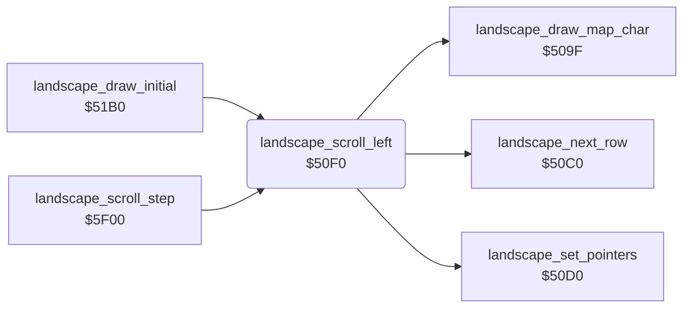

<!-- Generated by c64-docs from knowledge revision 20261025T214607.441-00m56k and .c64-re-tools/local/generated/src/source-map.json. Do not edit: change the knowledge, generate the source again, then run docs.ts generate. -->
# landscape/scroll_50f0.asm

Range `$50F0-$5116`. Source: [landscape/scroll_50f0.asm](../../../../src/landscape/scroll_50f0.asm). Index: [the reference](../../index.md).

## Routines

| Routine | Address | Reached from | Summary |
|---|---|---|---|
| [`landscape_scroll_left`](scroll_50f0.md#landscape_scroll_left) | `$50F0` | [`landscape_draw_initial`](draw_initial.md#landscape_draw_initial), [`landscape_scroll_step`](scroll_by_speed.md#landscape_scroll_step) | Scrolls the 8 landscape rows one column left, with the colours. |

## Call graph

A solid arrow is a call, a thick arrow a table entry. Rounded nodes are in this file.

## Details

### [`landscape_scroll_left`](../../../../src/landscape/scroll_50f0.asm#L6) `$50F0`

*routine*

Scrolls the 8 landscape rows one column left, with the colours. Adds 1 to the map column $0d and draws the new column 39.

- **Called from:** [`landscape_draw_initial`](draw_initial.md#landscape_draw_initial), [`landscape_scroll_step`](scroll_by_speed.md#landscape_scroll_step)
- **Calls:** [`landscape_set_pointers`](scroll_509f.md#landscape_set_pointers), [`landscape_draw_map_char`](scroll_509f.md#landscape_draw_map_char), [`landscape_next_row`](scroll_509f.md#landscape_next_row)
- **Reads:** [`map_column`](../../memory-map.md#map_column), [`colour_ptr`](../../memory-map.md#colour_ptr), [`scroll_colour_ptr`](../../memory-map.md#scroll_colour_ptr), [`scroll_row_count`](../../memory-map.md#scroll_row_count)
- **Writes:** [`map_column`](../../memory-map.md#map_column), [`scroll_row_count`](../../memory-map.md#scroll_row_count)

| Label | Address | Comment |
|---|---|---|
| [`landscape_scroll_left_row`](../../../../src/landscape/scroll_50f0.asm#L9) | `$50F5` |  |
| [`landscape_scroll_left_col`](../../../../src/landscape/scroll_50f0.asm#L11) | `$50F7` |  |
| [`landscape_scroll_left_done`](../../../../src/landscape/scroll_50f0.asm#L30) | `$5116` |  |
