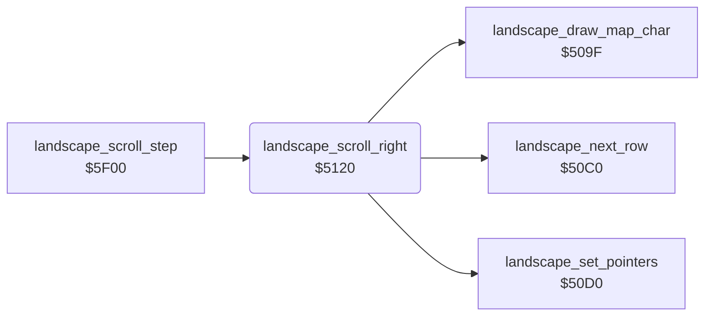

<!-- Generated by c64-docs from knowledge revision 20261024T103119.179-vx1fei and .c64-re-tools/local/generated/src/source-map.json. Do not edit: change the knowledge, generate the source again, then run docs.ts generate. -->
# landscape/scroll_5120.asm

Range `$5120-$5144`. Source: [landscape/scroll_5120.asm](../../../../src/landscape/scroll_5120.asm). Index: [the reference](../../index.md).

## Call graph

A solid arrow is a call, a thick arrow a table entry, a dotted arrow a jump. Rounded nodes are in this file.

## Names

### [`landscape_scroll_right`](../../../../src/landscape/scroll_5120.asm#L6) `$5120`

*routine*

Scrolls the 8 landscape rows one column right, with the colours. Subtracts 1 from the map column $0d and draws the new column 0.

- **Called from:** [`landscape_scroll_step`](scroll_by_speed.md#landscape_scroll_step) [`$5F28`](../../../../src/landscape/scroll_by_speed.asm#L29)
- **Calls:** [`landscape_set_pointers`](scroll_509f.md#landscape_set_pointers), [`landscape_draw_map_char`](scroll_509f.md#landscape_draw_map_char), [`landscape_next_row`](scroll_509f.md#landscape_next_row)
- **Reads:** [`map_column`](../../memory-map.md#map_column), [`colour_ptr`](../../memory-map.md#colour_ptr), [`scroll_colour_ptr`](../../memory-map.md#scroll_colour_ptr), [`scroll_row_count`](../../memory-map.md#scroll_row_count)
- **Writes:** [`map_column`](../../memory-map.md#map_column), [`scroll_row_count`](../../memory-map.md#scroll_row_count)

### [`landscape_scroll_right_row`](../../../../src/landscape/scroll_5120.asm#L9) `$5125`

*label*

- **Jumped to from:** [`landscape_scroll_right`](scroll_5120.md#landscape_scroll_right) [`$5142`](../../../../src/landscape/scroll_5120.asm#L28)

### [`landscape_scroll_right_col`](../../../../src/landscape/scroll_5120.asm#L11) `$5127`

*label*

- **Jumped to from:** [`landscape_scroll_right`](scroll_5120.md#landscape_scroll_right) [`$5134`](../../../../src/landscape/scroll_5120.asm#L21)

### [`landscape_scroll_right_done`](../../../../src/landscape/scroll_5120.asm#L29) `$5144`

*label*

- **Jumped to from:** [`landscape_scroll_right`](scroll_5120.md#landscape_scroll_right) [`$513C`](../../../../src/landscape/scroll_5120.asm#L25)
