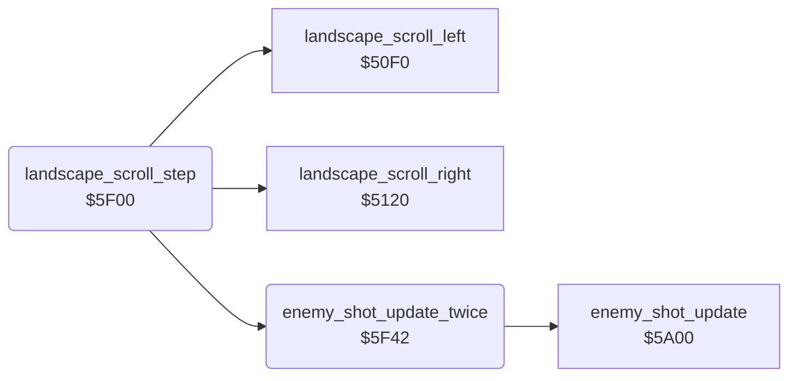

<!-- Generated by c64-docs from knowledge revision 20261024T103119.179-vx1fei and .c64-re-tools/local/generated/src/source-map.json. Do not edit: change the knowledge, generate the source again, then run docs.ts generate. -->
# landscape/scroll_by_speed.asm: Landscape scroll by the jet speed

Range `$5F00-$5F48`. Source: [landscape/scroll_by_speed.asm](../../../../src/landscape/scroll_by_speed.asm). Index: [the reference](../../index.md).

## Call graph

A solid arrow is a call, a thick arrow a table entry, a dotted arrow a jump. Rounded nodes are in this file.

## Data

| Range | Type | Name | Read by | Written by |
|---|---|---|---|---|
| [`$5F02`](../../../../src/landscape/scroll_by_speed.asm#L8)-`$5F03` | dual-use |  |  |  |
| [`$5F18`](../../../../src/landscape/scroll_by_speed.asm#L19)-`$5F19` | dual-use |  |  |  |
| [`$5F20`](../../../../src/landscape/scroll_by_speed.asm#L24)-`$5F21` | dual-use |  |  |  |

## Names

### [`landscape_scroll_step`](../../../../src/landscape/scroll_by_speed.asm#L6) `$5F00`

*routine*

Scrolls the landscape by the speed $2a: every call at +-3, every 2nd at +-2, every 4th at +-1 ($2c counts). Negative calls $5120, positive calls $50f0. When the scroll direction agrees with $60, it updates the enemy shots two more times.

- **Called from:** [`$419C`](../../../../src/game/main_loop.asm#L64)
- **Calls:** [`landscape_scroll_right`](scroll_5120.md#landscape_scroll_right), [`enemy_shot_update_twice`](scroll_by_speed.md#enemy_shot_update_twice), [`landscape_scroll_left`](scroll_50f0.md#landscape_scroll_left)
- **Reads:** [`scroll_tick`](../../memory-map.md#scroll_tick), [`jet_speed_x`](../../memory-map.md#jet_speed_x), [`wave_dir`](../../memory-map.md#wave_dir)
- **Writes:** [`scroll_tick`](../../memory-map.md#scroll_tick)

### [`landscape_scroll_slow`](../../../../src/landscape/scroll_by_speed.asm#L22) `$5F1E`

*label*

Speed +-1: every 4th call.

- **Jumped to from:** [`landscape_scroll_step`](scroll_by_speed.md#landscape_scroll_step) [`$5F10`](../../../../src/landscape/scroll_by_speed.asm#L15), [`landscape_scroll_step`](scroll_by_speed.md#landscape_scroll_step) [`$5F14`](../../../../src/landscape/scroll_by_speed.asm#L17)

### [`landscape_scroll_do`](../../../../src/landscape/scroll_by_speed.asm#L26) `$5F24`

*label*

- **Jumped to from:** [`landscape_scroll_step`](scroll_by_speed.md#landscape_scroll_step) [`$5F08`](../../../../src/landscape/scroll_by_speed.asm#L11), [`landscape_scroll_step`](scroll_by_speed.md#landscape_scroll_step) [`$5F0C`](../../../../src/landscape/scroll_by_speed.asm#L13), [`landscape_scroll_step`](scroll_by_speed.md#landscape_scroll_step) [`$5F1C`](../../../../src/landscape/scroll_by_speed.asm#L21)

### [`landscape_scroll_positive`](../../../../src/landscape/scroll_by_speed.asm#L35) `$5F35`

*label*

- **Jumped to from:** [`landscape_scroll_step`](scroll_by_speed.md#landscape_scroll_step) [`$5F26`](../../../../src/landscape/scroll_by_speed.asm#L28)

### [`landscape_scroll_done`](../../../../src/landscape/scroll_by_speed.asm#L41) `$5F41`

*label*

- **Jumped to from:** [`landscape_scroll_step`](scroll_by_speed.md#landscape_scroll_step) [`$5F04`](../../../../src/landscape/scroll_by_speed.asm#L9), [`landscape_scroll_step`](scroll_by_speed.md#landscape_scroll_step) [`$5F1A`](../../../../src/landscape/scroll_by_speed.asm#L20), [`landscape_scroll_step`](scroll_by_speed.md#landscape_scroll_step) [`$5F22`](../../../../src/landscape/scroll_by_speed.asm#L25), [`landscape_scroll_step`](scroll_by_speed.md#landscape_scroll_step) [`$5F2D`](../../../../src/landscape/scroll_by_speed.asm#L31), [`landscape_scroll_step`](scroll_by_speed.md#landscape_scroll_step) [`$5F33`](../../../../src/landscape/scroll_by_speed.asm#L34), [`landscape_scroll_step`](scroll_by_speed.md#landscape_scroll_step) [`$5F3C`](../../../../src/landscape/scroll_by_speed.asm#L39)

### [`enemy_shot_update_twice`](../../../../src/landscape/scroll_by_speed.asm#L44) `$5F42`

*routine*

Calls enemy_shot_update two times.

- **Called from:** [`landscape_scroll_step`](scroll_by_speed.md#landscape_scroll_step) [`$5F2F`](../../../../src/landscape/scroll_by_speed.asm#L32), [`landscape_scroll_step`](scroll_by_speed.md#landscape_scroll_step) [`$5F3E`](../../../../src/landscape/scroll_by_speed.asm#L40)
- **Calls:** [`enemy_shot_update`](../enemy/enemy_shots_5a00.md#enemy_shot_update)
