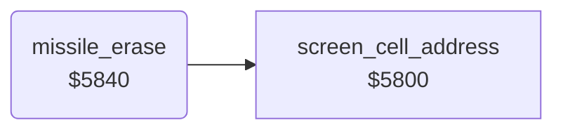

<!-- Generated by c64-docs from knowledge revision 20261025T214607.441-00m56k and .c64-re-tools/local/generated/src/source-map.json. Do not edit: change the knowledge, generate the source again, then run docs.ts generate. -->
# missile/missile_update.asm: Player missiles: erase, move and draw

Range `$5840-$5860`. Source: [missile/missile_update.asm](../../../../src/missile/missile_update.asm). Index: [the reference](../../index.md).

## Routines

| Routine | Address | Reached from | Summary |
|---|---|---|---|
| [`missile_erase`](missile_update.md#missile_erase) | `$5840` | [`$41A8`](../../../../src/game/main_loop.asm#L68) | Writes a space at the cell of each active missile. |

## Call graph

A solid arrow is a call, a thick arrow a table entry. Rounded nodes are in this file.

## Details

### [`missile_erase`](../../../../src/missile/missile_update.asm#L6) `$5840`

*routine*

Writes a space at the cell of each active missile. The slots are X = 12, 9, 6, 3: $2d+x column, $2e+x row, $2f+x direction.

- **Called from:** [`$41A8`](../../../../src/game/main_loop.asm#L68)
- **Calls:** [`screen_cell_address`](../game/screen_cell_address.md#screen_cell_address)
- **Reads:** [`temp2`](../../memory-map.md#temp2), [`gauge_colour`](../../memory-map.md#gauge_colour), [`tick`](../../memory-map.md#tick), [`screen_ptr`](../../memory-map.md#screen_ptr), [`temp`](../../memory-map.md#temp)
- **Writes:** [`temp`](../../memory-map.md#temp)

| Label | Address | Comment |
|---|---|---|
| [`missile_erase_loop`](../../../../src/missile/missile_update.asm#L8) | `$5842` | Direction 0: the slot is free. |
| [`missile_erase_next`](../../../../src/missile/missile_update.asm#L23) | `$585B` |  |
