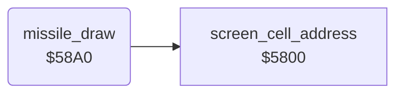

<!-- Generated by c64-docs from knowledge revision 20261025T214607.441-00m56k and .c64-re-tools/local/generated/src/source-map.json. Do not edit: change the knowledge, generate the source again, then run docs.ts generate. -->
# missile/missile_update_58a0.asm

Range `$58A0-$58CE`. Source: [missile/missile_update_58a0.asm](../../../../src/missile/missile_update_58a0.asm). Index: [the reference](../../index.md).

## Routines

| Routine | Address | Reached from | Summary |
|---|---|---|---|
| [`missile_draw`](missile_update_58a0.md#missile_draw) | `$58A0` | [`$41AE`](../../../../src/game/main_loop.asm#L70) | Writes each active missile on the screen: character $13 for direction +1 (left), $12 for $ff (right). |

## Call graph

A solid arrow is a call, a thick arrow a table entry. Rounded nodes are in this file.

## Details

### [`missile_draw`](../../../../src/missile/missile_update_58a0.asm#L6) `$58A0`

*routine*

Writes each active missile on the screen: character $13 for direction +1 (left), $12 for $ff (right). The colour comes from the table at $4000.

- **Called from:** [`$41AE`](../../../../src/game/main_loop.asm#L70)
- **Calls:** [`screen_cell_address`](../game/screen_cell_address.md#screen_cell_address)
- **Reads:** [`temp2`](../../memory-map.md#temp2), [`gauge_colour`](../../memory-map.md#gauge_colour), [`tick`](../../memory-map.md#tick), [`screen_ptr`](../../memory-map.md#screen_ptr), [`char_colours`](../data/char_colours.md#char_colours), [`colour_ptr`](../../memory-map.md#colour_ptr), [`temp`](../../memory-map.md#temp)
- **Writes:** [`temp`](../../memory-map.md#temp)

| Label | Address | Comment |
|---|---|---|
| [`missile_draw_loop`](../../../../src/missile/missile_update_58a0.asm#L8) | `$58A2` |  |
| [`missile_draw_char_left`](../../../../src/missile/missile_update_58a0.asm#L23) | `$58BA` |  |
| [`missile_draw_put`](../../../../src/missile/missile_update_58a0.asm#L25) | `$58BC` |  |
| [`missile_draw_next`](../../../../src/missile/missile_update_58a0.asm#L33) | `$58C9` |  |
