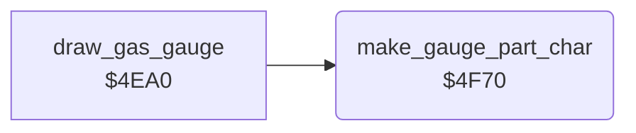

<!-- Generated by c64-docs from knowledge revision 20261025T214607.441-00m56k and .c64-re-tools/local/generated/src/source-map.json. Do not edit: change the knowledge, generate the source again, then run docs.ts generate. -->
# panel/gas_gauge_char.asm: Partial cell of the GAS gauge

Range `$4F70-$4F97`. Source: [panel/gas_gauge_char.asm](../../../../src/panel/gas_gauge_char.asm). Index: [the reference](../../index.md).

## Routines

| Routine | Address | Reached from | Summary |
|---|---|---|---|
| [`make_gauge_part_char`](gas_gauge_char.md#make_gauge_part_char) | `$4F70` | [`draw_gas_gauge`](panel_draw_4ea0.md#draw_gas_gauge) | Draws character $b4 ($35a0-$35a7) as a bar of N pixels from the left. |

## Call graph

A solid arrow is a call, a thick arrow a table entry. Rounded nodes are in this file.

## Details

### [`make_gauge_part_char`](../../../../src/panel/gas_gauge_char.asm#L6) `$4F70`

*routine*

Draws character $b4 ($35a0-$35a7) as a bar of N pixels from the left. N = (10 * $18 + $19) / 12, 0-8, from the GAS tens and units digits.

- **Called from:** [`draw_gas_gauge`](panel_draw_4ea0.md#draw_gas_gauge)
- **Reads:** [`gas_count`](../../memory-map.md#gas_count)
- **Writes:** [`gauge_part_char`](../data/charset.md#gauge_part_char)

| Label | Address | Comment |
|---|---|---|
| [`gauge_part_times_ten`](../../../../src/panel/gas_gauge_char.asm#L9) | `$4F74` |  |
| [`gauge_part_div12`](../../../../src/panel/gas_gauge_char.asm#L17) | `$4F7E` |  |
| [`gauge_part_bits_init`](../../../../src/panel/gas_gauge_char.asm#L23) | `$4F86` |  |
| [`gauge_part_bits_loop`](../../../../src/panel/gas_gauge_char.asm#L25) | `$4F88` |  |
| [`gauge_part_store_init`](../../../../src/panel/gas_gauge_char.asm#L31) | `$4F8F` |  |
| [`gauge_part_store`](../../../../src/panel/gas_gauge_char.asm#L33) | `$4F91` |  |
