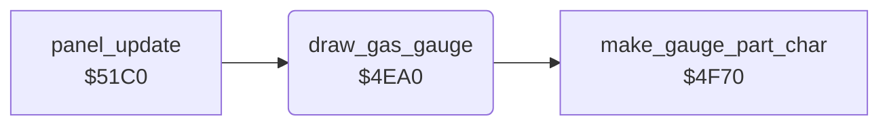

<!-- Generated by c64-docs from knowledge revision 20261025T214607.441-00m56k and .c64-re-tools/local/generated/src/source-map.json. Do not edit: change the knowledge, generate the source again, then run docs.ts generate. -->
# panel/panel_draw_4ea0.asm

Range `$4EA0-$4EDB`. Source: [panel/panel_draw_4ea0.asm](../../../../src/panel/panel_draw_4ea0.asm). Index: [the reference](../../index.md).

## Routines

| Routine | Address | Reached from | Summary |
|---|---|---|---|
| [`draw_gas_gauge`](panel_draw_4ea0.md#draw_gas_gauge) | `$4EA0` | [`panel_update`](panel_update.md#panel_update) | Draws the GAS gauge: 9 cells at $078f in colour $2e. |

## Call graph

A solid arrow is a call, a thick arrow a table entry. Rounded nodes are in this file.

## Details

### [`draw_gas_gauge`](../../../../src/panel/panel_draw_4ea0.asm#L6) `$4EA0`

*routine*

Draws the GAS gauge: 9 cells at $078f in colour $2e. The GAS hundreds digit $17 gives the full cells, character $b4 shows the rest ($4f70). The row is built in $6000-$6008.

- **Called from:** [`panel_update`](panel_update.md#panel_update)
- **Calls:** [`make_gauge_part_char`](gas_gauge_char.md#make_gauge_part_char)
- **Reads:** [`gauge_colour`](../../memory-map.md#gauge_colour), [`gas_count`](../../memory-map.md#gas_count), [`panel_bar_buffer`](../landscape/airfield_bombing_5fd0.md#panel_bar_buffer)
- **Writes:** [`panel_bar_buffer`](../landscape/airfield_bombing_5fd0.md#panel_bar_buffer), `$DB8F`, [`gas_gauge_display`](../../memory-map.md#gas_gauge_display)

| Label | Address | Comment |
|---|---|---|
| [`draw_gas_gauge_clear`](../../../../src/panel/panel_draw_4ea0.asm#L9) | `$4EA4` |  |
| [`draw_gas_gauge_full`](../../../../src/panel/panel_draw_4ea0.asm#L19) | `$4EB4` |  |
| [`draw_gas_gauge_partial`](../../../../src/panel/panel_draw_4ea0.asm#L25) | `$4EBE` |  |
| [`draw_gas_gauge_show`](../../../../src/panel/panel_draw_4ea0.asm#L37) | `$4ED0` |  |
| [`draw_gas_gauge_copy`](../../../../src/panel/panel_draw_4ea0.asm#L39) | `$4ED2` |  |
