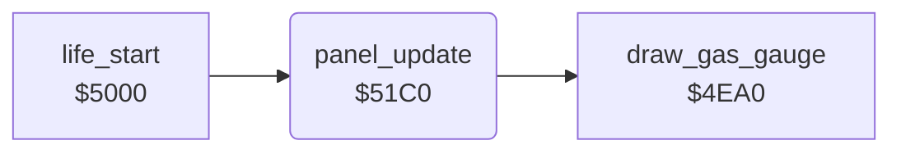

<!-- Generated by c64-docs from knowledge revision 20261024T103119.179-vx1fei and .c64-re-tools/local/generated/src/source-map.json. Do not edit: change the knowledge, generate the source again, then run docs.ts generate. -->
# panel/panel_update.asm: Bottom panel digits

Range `$51C0-$520F`. Source: [panel/panel_update.asm](../../../../src/panel/panel_update.asm). Index: [the reference](../../index.md).

## Call graph

A solid arrow is a call, a thick arrow a table entry, a dotted arrow a jump. Rounded nodes are in this file.

## Names

### [`panel_update`](../../../../src/panel/panel_update.asm#L6) `$51C0`

*routine*

Writes the panel: score at $0770, top high score at $07c0, AAM at $07e2, lives at $0777. Then $4ea0 shows the GAS gauge.

- **Called from:** [`$4156`](../../../../src/game/main_loop.asm#L17), [`$419F`](../../../../src/game/main_loop.asm#L65), [`life_start`](../player/life_start.md#life_start) [`$5011`](../../../../src/player/life_start.asm#L16)
- **Calls:** [`draw_gas_gauge`](panel_draw_4ea0.md#draw_gas_gauge)
- **Reads:** [`score`](../../memory-map.md#score), [`hiscore_table`](../../memory-map.md#hiscore_table), [`aam_count`](../../memory-map.md#aam_count), [`lives`](../../memory-map.md#lives)
- **Writes:** [`score_display`](../../memory-map.md#score_display), `$DB70`, [`hiscore_display`](../../memory-map.md#hiscore_display), `$DBC0`, [`aam_display`](../../memory-map.md#aam_display), `$DBE2`, [`lives_display`](../../memory-map.md#lives_display), `$DB77`

### [`panel_score_loop`](../../../../src/panel/panel_update.asm#L8) `$51C2`

*label*

score digits, colour 1.

- **Jumped to from:** [`panel_update`](panel_update.md#panel_update) [`$51CD`](../../../../src/panel/panel_update.asm#L14)

### [`panel_hiscore_loop`](../../../../src/panel/panel_update.asm#L16) `$51D1`

*label*

First row of the high-score table on the title screen, colour 6.

- **Jumped to from:** [`panel_update`](panel_update.md#panel_update) [`$51DD`](../../../../src/panel/panel_update.asm#L22)

### [`panel_aam_loop`](../../../../src/panel/panel_update.asm#L24) `$51E1`

*label*

aam_count digits, colour 7.

- **Jumped to from:** [`panel_update`](panel_update.md#panel_update) [`$51EC`](../../../../src/panel/panel_update.asm#L30)
