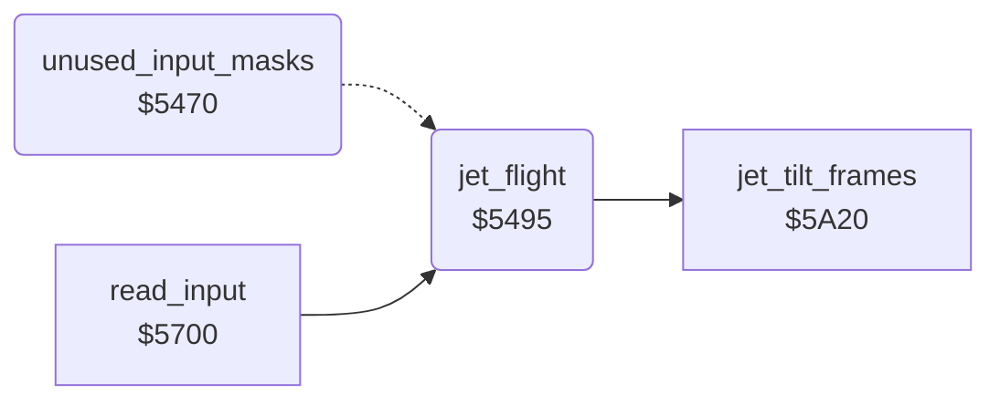

<!-- Generated by c64-docs from knowledge revision 20261024T103119.179-vx1fei and .c64-re-tools/local/generated/src/source-map.json. Do not edit: change the knowledge, generate the source again, then run docs.ts generate. -->
# player/flight.asm: Flight: jet speed, climb and movement

Range `$5470-$550F`. Source: [player/flight.asm](../../../../src/player/flight.asm). Index: [the reference](../../index.md).

## Call graph

A solid arrow is a call, a thick arrow a table entry, a dotted arrow a jump. Rounded nodes are in this file.

## Names

### [`unused_input_masks`](../../../../src/player/flight.asm#L6) `$5470`

*routine*

Dead code: nothing calls it. An earlier form of the input masks of $5700. It runs on into the flight routine at $5495.

- **Jumps to:** [`jet_flight`](flight.md#jet_flight)
- **Reads:** [`CIAPRB`](../../memory-map.md#CIAPRB), [`jet_state`](../../memory-map.md#jet_state), [`joy_bits`](../../memory-map.md#joy_bits)
- **Writes:** [`joy_bits`](../../memory-map.md#joy_bits)

### [`unused_input_check_forced`](../../../../src/player/flight.asm#L17) `$5483`

*label*

- **Jumped to from:** [`unused_input_masks`](flight.md#unused_input_masks) [`$5479`](../../../../src/player/flight.asm#L12)

### [`jet_flight`](../../../../src/player/flight.asm#L32) `$5495`

*routine*

Adds 1 to tick. Every 8th tick, LEFT/RIGHT change jet_speed_x (-3..+3). On even ticks, UP/DOWN change jet_climb. Then moves the jet by jet_climb.

- **Called from:** [`read_input`](../input/read_input.md#read_input) [`$5780`](../../../../src/input/read_input.asm#L82)
- **Jumped to from:** [`unused_input_masks`](flight.md#unused_input_masks) [`$5481`](../../../../src/player/flight.asm#L16), [`unused_input_masks`](flight.md#unused_input_masks) [`$5487`](../../../../src/player/flight.asm#L20)
- **Calls:** [`jet_tilt_frames`](jet_tilt_frames.md#jet_tilt_frames)
- **Reads:** [`tick`](../../memory-map.md#tick), [`joy_bits`](../../memory-map.md#joy_bits), [`jet_speed_x`](../../memory-map.md#jet_speed_x), [`jet_climb`](../../memory-map.md#jet_climb), [`SP0Y`](../../memory-map.md#SP0Y)
- **Writes:** [`tick`](../../memory-map.md#tick), [`jet_speed_x`](../../memory-map.md#jet_speed_x), [`jet_climb`](../../memory-map.md#jet_climb), [`SP0Y`](../../memory-map.md#SP0Y)

### [`jet_flight_odd_even`](../../../../src/player/flight.asm#L38) `$549F`

*label*

- **Jumped to from:** [`jet_flight`](flight.md#jet_flight) [`$549B`](../../../../src/player/flight.asm#L36)

### [`jet_flight_speed_input`](../../../../src/player/flight.asm#L45) `$54A8`

*label*

Bit 2 = 0: LEFT, speed - 1 down to -3.

- **Jumped to from:** [`jet_flight`](flight.md#jet_flight) [`$549D`](../../../../src/player/flight.asm#L37)

### [`jet_flight_check_right`](../../../../src/player/flight.asm#L54) `$54B9`

*label*

Bit 3 = 0: RIGHT, speed + 1 up to +3.

- **Jumped to from:** [`jet_flight`](flight.md#jet_flight) [`$54AC`](../../../../src/player/flight.asm#L48)

### [`jet_flight_check_up`](../../../../src/player/flight.asm#L65) `$54CA`

*label*

Bit 0 = 0: UP, climb + 1 up to +1.

- **Jumped to from:** [`jet_flight`](flight.md#jet_flight) [`$54A3`](../../../../src/player/flight.asm#L41), [`jet_flight`](flight.md#jet_flight) [`$54B2`](../../../../src/player/flight.asm#L51), [`jet_flight`](flight.md#jet_flight) [`$54B6`](../../../../src/player/flight.asm#L53), [`jet_flight`](flight.md#jet_flight) [`$54BD`](../../../../src/player/flight.asm#L57), [`jet_flight`](flight.md#jet_flight) [`$54C3`](../../../../src/player/flight.asm#L60)

### [`jet_flight_check_down`](../../../../src/player/flight.asm#L73) `$54D8`

*label*

Bit 1 = 0: DOWN, climb - 1 down to -1.

- **Jumped to from:** [`jet_flight`](flight.md#jet_flight) [`$54CE`](../../../../src/player/flight.asm#L68), [`jet_flight`](flight.md#jet_flight) [`$54D4`](../../../../src/player/flight.asm#L71)

### [`jet_flight_move`](../../../../src/player/flight.asm#L81) `$54E6`

*label*

- **Jumped to from:** [`jet_flight`](flight.md#jet_flight) [`$54A5`](../../../../src/player/flight.asm#L42), [`jet_flight`](flight.md#jet_flight) [`$54DC`](../../../../src/player/flight.asm#L76), [`jet_flight`](flight.md#jet_flight) [`$54E2`](../../../../src/player/flight.asm#L79)

### [`jet_flight_move_y`](../../../../src/player/flight.asm#L84) `$54EA`

*label*

- **Jumped to from:** [`jet_flight`](flight.md#jet_flight) [`$54E8`](../../../../src/player/flight.asm#L83)

### [`jet_flight_move_down`](../../../../src/player/flight.asm#L93) `$54F8`

*label*

- **Jumped to from:** [`jet_flight`](flight.md#jet_flight) [`$54EE`](../../../../src/player/flight.asm#L87)

### [`jet_flight_end`](../../../../src/player/flight.asm#L100) `$5500`

*label*

- **Jumped to from:** [`jet_flight`](flight.md#jet_flight) [`$54EC`](../../../../src/player/flight.asm#L86), [`jet_flight`](flight.md#jet_flight) [`$54F6`](../../../../src/player/flight.asm#L92)
