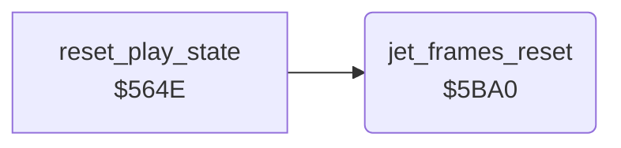

<!-- Generated by c64-docs from knowledge revision 20261024T103119.179-vx1fei and .c64-re-tools/local/generated/src/source-map.json. Do not edit: change the knowledge, generate the source again, then run docs.ts generate. -->
# player/jet_frames_reset.asm: Jet sprite frames reset

Range `$5BA0-$5BB1`. Source: [player/jet_frames_reset.asm](../../../../src/player/jet_frames_reset.asm). Index: [the reference](../../index.md).

## Call graph

A solid arrow is a call, a thick arrow a table entry, a dotted arrow a jump. Rounded nodes are in this file.

## Data

| Range | Type | Name | Read by | Written by |
|---|---|---|---|---|
| [`$5BAB`](../../../../src/player/jet_frames_reset.asm#L12)-`$5BAC` | dual-use |  |  |  |

## Names

### [`jet_frames_reset`](../../../../src/player/jet_frames_reset.asm#L6) `$5BA0`

*routine*

Copies the level frames to the jet sprite data: $2b80 to $2000 and $2cc0 to $2180, 64 bytes each.

- **Called from:** [`reset_play_state`](../game/jet_lost.md#reset_play_state) [`$567F`](../../../../src/game/jet_lost.asm#L44)
- **Reads:** [`jet_level_left`](../data/jet_pitch_sprites.md#jet_level_left), [`jet_level_right`](../data/jet_pitch_sprites.md#jet_level_right)
- **Writes:** [`jet_sprites`](../data/sprites.md#jet_sprites), [`jet_frame_right`](../data/sprites.md#jet_frame_right)

### [`jet_frames_reset_loop`](../../../../src/player/jet_frames_reset.asm#L8) `$5BA2`

*label*

- **Jumped to from:** [`jet_frames_reset`](jet_frames_reset.md#jet_frames_reset) [`$5BAF`](../../../../src/player/jet_frames_reset.asm#L14)
