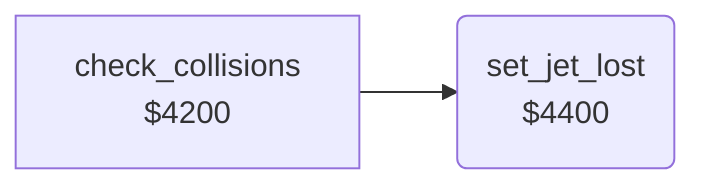

<!-- Generated by c64-docs from knowledge revision 20261025T214607.441-00m56k and .c64-re-tools/local/generated/src/source-map.json. Do not edit: change the knowledge, generate the source again, then run docs.ts generate. -->
# player/jet_lost.asm: Jet lost

Range `$4400-$4415`. Source: [player/jet_lost.asm](../../../../src/player/jet_lost.asm). Index: [the reference](../../index.md).

## Routines

| Routine | Address | Reached from | Summary |
|---|---|---|---|
| [`set_jet_lost`](jet_lost.md#set_jet_lost) | `$4400` | [`check_collisions`](../game/collisions.md#check_collisions) | Marks the jet as lost: jet_state keeps bit 4 and gets bit 3. |

## Call graph

A solid arrow is a call, a thick arrow a table entry. Rounded nodes are in this file.

## Details

### [`set_jet_lost`](../../../../src/player/jet_lost.asm#L6) `$4400`

*routine*

Marks the jet as lost: jet_state keeps bit 4 and gets bit 3. When jet Y >= $7f, jet_speed_x and jet_climb become 0.

- **Called from:** [`check_collisions`](../game/collisions.md#check_collisions)
- **Reads:** [`jet_state`](../../memory-map.md#jet_state), [`SP0Y`](../../memory-map.md#SP0Y)
- **Writes:** [`jet_state`](../../memory-map.md#jet_state), [`jet_speed_x`](../../memory-map.md#jet_speed_x), [`jet_climb`](../../memory-map.md#jet_climb)

| Label | Address | Comment |
|---|---|---|
| [`set_jet_lost_done`](../../../../src/player/jet_lost.asm#L17) | `$4415` |  |
