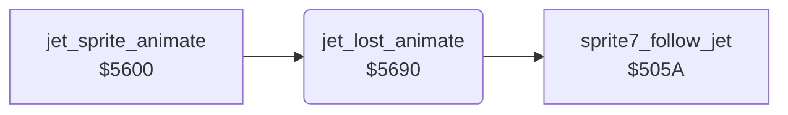

<!-- Generated by c64-docs from knowledge revision 20261024T103119.179-vx1fei and .c64-re-tools/local/generated/src/source-map.json. Do not edit: change the knowledge, generate the source again, then run docs.ts generate. -->
# player/jet_lost_animation.asm: Lost jet animation

Range `$5690-$56F3`. Source: [player/jet_lost_animation.asm](../../../../src/player/jet_lost_animation.asm). Index: [the reference](../../index.md).

## Call graph

A solid arrow is a call, a thick arrow a table entry, a dotted arrow a jump. Rounded nodes are in this file.

## Names

### [`jet_lost_animate`](../../../../src/player/jet_lost_animation.asm#L6) `$5690`

*routine*

Lost jet in the air: sprite 7 follows the jet with frames $90-$93. On the ground (Y >= $7f, climb 0): wreck frames $88-$8f, then up to $90.

- **Called from:** [`jet_sprite_animate`](jet_sprite.md#jet_sprite_animate) [`$5606`](../../../../src/player/jet_sprite.asm#L10)
- **Calls:** [`sprite7_follow_jet`](sprite7_follow.md#sprite7_follow_jet)
- **Reads:** [`SP0Y`](../../memory-map.md#SP0Y), [`jet_climb`](../../memory-map.md#jet_climb), [`crash_stage`](../../memory-map.md#crash_stage), [`RANDOM`](../../memory-map.md#RANDOM), [`SPENA`](../../memory-map.md#SPENA), [`SPMC`](../../memory-map.md#SPMC), [`tick`](../../memory-map.md#tick), [`SPRPTR`](../../memory-map.md#SPRPTR), [`smoke_sprite_ptr`](../../memory-map.md#smoke_sprite_ptr)
- **Writes:** [`SPRPTR`](../../memory-map.md#SPRPTR), [`SPENA`](../../memory-map.md#SPENA), [`SPMC`](../../memory-map.md#SPMC), [`SP0COL`](../../memory-map.md#SP0COL), [`smoke_sprite_ptr`](../../memory-map.md#smoke_sprite_ptr)
- **Refers to:** [`smoke_sprites`](../data/sprites_2200.md#smoke_sprites)

### [`jet_lost_ground_frames`](../../../../src/player/jet_lost_animation.asm#L29) `$56C3`

*label*

$24 = $90: every 8th tick the frame + 1 up to $90.

- **Jumped to from:** [`jet_lost_animate`](jet_lost_animation.md#jet_lost_animate) [`$569F`](../../../../src/player/jet_lost_animation.asm#L14)

### [`jet_lost_air_sprite7`](../../../../src/player/jet_lost_animation.asm#L38) `$56D5`

*label*

- **Jumped to from:** [`jet_lost_animate`](jet_lost_animation.md#jet_lost_animate) [`$5695`](../../../../src/player/jet_lost_animation.asm#L9), [`jet_lost_animate`](jet_lost_animation.md#jet_lost_animate) [`$5699`](../../../../src/player/jet_lost_animation.asm#L11)

### [`jet_lost_sprite7_first`](../../../../src/player/jet_lost_animation.asm#L45) `$56E5`

*label*

- **Jumped to from:** [`jet_lost_animate`](jet_lost_animation.md#jet_lost_animate) [`$56EE`](../../../../src/player/jet_lost_animation.asm#L51)

### [`jet_lost_sprite7_check`](../../../../src/player/jet_lost_animation.asm#L49) `$56EC`

*label*

- **Jumped to from:** [`jet_lost_animate`](jet_lost_animation.md#jet_lost_animate) [`$56E3`](../../../../src/player/jet_lost_animation.asm#L44)

### [`jet_lost_animate_done`](../../../../src/player/jet_lost_animation.asm#L53) `$56F3`

*label*

- **Jumped to from:** [`jet_lost_animate`](jet_lost_animation.md#jet_lost_animate) [`$56C1`](../../../../src/player/jet_lost_animation.asm#L28), [`jet_lost_animate`](jet_lost_animation.md#jet_lost_animate) [`$56C7`](../../../../src/player/jet_lost_animation.asm#L32), [`jet_lost_animate`](jet_lost_animation.md#jet_lost_animate) [`$56CE`](../../../../src/player/jet_lost_animation.asm#L35), [`jet_lost_animate`](jet_lost_animation.md#jet_lost_animate) [`$56D3`](../../../../src/player/jet_lost_animation.asm#L37), [`jet_lost_animate`](jet_lost_animation.md#jet_lost_animate) [`$56EA`](../../../../src/player/jet_lost_animation.asm#L48)
