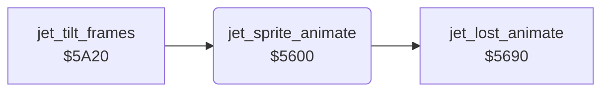

<!-- Generated by c64-docs from knowledge revision 20261024T103119.179-vx1fei and .c64-re-tools/local/generated/src/source-map.json. Do not edit: change the knowledge, generate the source again, then run docs.ts generate. -->
# player/jet_sprite.asm: Jet sprite frames

Range `$5600-$563F`. Source: [player/jet_sprite.asm](../../../../src/player/jet_sprite.asm). Index: [the reference](../../index.md).

## Call graph

A solid arrow is a call, a thick arrow a table entry, a dotted arrow a jump. Rounded nodes are in this file.

## Names

### [`jet_sprite_animate`](../../../../src/player/jet_sprite.asm#L6) `$5600`

*routine*

Lost jet: runs $5690. Else, when $98 = 0, every 4th tick moves the jet frame toward $83 (speed 0), $80 (speed < 0) or $86 (speed > 0).

- **Called from:** [`jet_tilt_frames`](jet_tilt_frames.md#jet_tilt_frames) [`$5AB8`](../../../../src/player/jet_tilt_frames.asm#L91)
- **Calls:** [`jet_lost_animate`](jet_lost_animation.md#jet_lost_animate)
- **Reads:** [`jet_state`](../../memory-map.md#jet_state), [`pitch_active`](../../memory-map.md#pitch_active), [`tick`](../../memory-map.md#tick), [`jet_speed_x`](../../memory-map.md#jet_speed_x), [`SPRPTR`](../../memory-map.md#SPRPTR)
- **Writes:** [`SPRPTR`](../../memory-map.md#SPRPTR)

### [`jet_sprite_turn`](../../../../src/player/jet_sprite.asm#L13) `$560C`

*label*

- **Jumped to from:** [`jet_sprite_animate`](jet_sprite.md#jet_sprite_animate) [`$5604`](../../../../src/player/jet_sprite.asm#L9)

### [`jet_sprite_next_frame`](../../../../src/player/jet_sprite.asm#L25) `$5623`

*label*

- **Jumped to from:** [`jet_sprite_animate`](jet_sprite.md#jet_sprite_animate) [`$563D`](../../../../src/player/jet_sprite.asm#L40)

### [`jet_sprite_prev_frame`](../../../../src/player/jet_sprite.asm#L28) `$5628`

*label*

- **Jumped to from:** [`jet_sprite_animate`](jet_sprite.md#jet_sprite_animate) [`$5621`](../../../../src/player/jet_sprite.asm#L24), [`jet_sprite_animate`](jet_sprite.md#jet_sprite_animate) [`$5636`](../../../../src/player/jet_sprite.asm#L36)

### [`jet_sprite_turn_moving`](../../../../src/player/jet_sprite.asm#L31) `$562D`

*label*

Flags of jet_speed_x from $5616.

- **Jumped to from:** [`jet_sprite_animate`](jet_sprite.md#jet_sprite_animate) [`$5618`](../../../../src/player/jet_sprite.asm#L20)

### [`jet_sprite_turn_right`](../../../../src/player/jet_sprite.asm#L37) `$5638`

*label*

- **Jumped to from:** [`jet_sprite_animate`](jet_sprite.md#jet_sprite_animate) [`$562D`](../../../../src/player/jet_sprite.asm#L32)

### [`jet_sprite_animate_done`](../../../../src/player/jet_sprite.asm#L41) `$563F`

*label*

- **Jumped to from:** [`jet_sprite_animate`](jet_sprite.md#jet_sprite_animate) [`$560A`](../../../../src/player/jet_sprite.asm#L12), [`jet_sprite_animate`](jet_sprite.md#jet_sprite_animate) [`$560E`](../../../../src/player/jet_sprite.asm#L15), [`jet_sprite_animate`](jet_sprite.md#jet_sprite_animate) [`$5614`](../../../../src/player/jet_sprite.asm#L18), [`jet_sprite_animate`](jet_sprite.md#jet_sprite_animate) [`$561F`](../../../../src/player/jet_sprite.asm#L23), [`jet_sprite_animate`](jet_sprite.md#jet_sprite_animate) [`$5626`](../../../../src/player/jet_sprite.asm#L27), [`jet_sprite_animate`](jet_sprite.md#jet_sprite_animate) [`$562B`](../../../../src/player/jet_sprite.asm#L30), [`jet_sprite_animate`](jet_sprite.md#jet_sprite_animate) [`$5634`](../../../../src/player/jet_sprite.asm#L35)
