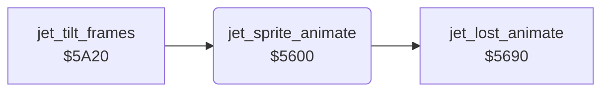

<!-- Generated by c64-docs from knowledge revision 20261025T214607.441-00m56k and .c64-re-tools/local/generated/src/source-map.json. Do not edit: change the knowledge, generate the source again, then run docs.ts generate. -->
# player/jet_sprite.asm: Jet sprite frames

Range `$5600-$563F`. Source: [player/jet_sprite.asm](../../../../src/player/jet_sprite.asm). Index: [the reference](../../index.md).

## Routines

| Routine | Address | Reached from | Summary |
|---|---|---|---|
| [`jet_sprite_animate`](jet_sprite.md#jet_sprite_animate) | `$5600` | [`jet_tilt_frames`](jet_tilt_frames.md#jet_tilt_frames) | Lost jet: runs $5690. |

## Call graph

A solid arrow is a call, a thick arrow a table entry. Rounded nodes are in this file.

## Details

### [`jet_sprite_animate`](../../../../src/player/jet_sprite.asm#L6) `$5600`

*routine*

Lost jet: runs $5690. Else, when $98 = 0, every 4th tick moves the jet frame toward $83 (speed 0), $80 (speed < 0) or $86 (speed > 0).

- **Called from:** [`jet_tilt_frames`](jet_tilt_frames.md#jet_tilt_frames)
- **Calls:** [`jet_lost_animate`](jet_lost_animation.md#jet_lost_animate)
- **Reads:** [`jet_state`](../../memory-map.md#jet_state), [`pitch_active`](../../memory-map.md#pitch_active), [`tick`](../../memory-map.md#tick), [`jet_speed_x`](../../memory-map.md#jet_speed_x), [`SPRPTR`](../../memory-map.md#SPRPTR)
- **Writes:** [`SPRPTR`](../../memory-map.md#SPRPTR)

| Label | Address | Comment |
|---|---|---|
| [`jet_sprite_turn`](../../../../src/player/jet_sprite.asm#L13) | `$560C` |  |
| [`jet_sprite_next_frame`](../../../../src/player/jet_sprite.asm#L25) | `$5623` |  |
| [`jet_sprite_prev_frame`](../../../../src/player/jet_sprite.asm#L28) | `$5628` |  |
| [`jet_sprite_turn_moving`](../../../../src/player/jet_sprite.asm#L31) | `$562D` | Flags of jet_speed_x from $5616. |
| [`jet_sprite_turn_right`](../../../../src/player/jet_sprite.asm#L37) | `$5638` |  |
| [`jet_sprite_animate_done`](../../../../src/player/jet_sprite.asm#L41) | `$563F` |  |
