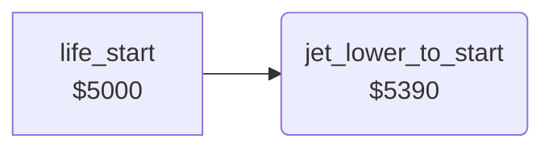

<!-- Generated by c64-docs from knowledge revision 20261024T103119.179-vx1fei and .c64-re-tools/local/generated/src/source-map.json. Do not edit: change the knowledge, generate the source again, then run docs.ts generate. -->
# player/jet_start.asm: Jet placement at the start of a life

Range `$5390-$53C0`. Source: [player/jet_start.asm](../../../../src/player/jet_start.asm). Index: [the reference](../../index.md).

## Call graph

A solid arrow is a call, a thick arrow a table entry, a dotted arrow a jump. Rounded nodes are in this file.

## Names

### [`jet_lower_to_start`](../../../../src/player/jet_start.asm#L6) `$5390`

*routine*

Puts the jet sprite at X 172, Y $60 with frame $83 and only sprite 0 on. Lowers it 36 lines to Y $84, then sets jet_state bit 0.

- **Called from:** [`life_start`](life_start.md#life_start) [`$5008`](../../../../src/player/life_start.asm#L12)
- **Reads:** [`SP0Y`](../../memory-map.md#SP0Y), [`jet_state`](../../memory-map.md#jet_state)
- **Writes:** [`SP0X`](../../memory-map.md#SP0X), [`SP0Y`](../../memory-map.md#SP0Y), [`SPRPTR`](../../memory-map.md#SPRPTR), [`SPENA`](../../memory-map.md#SPENA), [`jet_state`](../../memory-map.md#jet_state)
- **Refers to:** [`jet_sprites`](../data/sprites.md#jet_sprites)

### [`jet_lower_loop`](../../../../src/player/jet_start.asm#L16) `$53A6`

*label*

- **Jumped to from:** [`jet_lower_to_start`](jet_start.md#jet_lower_to_start) [`$53B8`](../../../../src/player/jet_start.asm#L29)

### [`jet_lower_delay_outer`](../../../../src/player/jet_start.asm#L21) `$53AE`

*label*

- **Jumped to from:** [`jet_lower_to_start`](jet_start.md#jet_lower_to_start) [`$53B6`](../../../../src/player/jet_start.asm#L28)

### [`jet_lower_delay_inner`](../../../../src/player/jet_start.asm#L23) `$53B0`

*label*

- **Jumped to from:** [`jet_lower_to_start`](jet_start.md#jet_lower_to_start) [`$53B1`](../../../../src/player/jet_start.asm#L25)

### [`jet_lower_done`](../../../../src/player/jet_start.asm#L30) `$53BA`

*label*

- **Jumped to from:** [`jet_lower_to_start`](jet_start.md#jet_lower_to_start) [`$53AA`](../../../../src/player/jet_start.asm#L19)
